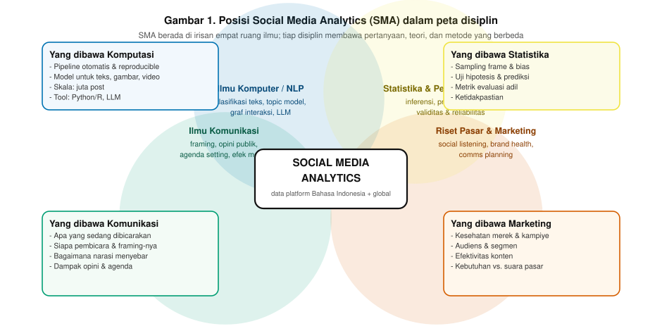
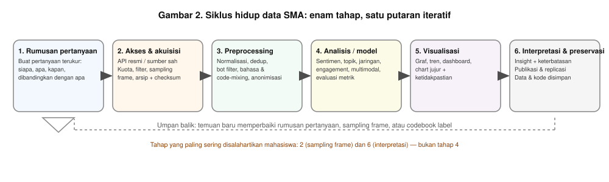
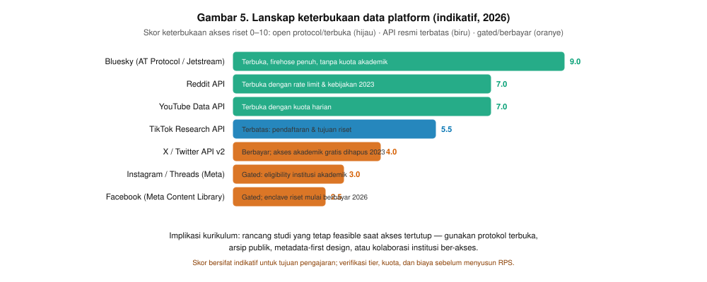
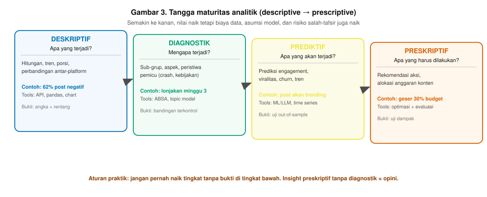
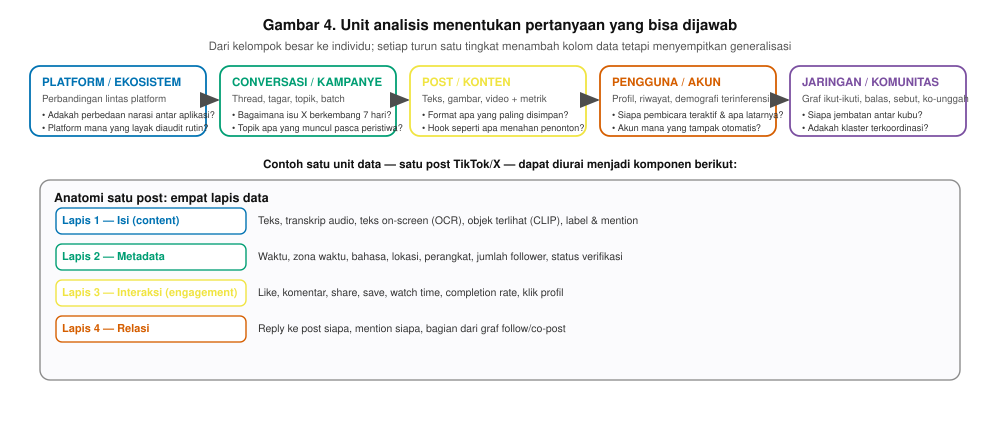
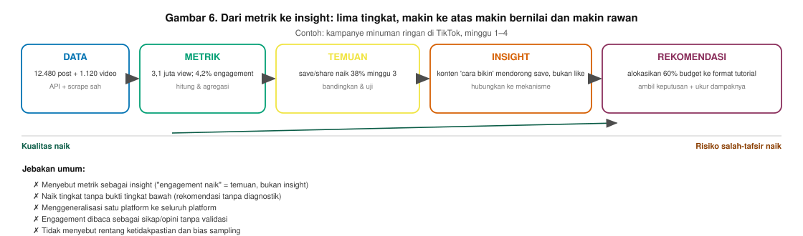

Buku Ajar Materi 1 — Fondasi & Ruang Lingkup Social Media Analytics
Buku Ajar · Mata Kuliah Social Media Analytics · Pertemuan 1 dari 14

# Materi 1 — Fondasi & Ruang Lingkup Social Media Analytics

Definisi, posisi disiplin, siklus hidup data, tangga maturitas analitik, unit analisis, dan perbedaan metrik–insight
**Tabel 0.1 — Identitas materi**

| Mata kuliah | Social Media Analytics (3 SKS · semester 5) |
| --- | --- |
| Pertemuan | 1 dari 14 (sesuai RPS 14 pertemuan) |
| Beban pertemuan | 150 menit tatap muka: 100 menit kuliah interaktif + 50 menituan praktikum |
| Prasyarat | Statistika Dasar · Pemrograman Dasar (Python atau R) · penguasaan dasar media sosial sebagai pengguna kritis |
| CPMK yang dikerjakan | CPMK-1: Menjelaskan ruang lingkup, jenis data, ekosistem platform, jalur akses, serta etika & regulasi analitik media sosial |
| Bukti penilaian pertemuan ini | Kuis konsep (5%) + rencana analisis 2 halaman (5%) + ketuntasan latihan mandiri (formatif) |
| Dasar penyusunan | Hasil riset 29 modul kurikulum SMA 2024–2026 (arsip `results/*.json`) dan web-search tren 2024–2026 |

> **Cara memakai buku ini**  
> Buku ini dirancang untuk satu pertemuan (“one-meeting teaching module”). Urutan baku yang disarankan: **Bagian 2 → 3 → 4 → 5 → 6 → 7 → 8**, ditutup **studi kasus terpandu (Bagian 9)** dan **latihan mandiri (Bagian 12)**. Bagian 10–11 adalah referensi permanen untuk tugas-tugas berikutnya. Semua angka industri di buku ini berasal dari laporan vendor/institusi dan diberi catatan sumber — mahasiswa wajib memverifikasi ulang sebelum mengutipnya di karya tulis.
>

Daftar isi
1. Peta pembelajaran pertemuan 1
2. Apa itu Social Media Analytics
3. Mengapa materi ini penting pada 2026
4. Siklus hidup data analitik media sosial
5. Sumber data dan lanskap akses 2026
6. Tangga maturitas: deskriptif → preskriptif
7. Unit analisis: apa yang sedang anda analisis
8. Dari metrik ke insight
9. Studi kasus terpandu: “Apakah persepsi merek X memburuk di TikTok?”
10. Sepuluh kesalahan umum mahasiswa
11. Etika dan regulasi secara ringkas
12. Latihan mandiri dan studi kasus diskusi
13. Ringkasan, glosarium, dan referensi

## 1. Peta pembelajaran pertemuan 1

**Tabel 1.1 — Sub-CPMK, indikator, dan rute pembelajaran**

| Tahap | Sub-CPMK (indikator) | Materi / aktivitas | Alokasi |
| --- | --- | --- | --- |
| T1 | Menjelaskan definisi, ruang lingkup, dan batas SMA | Kuliah interaktif Bagian 2 + diskusi “SMA vs monitoring” | 25 menit |
| T2 | Memetakan posisi SMA dalam disiplin ilmu | Gambar 1 + latihan memetakan sendiri disiplin | 15 menit |
| T3 | Menjelaskan enam tahap siklus data | Gambar 2 + contoh tautan antar-tahap | 20 menit |
| T4 | Membedakan sumber data & tingkat keterbukaannya | Tabel 5.2 + Gambar 5 + demo dokumentasi API | 20 menit |
| T5 | Mengelompokkan pertanyaan analitik ke tingkat maturitas | Gambar 3 + latihan mengurutkan 6 pertanyaan | 10 menit |
| T6 | Menentukan unit analisis yang tepat | Gambar 4 + Tabel 7.1 | 10 menit |
| T7 | Membedakan metrik, temuan, dan insight | Gambar 6 + studi kasus terpandu Bagian 9 | 30 menit |
| T8 | Menyusun rencana analisis sederhana | Praktikum: kerangka rencana (kelompok 2–3) | 20 menit |

> **Pertanyaan pemantik pembuka (5 menit, sebelum kuliah)**  
> “Sebuah merek menarik 3 juta *view* dan 4,2% *engagement* di TikTok minggu lalu. Apakah itu kabar baik?” Simpan jawaban mahasiswa; pertanyaan ini dibuka kembali di Bagian 8 sebagai alat evaluasi pemahaman.
>

## 2. Apa itu Social Media Analytics

### 2.1 Definisi lengkap dan definisi operasional

**Definisi panjang.** *Social media analytics* (SMA) adalah serangkaian metode dan proses untuk memperoleh, membersihkan, menganalisis, dan menginterpretasikan data yang dihasilkan oleh aktivitas manusia pada platform media sosial — beserta seluruh aktivitas *engagement* dan metadata sistemnya — guna menjawab pertanyaan terukur tentang audiens, isu, konten, merek, atau perilaku kolektif.

**Definisi operasional yang dipakai di kuliah ini.** Suatu kegiatan dikatakan SMA apabila memenuhi **empat syarat**:

1. **Data sebagai bahan dasar** — ada unit data platform yang terarsip (teks, media, interaksi, atau metadata), bukan hanya opini/cerita.
2. **Prosedur yang dapat diulang** — tahap akuisisi sampai analisis terdokumentasi sehingga bisa dijalankan ulang oleh orang lain.
3. **Metode yang eksplisit** — teknik dinyatakan terbuka (mis. TF-IDF, BERTopic, sentralitas *betweenness*), bukan “dibaca dulu”.
4. **Pertanyaan yang terukur** — pertanyaan memuat siapa, apa, kapan, dibandingkan dengan apa, dan batasan generalisasi.

> **Tes cepat untuk mahasiswa**  
> “Saya membaca 500 komentar dan menyimpulkan audiens marah” — **bukan** SMA menurut empat syarat di atas (tidak terdokumentasi, tidak eksplisit, tidak terukur). “Saya menarik 4.812 komentar dari 31 hari, menandai 200 di antaranya sebagai emosi marah melalui dua pemeriksa dengan κ = 0,78, lalu melatih classifier dan melaporkan rasio per minggu” — **adalah** SMA.
>

### 2.2 Ruang lingkup: apa yang termasuk dan yang tidak

**Tabel 2.1 — Batas ruang lingkup SMA**

| Termasuk | Sebagian (tergantung metode) | Tidak termasuk (di kuliah ini) |
| --- | --- | --- |
| Analisis teks, topik, sentimen, emosi; analisis jaringan interaksi; perilaku & engagement; konten multimodal; deteksi konten sintetis; pengukuran audiens dan merek | Riset pengalaman pengguna (UX) berbasis interview; studi kasus kualitatif tanpa data terstruktur; observasi etnografis komunitas daring | Manajemen media sosial (jadwal unggah, moderasi komunitas); produksi konten; kampanye berbayar (media buying); social media *customer service* |

### 2.3 SMA bukan nama lain untuk “social listening”

Empat istilah sering dipakai bergantian padahal cakupannya berbeda. Mahasiswa wajib bisa membedakannya, karena di dunia kerja ketidakmampuannya membedakan istilah ini menjadi salah satu kesalahan yang paling sering ditemui pewawancara kerja pada lulusan muda.

**Tabel 2.2 — Empat istilah yang sering tertukar**

| Istilah | Ciri utama | Produk khas | Contoh instrumen |
| --- | --- | --- | --- |
| **Social listening** | Pemantauan menyeluruh untuk kesadaran merek dan isu; komersial; dekat waktu-nyata | Peringatan lonjakan, laporan keseimbangan sentimen | Brandwatch, Meltwater, Pulsar, Talkwalker |
| **Social media analytics** | Analisis data terstruktur untuk pertanyaan spesifik; seperti statistik; riset | Model, metrik, tabel hasil, dataset & kode | Python/R + API platform |
| **Digital/web analytics** | Perilaku pengunjung pada properti milik sendiri (situs, aplikasi) | Funnel, konversi, retensi, atribusi | Google Analytics, Matomo |
| **Social media monitoring** | Pencatatan terjadwal tanpa analisis panjang | Dashboard angka dan notifikasi | Alert, mention counter |

### 2.4 Peta disiplin

SMA lahir dari pertemuan empat tradisi ilmu yang membawa pertanyaan dan metode berbeda. Satu tim proyek SMA yang baik biasanya memerlukan keempat sumbangsih ini — dan kesalahan paling mahal terjadi ketika satu disiplin menguasai penuh proyek (mis. hanya metode komputasi, tanpa teori komunikasi, sehingga temuan tidak bermakna secara substantif).

**Gambar 1.** Posisi Social Media Analytics sebagai irisan empat disiplin: ilmu komunikasi (apa yang dibicarakan dan bagaimana narasi terbentuk), ilmu komputer/NLP (pipeline dan model), statistika/pembelajaran mesin (validitas dan ketidakpastian), riset pasar/marketing (nilai bisnis).

**Tabel 2.3 — Sumbangan tiap disiplin dalam satu proyek SMA**

| Disiplin | Pertanyaan yang dibawa | Metode yang dibawa | Kegagalan bila dikuasai sendiri |
| --- | --- | --- | --- |
| Ilmu komunikasi | Isu apa yang berkembang? Siapa pembicara? Framing seperti apa? | Analisis wacana, analisis isi, teori agenda | Temuan tanpa teori: daftar kata populer tanpa penjelasan makna |
| Ilmu komputer / NLP | Bagaimana memproses data dalam skala besar dan reproducible? | Klasifikasi, topic modeling, pencocokan teks, pipeline otomatis | Model berakurasi tinggi tetapi menjawab pertanyaan yang tidak penting |
| Statistika / ML | Seberapa yakin kita? Apa bias sampelnya? | Sampling, uji hipotesis, metrik evaluasi, validasi | Angka presisi tetapi tidak dapat dipertahankan (overclaiming) |
| Riset pasar / marketing | Apa implikasi untuk merek dan keputusan? | Social listening, pengukuran merek, perencanaan konten | Rekomendasi tanpa bukti diagnostik (Gambar 6) |

## 3. Mengapa materi ini penting pada 2026

### 3.1 Skala fenomena dan pasarnya

**Tabel 3.1 — Indikator skala per 2026 (laporan vendor/lembaga; verifikasi sebelum dikutip)**

| Indikator | Angka | Sumber | Catatan pemakaian |
| --- | --- | --- | --- |
| Pengguna media sosial global | ±5,41 miliar (±68,5% populasi dunia) | Improvado, *Social Media Data & Statistics 2026* | Estimasi vendor; bedakan dengan “identitas pengguna” (±5,81 miliar, DataReportal Okt 2026) |
| Pasar perangkat analitik media sosial | USD 10,94 miliar (2026) → USD 24,42 miliar (2031), CAGR 17,42% | Mordor Intelligence | Menunjukkan permintaan tenaga menganalisis; angka pasar, bukan pengguna |
| Lanskap akses data | Berbayar & dibatasi menjadi norm baru | arXiv:2505.09877 (2025); dokumentasi Meta; X | Lihat Tabel 5.2 |
| Konten yang dianalisis | Terdesak ke video pendek & multimodal | Hootsuite *Social Trends 2026*; We Are Social | Analisis teks saja kini tidak memadai |
| Creator economy & social commerce | ±USD 249 miliar (2026) | DemandSage/Riset industri | Dasar modul creator & commerce (electif) |

### 3.2 Tujuh perubahan yang menentukan isi kuliah ini

**Tabel 3.2 — Perubahan 2024–2026 dan konsekuensinya pada kemampuan**

| # | Perubahan | Bukti | Konsekuensi bagi mahasiswa |
| --- | --- | --- | --- |
| 1 | Konten multimodal jadi default | Hootsuite 2026: konten harus multi-modal | Wajib bisa transkrip audio (Whisper), OCR teks layar, analisis gambar |
| 2 | LLM menjadi standar koder/annotator | Törnberg 2024; Gilardi 2024; Bermejo 2025 | Wajib bisa merancang codebook→prompt dan memvalidasi dengan κ |
| 3 | Video pendek menjadi satu satuan konten utama | TikTok, Reels, Shorts; panduan metrik 2025–2026 | Metrik utama pindah ke *watch time*, *completion*, *save* / *share* |
| 4 | Social commerce & creator economy tumbuh | Estimasi pasar 2026 ±USD 249 miliar | Pengukuran penjualan influencer, kualitas engagement, kepatuhan label |
| 5 | Konten sintetis & misinformasi AI meningkat | arXiv:2505.10266; Park 2026; NewsGuard AI Tracking Center | Deteksi konten AI, provenance/watermarking, “pangsa post sintetis” |
| 6 | Agentic AI masuk workflow listening | Produk Pulsar/Talkwalker 2025–2026; panduan agent untuk riset pasar | Peran analis: merancang, mengevaluasi, dan mengaudit keluaran agent |
| 7 | Akses data berbayar/terbatas | X menghapus akses akademik gratis (2023); enclave riset berbayar 2026 | Kemampuan “desain studi yang tetap feasible” menjadi inti kurikulum |

## 4. Siklus hidup data analitik media sosial

SMA bukan satu teknik, melainkan **rangkaian enam tahap**. Kualitas akhir hanya sebaik tahap terlemahnya: satu tahap yang bocor merusak tahap berikutnya, dan tidak dapat diperbaiki oleh teknik pada tahap akhir.

**Gambar 2.** Siklus enam tahap SMA beserta putaran umpan balik. Perhatikan bahwa tahap yang paling sering salah dimahasiswa adalah tahap 2 (sampling frame) dan tahap 6 (interpretasi), bukan tahap 4 (pemodelan).

### 4.1 Rincian tiap tahap

**Tabel 4.1 — Enam tahap siklus: aksi nyata, luaran, dan kesalahan umum**

| Tahap | Aksi nyata | Luaran yang harus ada | Kesalahan umum |
| --- | --- | --- | --- |
| **1. Rumusan pertanyaan** | Menerjemahkan keluhan pembuat keputusan menjadi pertanyaan terukur | Rencana analisis 1–2 halaman: pertanyaan, unit analisis, pembanding, batasan | Pertanyaan kabur (“bagaimana opini publik?”) yang tak bisa dijawab salah/benar |
| **2. Akses & akuisisi** | Pilih jalur akses, tentukan sampling frame, patuhi kuota | Dataset mentah + collection log (query, tanggal, jumlah, filter) + checksum | Sampling tersembunyi (API hanya mengembalikan “top”, bukan semua) dan tidak dilaporkan |
| **3. Preprocessing** | Normalisasi, dedup, filter bot, deteksi bahasa, anonimisasi | Dataset bersih + laporan before/after (jumlah, duplikat, komposisi bahasa) | Membersihkan berlebihan (menghapus negasi/sarkasme) atau menyaring bot berlebihan |
| **4. Analisis / model** | Terapkan metode sesuai pertanyaan dan tingkat maturitas | Kode, model, dan metrik evaluasi (bukan hanya angka akhir) | Melompat ke model canggih tanpa baseline; kebocoran data masa depan (leak) |
| **5. Visualisasi** | Bangun graf/tren/dashboard yang jujur dan memuat ketidakpastian | Figur/table dengan sumbu wajar, rentang tanggal, ukuran sampel | Graf tanpa ukuran sampel; potongan sumbu; memilih jendela waktu menguntungkan |
| **6. Interpretasi & preservasi** | Hubungkan temuan dengan mekanisme, nyatakan keterbatasan, simpan artefak | Insight bermakna + bagian keterbatasan + paket data & kode | Menyebut metrik sebagai insight; tidak menyimpan kode/data (tidak reproducible) |

> **Prinsip “rantai terlemah”**  
> Bayangkan masing-masing tahap sebagai fungsi: *kualitas akhir = min(tahap 1..6)*. Sampel bias (tahap 2) tidak dapat diselamatkan oleh model terbaik (tahap 4) — model hanya akan mempelajari bias itu dengan lebih rapi.
>

## 5. Sumber data dan lanskap akses 2026

### 5.1 Jalur akses dan konsekuensinya

Ada tiga jalur utama memperoleh data. Mahasiswa harus tahu jalur mana yang memungkinkan pertanyaan apa, dan biaya apa yang “tidak terlihat”.

**Tabel 5.1 — Tiga jalur akuisisi data**

| Jalur | Contoh | Kekuatan | Risiko / batasan |
| --- | --- | --- | --- |
| API resmi | X API v2, TikTok Research API, YouTube Data API, Reddit API, Bluesky Jetstream | Stabil, terdokumentasi, legal, ada metadata lengkap | Kuota, filter tersembunyi, biaya (X), gating (Meta) |
| Enclave riset | Meta Content Library & SOMAR Virtual Data Enclave | Arsip besar & berkualitas tinggi; gratis untuk institusi akademik yang lolos | Eligibility institusional; eksekusi hanya di dalam enclave; mulai ada biaya per tim sejak Jan 2026 (±USD 371/tim/bulan — verifikasi) |
| Scraping & sumber terbuka lain | HTML/playwright, yt-dlp, arsip publik, dataset komunitas | Gratis, dapat menjangkau hal yang tidak tersedia di API | ToS dan hukum (UU PDP, GDPR), anti-bot, reputasi, tidak stabil |

### 5.2 Lanskap keterbukaan per platform

**Gambar 5.** Perbandingan indikatif keterbukaan akses riset per platform (2026). Platform dengan protokol terbuka memudahkan studi reproducible; platform ter-gated menuntut perencanaan akses sejak awal desain studi.

**Tabel 5.2 — Matriks akses platform (verifikasi tier/kuota/biaya setiap semester)**

| Platform | Jalur utama | Status akses | Catatan untuk rancangan studi |
| --- | --- | --- | --- |
| Bluesky | AT Protocol / Jetstream | Terbuka | Pilihan utama proyek kelas yang membutuhkan graf besar & reproducible; perhatikan ukuran komunitas Indonesia yang masih terbatas |
| Reddit | API resmi | Terbuka berkuota | Rate limit dan kebijakan pasca-2023; cocok untuk data thread terstruktur |
| YouTube | Data API | Terbuka berkuota | Komentar + metadata video; kuota harian perlu dikuotakan antar tim |
| TikTok | Research API | Terbatas/terdaftar | Memerlukan pengajuan tujuan riset; alternatif: data publik dari akun sendiri (dengan persetujuan pemilik) atau studi kasus |
| X / Twitter | API v2 berbayar | Berbayar | Akses akademik gratis dihapus 2023; rencana anggaran harus ditulis sejak RPS |
| Facebook / Instagram | Meta Content Library | Gated akademik | Gratis tetapi hanya untuk institusi akademik yang lolos; eksekusi di enclave, ekspor terbatas |

> **Konsekuensi pedagogis**  
> Karena akses tidak dapat diasumsikan gratis, kemampuan yang dinilai bukan “bisa memakai satu platform”, melainkan: **memilih platform yang bisa diakses, merancang pertanyaan yang tetap dapat dijawab dengan data yang diperoleh, dan mendokumentasikan batasan sampling tersebut secara eksplisit.**
>

## 6. Tangga maturitas: deskriptif → preskriptif

Setiap pertanyaan analitik menempati salah satu dari empat tingkat. Semua tingkat sah; yang tidak sah adalah **memakai bahasa tingkat tinggi untuk klaim tingkat rendah** (mis. menyebut “brand rusak” hanya dari selisih sentimen).

**Gambar 3.** Empat tingkat maturitas analitik beserta bukti yang diwajibkan tiap tingkat. Nilai meningkat ke kanan, tetapi begitu pula kesempatan salah tafsir.

**Tabel 6.1 — Empat tingkat: contoh pertanyaan, bukti, dan alat**

| Tingkat | Contoh pertanyaan | Bukti yang diwajibkan | Alat/modul terkait |
| --- | --- | --- | --- |
| **Deskriptif** | Berapa porsi sentimen negatif tiap minggu? | Jumlah data, definisi label, rentang tanggal, ketidakpastian sederhana | pandas, lexicon, visualisasi |
| **Diagnostik** | Mengapa lonjakan terjadi pada minggu 3? | Perbandingan terkontrol (kegiatan platform/kebijakan/event), analisis aspek/topik | ABSA, BERTopic, kohort waktu |
| **Prediktif** | Post seperti apa yang akan *trending*? | Split temporal (bukan acak), metrik out-of-sample, kalibrasi | Regresi/ML, fitur konten, time series |
| **Preskriptif** | Anggaran konten dialokasikan bagaimana? | Evaluasi dampak tindakan (bukan hanya korelasi), uji A/B bila memungkinkan | Optimasi + evaluasi kampanye |

## 7. Unit analisis: apa yang sedang anda analisis

Kegagalan paling sering bukan pada model, melainkan pada **kesalahan peralihan unit analisis**: metrik per-post diartikan sebagai metrik per-pengguna, atau agregasi per-kampanye diartikan sebagai peristiwa individual. Gambar 4 memetakan lima tingkatan dan pertanyaan yang sah untuk masing-masing.

**Gambar 4.** Lima tingkatan unit analisis dan anatomi empat lapis data dalam satu post. Setiap pernyataan dalam laporan analisis harus menyebut explisit unit analisis yang dipakai.

**Tabel 7.1 — Unit analisis, data yang dibutuhkan, pertanyaan sah, dan jebakan**

| Unit | Data yang dibutuhkan | Pertanyaan sah | Jebakan |
| --- | --- | --- | --- |
| **Platform / ekosistem** | Kumpulan beberapa platform dengan kueri yang setara | Apakah narasi berbeda antar aplikasi? Platform mana layak diaudit? | Membandingkan jumlah mentah tanpa normalisasi ukuran audiens |
| **Conversasi / kampanye** | Thread, tagar, rentang waktu lengkap | Bagaimana isu X berkembang 7 hari? Topik apa muncul pasca peristiwa? | Jendela waktu dipilih setelah melihat puncak (cherry-picking) |
| **Post / konten** | Teks + media + metrik engagement | Format apa yang mendorong *save*? Hook seperti apa menahan penonton? | Engagement dibaca sebagai sikap/opini individu |
| **Pengguna / akun** | Profil + riwayat post; demografi hanya jika tersedia | Siapa pembicara teraktif? Akun mana tampak otomatis? | Demografi terinferensi diperlakukan sebagai fakta |
| **Jaringan / komunitas** | Graf balas/mention/follow/co-post | Siapa jembatan antar-kubu? Adakah klaster terkoordinasi? | Sentralitas dibaca sebagai “pengaruh” tanpa uji efek |

## 8. Dari metrik ke insight

Perbedaan antara laporan yang baik dan laporan biasa berada di bagian ini. **Metrik** menjawab “berapa”, **temuan** menjawab “apa polanya”, dan **insight** menjawab “mengapa bisa demikian” *plus implikasinya*. Hanya tingkat ketiga dapat digunakan untuk keputusan, dan hanya ia yang memerlukan kemungkinan keterangan alternatif.

**Gambar 6.** Lima tingkat dari data ke rekomendasi. Nilai naik ke kanan, namun begitu pula risiko salah-tafsir; daftar jebakan di bawah grafik adalah checklist minimum setiap laporan.

**Tabel 8.1 — Metrik, temuan, dan insight pada satu kasus**

| Tingkat | Pernyataan | Kenapa level ini |
| --- | --- | --- |
| Metrik | “3,1 juta view, engagement 4,2%.” | Angka, tanpa pembanding dan tanpa penjelasan |
| Temuan | “ *Save* naik 38% pada minggu 3, sementara *like* datar.” | Ada pola dan arah perubahan, belum ada mekanisme |
| Insight | “Format ‘cara membuat’ mendorong *save* karena konten tutorial dipakai seperti resep; *like* bukan indikator minat tertunda.” | Ada mekanisme (referensi/utilitas) dan implikasi format |
| Rekomendasi | “Aliokasikan 60% produksi ke format tutorial; ukur *save* sebagai KPI utama, bukan *like*.” | Ada keputusan yang dapat diuji dampaknya |

> **Empat pemeriksaan wajib sebelum mengemukakan klaim**  
> 1. **Unit** — angka ini per post, per akun, atau per kampanye?
> 2. **Pembanding** — dibandingkan dengan apa, dan apakah pembandingnya setara?
> 3. **Ketidakpastian & bias** — berapa ukuran sampel, apa bias sampling, apa penjelasan alternatif?
> 4. **Mekanisme** — mengapa pola ini bisa terjadi, dan apa bukti pendukungnya?
>

## 9. Studi kasus terpandu: “Apakah persepsi merek X memburuk di TikTok?”

Studi kasus ini menelusuri satu pertanyaan melalui seluruh rangkaian tahap siklus data dan seluruh tingkat maturitas. Mahasiswa cukup mengubah nama merek, platform, dan rentang waktu untuk menjadikannya rencana tugas mandiri.

**Tabel 9.1 — Langkah demi langkah studi kasus**

| Langkah | Tahap siklus | Yang dikerjakan | Keputusan & catatan metodologis |
| --- | --- | --- | --- |
| 1 | Rumusan pertanyaan | “Bagaimana emosi terhadap merek X berubah selama 4 minggu di TikTok, dan aspek apa yang mendorong perubahan itu?” | Dibatasi pada 1 platform + 4 minggu; satuan: post; label: emosi (positif/negatif/Netral/marah?) |
| 2 | Definisi label | Codebook 1 halaman: definisi setiap kelas emosi, aturan sarkasme, ambang keputusan | Wajib ditulis sebelum penggalangan data; menjadi dasar prompt LLM di langkah 5 |
| 3 | Akses & akuisisi | Tentukan jalur (API riset / metadata publik), tetapkan sampling frame, kumpulkan 4 minggu | Collection log: kueri, tanggal, jumlah, filter; checksum tiap batch |
| 4 | Preprocessing | Normalisasi, dedup, deteksi bahasa, filter bot heuristik, anonimisasi akun | Laporkan jumlah sebelum/sesudah; jangan menyaring “akun kecil” tanpa alasan eksplisit |
| 5 | Analisis emosi | Gold set 200 item dikode dua pemeriksa (κ); jalankan LLM pada gold set; bandingkan; jalankan LLM pada seluruh data bila κ ≥ 0,70 | Kalau κ < 0,70: perbaiki codebook atau labeling bertahap, jangan memakai label |
| 6 | Analisis aspek & topik | Extraksi aspek (rasa/harga/iklan/kemasan); BERTopic untuk klaster keluhan | Validasi 30 dokumen/topik dibaca manusia; catkan coherence |
| 7 | Visualisasi | Graf emosi per minggu; diagram topik; tabel aspek dengan contoh kutipan | Setiap figur wajib memuat ukuran sampel dan rentang tanggal |
| 8 | Interpretasi | Susun pernyataan tingkat diagnostik: perubahan apa, aspek mana, peristiwa pemicu apa, penjelasan alternatif apa | Daftarkan minimal tiga penjelasan alternatif dan mengapa yang terpilih lebih kuat |

> **Versi salah yang harus dihindari**  
> “Sentimen negatif naik dari 12% ke 18%, jadi reputasi merek rusak.” — hanya deskriptif, tanpa asosiasi ke aspek/peristiwa, tanpa penjelasan alternatif (mis. satu video viral oleh akun besar yang sudah dibaca di langkah preprocessing sebagai kasus khusus).
>

## 10. Sepuluh kesalahan umum mahasiswa

**Tabel 10.1 — Kesalahan, dampak, dan mitigasi**

| # | Kesalahan | Dampak | Mitigasi yang diajarkan |
| --- | --- | --- | --- |
| 1 | Menyebut metrik sebagai insight | Rekomendasi tanpa dasar | Pakai checklist 4 pemeriksaan (Bagian 8) |
| 2 | Sampling frame tidak terdokumentasi | Hasil tidak dapat dipercaya atau direplikasi | Collection log wajib tiap batch |
| 3 | Melompat ke model canggih tanpa baseline | Tidak bisa membuktikan peningkatan apa pun | Selalu mulai dengan lexicon/TF-IDF baseline |
| 4 | Membersihkan berlebihan | Hilangnya negasi, sarkasme, dan sinyal emosi | Simpan salinan mentah; laporkan aturan cleaning |
| 5 | Menggeneralisasi satu platform | Klaim tidak berlaku untuk ekosistem lain | Nyatakan batasan platform dalam kesimpulan |
| 6 | Demografi terinferensi dibaca sebagai fakta | Kesimpulan salah tentang audiens | Laporkan kepercayaan dan asal inferensi |
| 7 | Sentralitas jaringan dibaca sebagai pengaruh | Klaim kausal tidak berdasar | Bedakan metrik struktur dari efek, dan uji bila memungkinkan |
| 8 | Label LLM dipakai tanpa validasi manusia | Bias dan galat tidak terdeteksi | Gold set + κ; kalibrasi prompt |
| 9 | Graf tanpa ukuran sampel / window menguntungkan | Presentasi menyesatkan | Wajibkan anotasi n, rentang tanggal, dan ketidakpastian |
| 10 | Tidak menyimpan data & kode | Tugas tidak reproducible | Paket berkas: dataset, kode, README, environment |

## 11. Etika dan regulasi secara ringkas

**Tabel 11.1 — Instrumen hukum dan prinsip etis yang relevan**

| Instrumen / prinsip | Implikasi pada pekerjaan SMA | Tindakan wajib dalam tugas |
| --- | --- | --- |
| UU PDP No. 27/2022 (Indonesia) | Perlindungan data pribadi: dasar hukum, minimasi, retensi, hak subjek data | Nyatakan dasar pemrosesan, batasi kolom, anonimisasi, tetapkan masa retensi |
| GDPR (jika data terkait UE) | Prinsip serupa dengan UU PDP + hak akses & penghapusan | Hindari pengumpulan data sensitif; tidak memublikasikan profil individu |
| Terms of Service platform | Membatasi pengumpulan, distribusi, dan komersialisasi data | Baca ToS jalur akses yang dipakai; catat dalam method |
| Prinsip “publik ≠ sebabnya boleh dipakai” | Data dapat diakses publik tetapi tetap memuat risiko privasi/re-identifikasi | Hilangkan pengenal langsung (username) sebelum publikasi |
| Etika penelitian & komite etik | Studi yang melibatkan manusia (termasuk analisis perilaku) perlu kajian etik | Sertakan catatan etik (1 halaman) dalam rencana analisis |
| Kepatuhan & pengungkapan AI | Penggunaan LLM untuk analisis perlu diungkapkan dan divalidasi | Catat model, versi, prompt, gold set, dan κ |

## 12. Latihan mandiri dan studi kasus diskusi

### 12.1 Soal konsep

1. Jelaskan dengan bahasa anda mengapa “sampel bias tidak dapat diselamatkan oleh model yang baik”. Berikan satu contoh pada konteks tagar yang sedang tren.
2. Sebuah laporan menyatakan “engagement naik 20%, sehingga audiens lebih puas”. Identifikasi tiga tingkat maturitas dan klaim mana yang belum didukung bukti.
3. Andi menarik 2.000 post terpopuler untuk topik kebijakan. Mengapa *frame* ini berbahaya, dan apa alternatifnya?
4. Apa perbedaan “sentimen negatif 18%” sebagai metrik dan sebagai insight? Rumuskan versi insight dari angka yang sama.
5. Mengapa “akun terpusat tertinggi” belum tentu berarti “akun paling berpengaruh”? Uji apa saja yang diperlukan?

### 12.2 Latihan tak terstruktur (untuk praktikum 50 menituan)

**Tabel 12.1 — Latihan praktikum pertemuan 1**

| No | Latihan | Luaran | Kriteria penilaian |
| --- | --- | --- | --- |
| L1 | Peta lima pertanyaan analitik dari berita/isu terkini ke tingkat maturitas (deskriptif–preskriptif) | Tabel 5 baris | Kebenaran pemetaan tingkat + alasan |
| L2 | Pilih satu platform; tulis rencana akses untuk satu pertanyaan (jalur, kuota, batch, waktu) | Rencana akses 1 halaman | Realisme dan penanganan batasan akses |
| L3 | Ubah satu pertanyaan kabur menjadi pertanyaan terukur (siapa/apa/kapan/dibanding apa/batas) | Formulir 8 baris | Kelima elemen terpenuhi |
| L4 | Dari satu metrik platform (mis. *watch time*), turunkan menjadi temuan dan insight yang sah | Tabel metrik–temuan–insight | Pemisahan level yang tegas |

### 12.3 Studi kasus diskusi kelompok (untuk pertemuan berikutnya)

**Kasus “Angka bagus, keputusan salah”.** Sebuah UMKM melaporkan “3 juta view dan 4,2% engagement” untuk video promosi, lalu menaikkan angggaran. Dua minggu berikutnya penjualan justru turun. Anggaplah anda analis yang diminta meneliti.

**Tabel 12.2 — Panduan analisis kasus diskusi**

| Pertanyaan | Petunjuk jawaban |
| --- | --- |
| Apa yang sebenarnya diketahui? | Hanya dua metrik deskriptif tanpa pembanding, tanpa unit analisis, tanpa distribusi audiens |
| Penjelasan alternatif apa yang harus diuji? | Jangkauan penonton salah sasaran; komunitas viral bukan pasar; konten menarik namun bukan pembeli; efek platform vs konten; pengukuran penjualan salah jendela |
| Data apa yang dibutuhkan untuk membedakan penjelasan itu? | Demografi audiens (terinferensi, disertai kepercayaan), analisis aspek komentar, konversi/attribution, perbandingan dengan baseline historis |
| Rekomendasi berbasis tingkat mana yang sah? | Hanya setelah tingkat diagnostik terbukti; bila belum, langkah berikutnya adalah diagnosa, bukan penyesuaian anggaran |

## 13. Ringkasan, glosarium, dan referensi

### 13.1 Sepuluh poin yang harus diingat

1. SMA adalah proses berantai; kekuatan hebat pada satu tahap tidak menutupi kelemahan tahap lain.
2. Satu kegiatan disebut SMA apabila: ada data terarsip, prosedur reproducible, metode eksplisit, dan pertanyaan terukur.
3. SMA berbeda dari social listening, monitoring, dan digital analytics meski alatnya sering tumpang tindih.
4. Enam tahap siklus: rumusan pertanyaan → akuisisi → preprocessing → analisis → visualisasi → interpretasi & preservasi.
5. Akses data 2026 tidak gratis secara otomatis; perencanaan akses adalah bagian dari desain studi.
6. Empat tingkat maturitas: deskriptif, diagnostik, prediktif, preskriptif — tiap tingkat punya syarat bukti.
7. Unit analisis harus dinyatakan eksplisit pada setiap pernyataan.
8. Metrik ≠ temuan ≠ insight; insight memerlukan mekanisme dan penjelasan alternatif.
9. Label LLM hanya sah setelah divalidasi terhadap gold set manusia (κ) dan dilaporkan biasnya.
10. Etika & regulasi (UU PDP, GDPR, ToS) adalah bagian metode, bukan pelengkap.

### 13.2 Glosarium inti

**Tabel 13.1 — Glosarium 24 istilah**

| Istilah | Definisi ringkas |
| --- | --- |
| Social media analytics | Proses memperoleh, membersihkan, menganalisis, dan menginterpretasi data platform untuk pertanyaan terukur |
| Unit analisis | Entitas tingkat yang menjadi dasar pernyataan (post, akun, percakapan, jaringan) |
| Sampling frame | Deskripsi populasi yang benar-benar dapat diambil sampelnya oleh jalur akses yang dipilih |
| Collection log | Catatan kueri, tanggal, jumlah, dan filter pada setiap pengambilan data |
| Codebook | Definisi operasional setiap label beserta aturan penentuan (termasuk kasus ambigu) |
| Gold set | Subsampel yang dikode manusia sebagai pembanding untuk label otomatis |
| Cohen's κ | Koefisien kesepakatan antar-pemeriksa yang dikoreksi kesepakatan kebetulan |
| Baseline | Metode sederhana dan dapat dijelaskan sebagai pembanding minimal |
| Metrik | Angka deskriptif (hitungan, rasio, rata-rata) |
| Temuan | Pola terukur hasil perbandingan yang sah |
| Insight | Mekanisme + implikasi yang menjelaskan sebuah temuan |
| ABSA | Analisis sentimen berbasis aspek (per bagian produk/layanan) |
| Topic modeling | Kelompok kata/isi dokumen yang sering muncul bersama (mis. LDA, BERTopic) |
| Coherence | Ukuran kejelasan semantik topik (C_v, NPMI) |
| Embedding | Representasi vektor teks yang menangkap kemiripan makna |
| Zero-shot classification | Klasifikasi teks menggunakan instruksi bahasa alami tanpa data latihan |
| Centrality | Ukuran kepentingan simpul dalam graf (degree, betweenness, eigenvector) |
| Community detection | Penemukan klaster simpul yang saling lebih erat (mis. Louvain, Leiden) |
| Engagement | Aksi audiens terhadap konten (like, komentar, share, save, watch time) |
| Watch time / completion | Waktu tonton absolut dan rasio selesai menonton — metrik inti video pendek |
| Konten sintetis | Teks/gambar/audio/video yang dihasilkan atau dimanipulasi AI |
| Enclave riset | Lingkungan aman tempat analisis dijalankan tanpa mengunduh data mentah |
| Isu siklikal (trending) | Isu yang melonjak dalam jendela waktu pendek dan cenderung mereda |
| DPIA / catatan etik | Penilaian dampak privasi: data, dasar hukum, risiko, mitigasi, retensi |

### 13.3 Referensi

1. Zafarani, R., Abbasi, M. A., & Liu, H. (2014). *Social Media Mining*. Cambridge University Press.
2. Russell, M. A. (2019). *Mining the Social Web* (3rd ed.). O'Reilly Media.
3. Silge, J., & Robinson, D. (2017). *Text Mining with R*. O'Reilly Media.
4. Wasserman, S., & Faust, K. (1994). *Social Network Analysis: Methods and Applications*. Cambridge University Press.
5. Barabási, A.-L. (2016). *Network Science*. Cambridge University Press.
6. Jurafsky, D., & Martin, J. H. *Speech and Language Processing* (3rd ed. draft).
7. Grootendorst, M. (2022). BERTopic: Neural topic modeling with class-based TF-IDF. arXiv:2203.05794.
8. Törnberg, P. (2024). Best practices for text annotation with large language models. *Sociologica*.
9. Gilardi, F., Alizadeh, M., & Kubli, M. (2023/2024). ChatGPT outperforms crowd workers and expert coders in annotation tasks. *SSRN* / *M&SOM*.
10. Bermejo, V. J. et al. (2025). LLMs outperform outsourced human coders on complex annotation tasks. *Scientific Reports*.
11. Schroeder, B. et al. (2025). Just put a human in the loop? LLM-assisted annotation for subjective tasks. *Findings of ACL*.
12. Park, S. et al. (2026). Generative AI and misinformation: a scoping review. *AI & Society*.
13. Bellingcat / dokumentasi Meta Content Library and API; dokumentasi X API v2, YouTube Data API, TikTok Research API, dan AT Protocol — diakses Oktober 2026.
14. We Are Social / DataReportal (2026); Hootsuite *Social Trends 2026*; Mordor Intelligence *Social Media Analytics Market*; Improvado *Social Media Data & Statistics 2026*.
15. arXiv:2505.09877 (2025). *Studying Digital Platforms in Scant Data Access Times*.

> **Catatan akhir dosen**  
> Buku ini adalah **modul satu pertemuan** dari rangkaian 14. Pertemuan 2–6 memperluas Bagian 5 (akses, legalitas, preprocessing); pertemuan 8–11 merupakan perwujudan tahap 4 siklus pada tiga keluarga metode; pertemuan 12–13 membawa mahasiswa ke tahap 4–6 dengan multimodal, short-video, LLM-annotation, dan agentic workflow.
>
