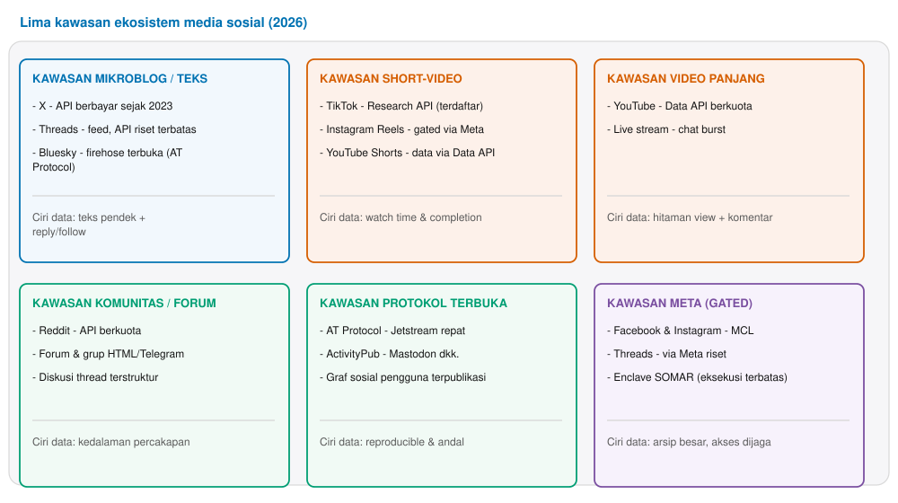
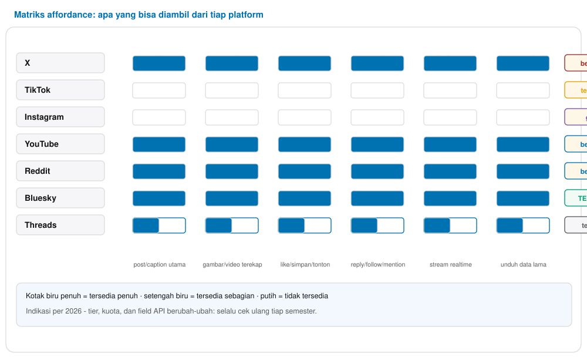
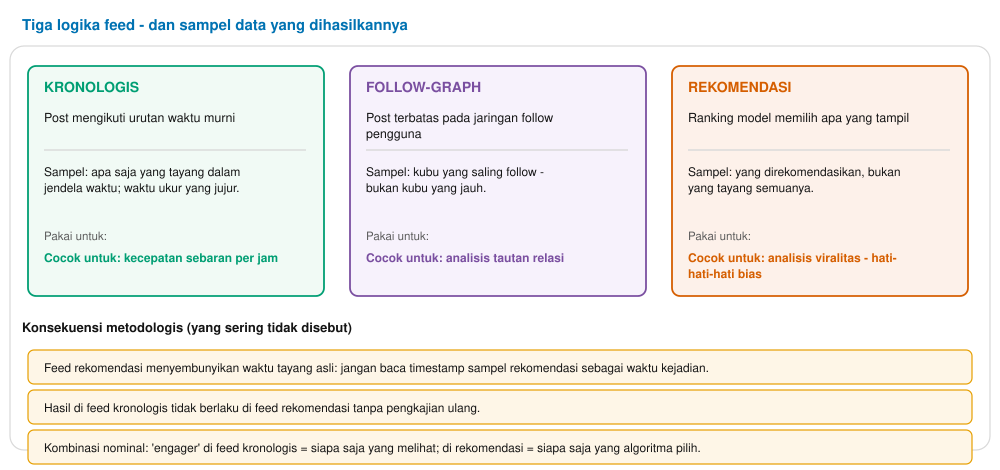
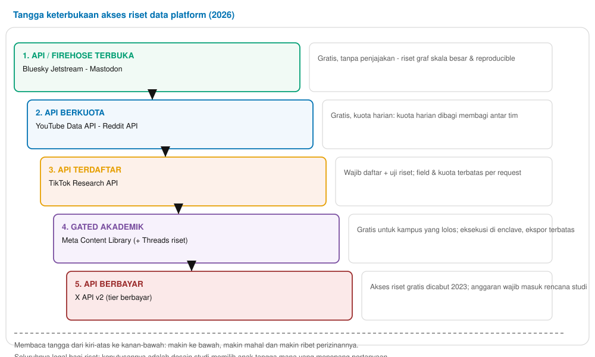
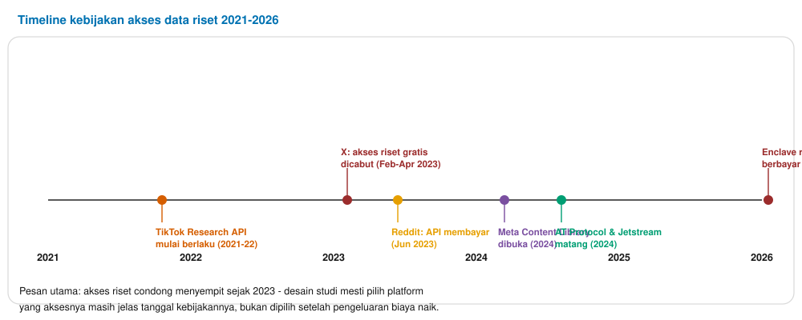
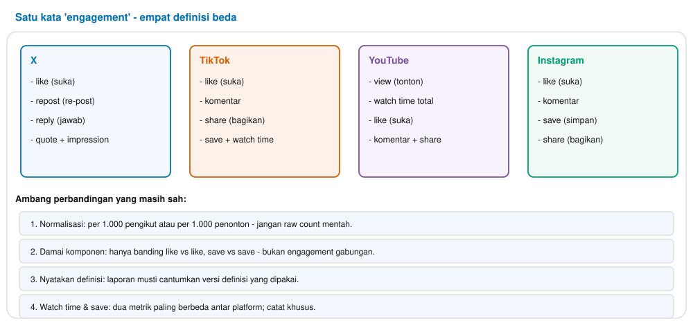

Buku Ajar Materi 2 — Ekosistem Platform & Data Affordance
Pertemuan 2 · 150 menit · CPMK-1

# Materi 2 — Ekosistem Platform & Data Affordance

Peta platform, matriks affordance, logika feed, tangga keterbukaan akses, dan metrik lintas-platform: mengapa pilihan platform menentukan pertanyaan yang tersedia.
**Tabel 0.1 — Identitas materi**

| Aspek | Isi |
| --- | --- |
| Mata kuliah | Social Media Analytics (3 SKS · semester 5) |
| Pertemuan | 2 dari 14 (sesuai RPS; jalur A — Fondasi) |
| Beban | 150 menit: teori 60′ + implementasi 70′ + artefak 20′ |
| CPMK | CPMK-1: membandingkan platform pada ketersediaan data, keterbukaan API, dan logika feed (C4); memilih platform untuk sebuah pertanyaan (C3); menjelaskan mengapa metrik identik berarti beda antar-platform (C5) |
| Bukti penilaian | Tugas mini 10% — matriks affordance + memo komparabilitas 1 halaman; kuis konsep |
| Dasar penyusunan | Arsip riset `results/ekosistem-platform.json`; dokumentasi API resmi; literatur platform-studies 2024–2026 |

> **Cara memakai buku ini**  
> Desain tiga lapis: **Lapis Teori** menamai konsep formal; **Lapis Implementasi** menerjemahkannya ke data social media nyata; **Lapis Artefak** berisi sesuatu yang mahasiswa kerjakan dan dinilai. Urutan baca baku Bagian 2→4→6→7; Bagian 8–10 dipakai saat lab; Bagian 11–14 referensi permanen. Semua angka biaya/kuota berlaku per 2026 dan *wajib diverifikasi ulang* sebelum dikutip.
>

Daftar isi
1. Peta pembelajaran pertemuan 2
2. Data affordance: konsep inti
3. Lima kawasan ekosistem
4. Logika feed dan sampel yang dihasilkannya
5. Tangga keterbukaan akses dan biayanya
6. Protokol terbuka: AT Protocol dan ActivityPub
7. Metrik lintas-platform: satu kata, banyak definisi
8. Implementasi: membangun matriks affordance di lab
9. Studi kasus terpandu: isu publik di tiga platform
10. Sepuluh kesalahan umum mahasiswa
11. Etika dan regulasi secara ringkas
12. Latihan mandiri
13. Ringkasan
14. Glosarium dan referensi

## 1. Peta pembelajaran pertemuan 2

**Tabel 1.1 — Sub-CPMK, indikator, dan rute pembelajaran**

| Tahap | Sub-CPMK (indikator) | Aktivitas | Alokasi |
| --- | --- | --- | --- |
| T1 | Menjelaskan definisi data affordance dan tiga pertanyaan kuncinya | Kuliah Bagian 2 + contoh objek API | 15′ |
| T2 | Memetakan lima kawasan ekosistem dan ciri data khasnya | Gambar 1 + diskusi platform asal-usul data | 10′ |
| T3 | Membedakan tiga logika feed dan konsekuensi sampelnya | Gambar 2 + latihan mengaitkan feed → inferensi | 15′ |
| T4 | Mengurutkan enam anak tangga keterbukaan akses beserta biayanya | Gambar 3–4 + studi kasus biaya | 20′ |
| T5 | Mampu membuat matriks affordance untuk 3 platform | Lab implementasi (Bagian 8) | 60′ |
| T6 | Menilai platform mana yang mampu menjawab pertanyaan tertentu | Studi kasus terpandu (Bagian 9) | 30′ |

## 2. Data affordance: konsep inti

**Definisi.** *Data affordance* adalah apa yang suatu platform **memungkinkan** dan **mengizinkan** diambil oleh analis akademik: field data yang dihasilkan API, tingkat penelusuran ke belakang, laju streaming, dan syarat hukum/tarifnya. Istilah menandingi pertanyaan metodologis dan pertanyaan biaya sekaligus — data affordance dijabarkan sebagai pertanyaan **tiga lapis**:

- **Metodologis** — field apa yang punya alasan ilmiah dipakai? Contoh: metrik `like` tersedia di semua platform, tetapi *watch time* hanya di platform video dan definisinya berbeda sehingga tidak bisa langsung disandingkan.
- **Teknis** — endpoint apa, rate limit berapa, pagination apa, status envelope apa? Endpoint yang sama di dua tier bisa punya cakupan beda.
- **Legal/financial** — apakah akses gratis, berkuota, terdaftar, gated, atau berbayar? Jawabannya tidak seragam: X mencabut akses akademik gratis pada 2023; Meta Content Library terbuka-lewat-tetapi-gated dan gratis untuk institusi yang lolos.

> **Lapis teori**  
> Affordance adalah **properti relasi** (platform × pertanyaan × analis), bukan properti platform semata. Platform yang kaya data bisa tetap tidak afford untuk riset tertentu bila aksesnya tertutup atau memuat biaya. Dari sisi ilmu komputer, istilah ini menghubungkan dua bidang: desain sistem (API design) dan metodologi riset (sampling frame).
>

## 3. Lima kawasan ekosistem

**Gambar 1.** Lima kawasan ekosistem media sosial (2026) beserta ciri data khasnya. Masing-masing kawasan menuntut metode penyimpanan dan analisis berbeda; sebelum menganalisis, rangkuman pertanyaan apa yang mampu dijawab kawasan mana.

Analis yang belajar riset platform tidak belajar satu platform, melainkan belajar **kawasan** beserta affordance-nya:

**Tabel 3.1 — Profil affordance per platform (per 2026; cek ulang tiap semester)**

| Platform | Unit dasar | Data kaya | Akses riset | Biaya | Retrospektif |
| --- | --- | --- | --- | --- | --- |
| X (Twitter) | post teks | teks + engagement + graf | API berbayar v2 | berbayar sejak 2023 | search lama terbatas |
| TikTok | video pendek | watch time + on-screen teks | Research API (terdaftar) | gratis untuk yang lolos | 7–30 hari via API |
| Instagram | visual + reel | visual + save/share | gated via Meta Content Library | gratis untuk gated | terbatas |
| YouTube | video (semua) | komentar + watch time (gated) | Data API berkuota | gratis berkuota | sangat baik |
| Reddit | thread / komentar | teks thread + vote | API berkuota | berbayar sejak Jun 2023 | pushshift terbatas |
| Bluesky | post teks | teks + graf publik | firehose terbuka (Jetstream) | gratis | firehose forward + search |
| Threads | post teks | teks + engagement | gated via Meta riset | gated | terbatas |

**Gambar 2.** Matriks affordance 7 platform: baris platform, kolom jenis affordance (teks, media, engagement, graf, firehose, retrospektif) plus status akses. Kotak biru penuh = tersedia penuh; setengah = sebagian; putih = tidak tersedia. Indikasi per 2026 — tier dan kuota API berubah, cek ulang tiap semester.

> **Lapis implementasi**  
> Cara praktis menghafal profil platform: **buka objek mentahnya** sekarang, bukan minggu depan. Nyalakan `curl` atau browser devtools ke endpoint publik sebuah post Bluesky, lihat field apa yang sebenarnya ada. Platform berbeda punya bentuk JSON berbeda; yang sama namanya (mis. `timestamp`) bisa beda unit (detik vs milidetik vs ISO-string).
>

## 4. Logika feed dan sampel yang dihasilkannya

**Gambar 3.** Tiga logika feed - kronologis, follow-graph, dan rekomendasi - tiga jendela yang menghasilkan dunia berbeda; sampel yang dihasilkannya tidak tumpang-tindih sempurna.

Logika feed menentukan **siapa yang melihat apa**, dan dengan demikian data yang terkoleksi. Kesalahan metodenya ialah memperlakukan feed sebagai pipa netral. Konsekuensinya bertingkat:

**Tabel 4.1 — Feed, sampel, dan inferensi berlebihan yang harus dihindari**

| Logika feed | Sampel yang terlihat | Inferensi yang melanggar |
| --- | --- | --- |
| Kronologis | semua post dalam rentang waktu; cenderung bebas rooting | menganggap populasi = sampel; pengguna di dalam feed tidak representatif |
| Follow-graph | netral terutama di dalam kubu graph pilih; mewarisi pola struktur sosial jaringan | menyimpulkan konsensi publik dari kubu yang saling follow |
| Rekomendasi | post yang algoritma angkat; hasilnya tergantung personalisasi penonton | menganggap timestamp atau engagement sampel rekomendasi sebagai rata-rata populasi |

> **Lapis teori: sampling frame**  
> Feed adalah **sampling frame** (kerangka sampel) yang tidak dipilih kita. Akibatnya kebanyakan kesalahan yang disebut *filter bubble* sebenarnya kesalahan inferensi: sampel yang diluluskan algoritma dicompare dengan populasi. Bruns (2019) menunjukkan bahwa perdebatan "filter bubble" sering melewatkan poin sampling: masalah utamanya bukan semata keragaman konten, melainkan inferensi yang salah — sampel feed diperlakukan sebagai populasi.
>

## 5. Tangga keterbukaan akses dan biayanya

**Gambar 4.** Enam anak tangga keterbukaan akses riset, dari API/firehose terbuka di kiri-atas sampai API berbayar di kanan-bawah. Semuanya legal bagi riset; yang beda adalah biaya, formalitas, dan kemudahannya.

**Gambar 5.** Timeline kebijakan akses data riset 2021–2026. Titik-titik menandai perubahan besar: TikTok Research API (2021-22), X mencabut akses gratis (2023), Reddit berbayar (Jun 2023), Meta Content Library (2024), AT Protocol matang (2024), dan enclave riset berbayar (Jan 2026).

**Tabel 5.1 — Rincian akses dan biaya per anak tangga (angka verifikasi per 2026, wajib cek ulang)**

| Anak tangga | Contoh | Syarat formal | Risiko bagi proyek capstone |
| --- | --- | --- | --- |
| 1. API/firehose terbuka | Bluesky Jetstream, Mastodon | tanpa pendaftaran | arsitektur penyimpanan berbeda bila volume firehose besar |
| 2. API berkuota | YouTube Data API, Reddit API | API key, batas unit | kuota habis di tengah koleksi; desain sampel harus mengakui plural batas |
| 3. API terdaftar | TikTok Research API | daftar, klarifikasi riset | field dipilah tiap request; musti buat catatan request yang dipilih |
| 4. Gated akademik | Meta Content Library | kampus lolos prasyarat | enclave; ekspor data agregat terbatas; perlu direncanakan aksesnya |
| 5. API berbayar | X API v2 | kartu kredit / anggaran proyek | biaya bertumbuh jika koleksi mengerem; anggaran disiapkan di surat riset |
| 6. Enclave berbayar | Meta SOMAR (2026) | penyewaan per tim | eksekusi terkontrol; output terbatas; lapor biaya ke unit riset |

## 6. Protokol terbuka: AT Protocol dan ActivityPub

Dua protokol terbuka mengubah lanskap riset 2024–2026: **AT Protocol** (Bluesky) menawarkan **firehose** publik — deretan event murah untuk skala besar; **ActivityPub** (Mastodon, dkk.) menata data sebagai graf terfederasi antar server. Keduanya mendekatkan riset ke ideal *reproducible*: data dapat dicapture ulang dari protokol, bukan bergantung pada akses lingkungan komersial. Affordance risetnya:

- AT Protocol (Bluesky) — firehose Jetstream. Untuk riset graf sosial skala besar, ini jalur yang paling murah.
- ActivityPub (Mastodon dkk.) — data terfederasi antar server; sejumlah instansi menutup pencarian publik untuk privasi.

> **Lapis teori: keterbukaan protocol vs komersial**  
> Protokol terbuka menawarkan data yang lebih stabil antar-tahun, tetapi komunitas penggunanya sering lebih kecil. Untuk riset Indonesia, diperiksa dulu ukuran komunitas lokal sebelum memilih platform berprotokol terbuka.
>

## 7. Metrik lintas-platform: satu kata, banyak definisi

**Gambar 6.** Satu kata "engagement" memuat komponen berbeda di empat platform. Sebelum dipakai sebagai variabel di riset, semua komponen harus dinyatakan secara eksplisit.

**Tabel 7.1 — Nama yang terlihat sama, definisi yang berbeda**

| Nama | X | TikTok | YouTube | Instagram |
| --- | --- | --- | --- | --- |
| like | aksi suka | aksi suka | aksi suka | aksi suka |
| share | repost / retweet / quote | bagikan ke chat atau platform lain | bagikan (embed) | bagikan ke story/DM |
| save | tidak ada | bookmark personal | tidak ada | bookmark personal |
| watch | tidak diketahui | watch time & completion | view (≥30 detik) | view + retensi |

> **Aturan harfiah**  
> Jangan pernah mencantumkan kolom `engagement` di tabel hasil tanpa **manuscript formula** — daftar eksplisit komponen yang diragukan. Safeguard terkuat: normalisasi per 1.000 pengikut atau per 1.000 tontonan; bandingkan **komponen dengan komponen yang setara**.
>

## 8. Implementasi: membangun matriks affordance di lab

> **Lapis implementasi (60 menit lab)**  
> 1. Pilih 3 platform yang aktif di Indonesia (saran: X atau Bluesky + TikTok atau YouTube + Reddit).
> 2. Beri satu topik yang sama sama antara ketiganya (contoh: kenaikan harga BBM, pemilu, krisis pangan).
> 3. Kumpulkan (atau simulasi, bila API terlalu ketat) **1.000 item** per platform ke folder `data/raw/{platform}/`.
> 4. Masuk tiap platform ke dataframe; daftar semua field yang muncul beserta tipe datanya — field bersarang ditulis sebagai jalur penuh (`metrics.like`).
> 5. Berikan skor affordance: teks / media / engagement / graf / firehose / retrospektif, disertai status akses.
>

Hasil lab: **matriks affordance** 3 baris × 6 kolom mirip Gambar 2, plus **memo komparabilitas** 1 halaman yang menjawab: "Pertanyaan apa yang mampu dijawab di platform mana?" Bagian wajib memo: tabel per platform, ukuran numerik, dan status akses.

## 9. Studi kasus terpandu: isu publik di tiga platform

Pertanyaan kasus: **"Isu kenaikan harga BBM ramai di tiga platform — dan masing-masing platform mampu menjawab apa saja?"** Lakukan bersama di kelas:

**Tabel 9.1 — Walkthrough studi kasus (lengkap rubrik isi dengan bagian memo yang menjawabnya)**

| Aspek | Ujiannya | Bagian memo yang menjawab |
| --- | --- | --- |
| Sampling frame | feed di ketiga platform berada dalam jendela waktu yang jelas? | Bab 1 memo — feed: kronologis / follow / rekomendasi |
| Representasi | kerangka pengambilan (kata kunci, tag, akun) dinyatakan transparan | Bab 1 memo — jaminan pada bahasa & waktu lokal |
| Legality | jalur akses legal dan prasyaratnya jelas | Bab 2 memo — status per anak tangga keterbukaan |
| Costs | estimasi anggaran untuk sampel minimum yang layak | Bab 2 memo — kuota harian atau biaya per hari |
| Design | keputusan desain meminimalkan bias yang bisa dihindari | Bab 3 memo — kombinasi platform vs satu platform |

> **Lapis artefak**  
> Artefak yang dinilai: **memo komparabilitas** yang dapat dipakai ulang mahasiswa lain untuk pertanyaan berbeda. Kalau bisa dipergunakan luas, memo berhasil.
>

## 10. Sepuluh kesalahan umum mahasiswa

**Tabel 10.1 — Kesalahan umum: gejala, akibat, dan mitigasi**

| # | Kesalahan | Konsekuensi metrik | Pencegahan |
| --- | --- | --- | --- |
| 1 | Membandingkan hitungan engagement mentah lintas platform | skala yang berbeda tanpa normalisasi melahirkan kesimpulan keliru | normalisasi per 1.000 followers/penonton |
| 2 | Menganggap feed rekomendasi = feed kronologis | timestamp sampel rekomendasi diperlakukan sebagai waktu aktual | catat jenis feed di metadata dataset |
| 3 | Menganggap teks = seluruh unit data platform | teks on-screen hilang dari analisis | simpan teks on-screen sebagai field terpisah |
| 4 | Asumsi field API satu tier berlaku di tier lain | perbandingan antar tier memakai field yang sebenarnya berbeda | verifikasi field yang disajikan tiap request |
| 5 | Mengabaikan akun yang dihapus antara dua snapshot | sampel berkecenderungan ke akun yang masih aktif | catat persentase akun yang hilang antar snapshot |
| 6 | Timestamp dari dua platform dicampur tanpa standarisasi | urutan waktu rusak karena unitnya beda (s/milidetik/ISO) | standarkan timestamp ke format ISO 8601 |
| 7 | Lupa menyiapkan kredensial API resmi sebelum lab | lab gagal atau waktu pada kertas terpakai mengantri akses | siapkan data cadangan lokal untuk demo |
| 8 | Asumsi bahasa tidak perlu dideteksi ulang | bias bahasa masuk ke sampel tanpa tercatat | lakukan language ID terpisah pada data lokal |
| 9 | Menggabungkan data dua feed menjadi satu sampel | feed kronologis dan rekomendasi tercampur | simpan jenis feed di kolom terpisah |
| 10 | Mengabaikan jendela snapshot batch data | rapor salah karena batch yang berbeda periode dibanding-bandingkan | nyatakan jendela snapshot di memo dan laporan |

## 11. Etika dan regulasi secara ringkas

Empat rujukan dari Materi 1 yang tetap membatasi pilihan platform:

**Tabel 11.1 — Regulasi yang menentukan akses data**

| Regulasi | Guna bagi | Waktu riil |
| --- | --- | --- |
| UU PDP No. 27/2022 | fondasi legal pemrosesan data pribadi di Indonesia | kewajiban konfirmasi dosen dan paket penelitian |
| GDPR | data berbackground lintas yurisdiksi | rencanakan trasparansi data pengguna |
| Platform ToS | syarat penyimpanan data oleh platform | verifikasi di awal setiap unit riset |
| IRB-ring per riset | riset dengan data pribadi pengguna yang percaya / vulnerable | penilaian bersama dengan dosen aman riset |

> **Prinsip yang tidak bisa dilanggar**  
> **Publik bukan sama dengan consentable.** Kuncinya: sebuah data bersifat *publik* karena penggunanya menayangkannya di aplikasi, tetapi ia tidak otomatis *consentable* — izin yang relevan adalah izin memproses yang dicatat di kerangka metodologi. Riset yang mengandung data pengguna pribadi masih perlu tinjauan etik seperti di Materi 3.
>

## 12. Latihan mandiri

1. Tebak dulu — **tanpa** membaca tabel affordance, daftarkan affordance satu platform yang sering dipakai (X atau TikTok), lalu bandingkan dengan dokumentasi resmi. Catat selisihnya.
2. Simulasi feed: tulis urutan langkah yang menyatakan cara memilih feed di satu platform — sebut pemantik (timestamp paling stabil) dan pelampauan pasti sebelum mengaitkan hasil sampel ke populasi.
3. Akses maze: **pilih dua platform** yang menopang satu pertanyaan riset berikut yang cukup rumit (contoh: "sentimen terhadap satu kebijakan publik"), lalu rangkum rute aksesnya.
4. Anggaran riset: **untuk proyek capstone**, buat perkiraan biaya 3 bulan pengumpulan data di dua platform dan cantumkan di surat riset Anda.

## 13. Ringkasan

- **Affordance** = metode ∩ teknik ∩ legal; platform baru dipilih setelah pertanyaan dan urgensinya jelas.
- **Kawasan** (mikroblog, short-video, video panjang, komunitas, protokol terbuka, kawasan gated) lebih informatif dibanding memilih platform satu per satu.
- **Feed** adalah sampling frame; rekomendasi feed tidak boleh diperlakukan sebagai pengukur waktu.
- **Tangga keterbukaan** memandu masuk; trajectory akses sejak 2023 condong turun ke kanan-bawah; rencanakan anggaran sejak awal.
- **Metrik** — nama sama, definisi beda: normalisasi + komponen + formula yang dinyatakan di laporan.
- Memo komparabilitas dan arsip affordance adalah fondasi materi-materi berikut: jenis data (P3), akuisisi API (P4), dan akses gated (P5).

## 14. Glosarium dan referensi

### Glosarium

1. **Data affordance** — potensi data yang suatu platform memungkinkan dan mengizinkan diambil, yang mencakup dimensi metodologi, teknik, dan legal.
2. **Sampling frame** — kerangka dari mana sampel ditarik; feed adalah sebuah sampling frame.
3. **Firehose** — deretan event realtime yang dipublikasikan platform/protokol terbuka.
4. **AT Protocol** — protokol terbuka yang dipakai Bluesky; firehose + repositori data terstruktur.
5. **ActivityPub** — protokol terbuka federasi (Mastodon, PeerTube, dll.).
6. **Endpoint** — alamat API untuk satu tujuan (search, lookup, timeline).
7. **Rate limit** — batas jumlah panggilan API per jendela waktu.
8. **Quota / kuota unit** — anggaran panggilan hari-an; YouTube memakai unit (quota).
9. **Retrospektif** — kemampuan mengambil data lama (pencarian ke belakang).
10. **Enclave** — lingkungan eksekusi terpasang yang membatasi ekspor data.
11. **Meta Content Library (MCL)** — pintu akses gated riset Meta untuk institusi akademik.
12. **Tier** — tingkatan layanan API (free/Basic/Pro) yang beda field & kuota.
13. **Engagement** — nama umum untuk aksi pengguna (like/reply/share/save); definisinya plat X vs TikTok vs YouTube vs IG berbeda.
14. **Watch time** — durasi total yang ditonton; paling beda antar platform.
15. **Impression** — sinyal bahwa konten tampil; tidak selalu berarti dilihat.
16. **Protokol federasi** — sistem yang menyebarkan data antar server dengan mandating isyarat.

### Referensi pokok

1. Zafarani, Abbasi, & Liu (2014). *Social Media Mining*, ch. 2 — data sources.
2. Bruns (2019). *Are Filter Bubbles Real?* — karekter feed dan sampling.
3. Dokumentasi resmi: **X API v2** (tiers, pricing), **YouTube Data API** (quota), **TikTok Research API**, **Reddit API**, **Meta Content Library**.
4. Dokumentasi resmi: **AT Protocol** (Jetstream & sync) dan **ActivityPub**.
5. arXiv:2505.09877 (2025). *Studying Digital Platforms in Scant Data Access Times*.
6. Rice et al. (2022). *Working with computational data* — akses data antar platform.
7. Freelon (2018). *Computational research on random publics*. *Stanford Annals*.
8. UU PDP No. 27 Tahun 2022 dan kanto resmi privasi platform (X/Meta/Google).

> **Jembatan ke Materi 3**  
> Materi ini mengakui affordance (kesempatan); materi berikutnya menajamkan format (figur): **jenis data, schema, dan field dictionary** — bagaimana objek mentah dari API yang dibaca & dirangkum dengan pengukuran realistis.
>
