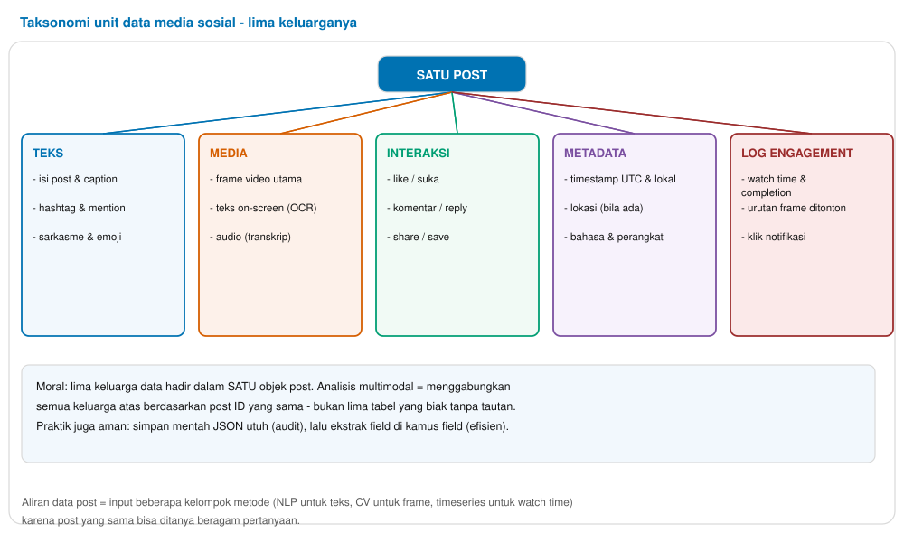
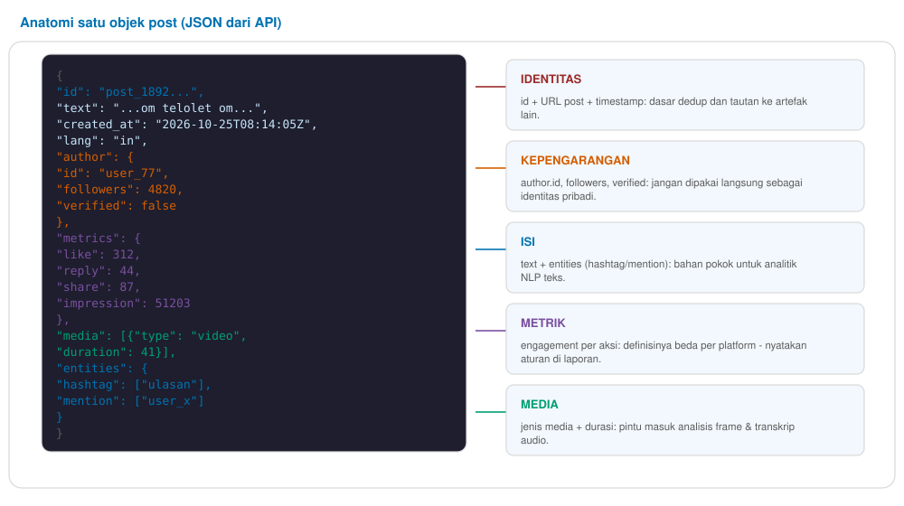
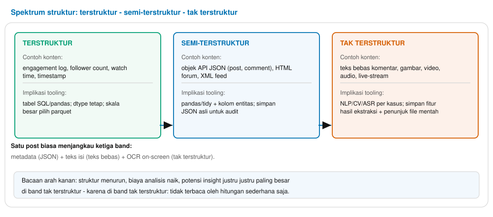
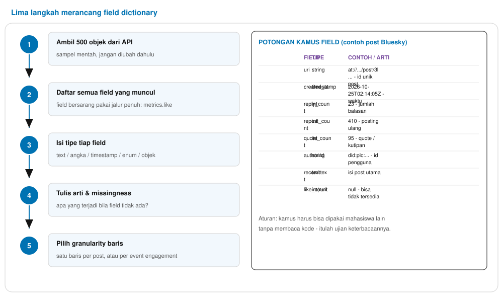
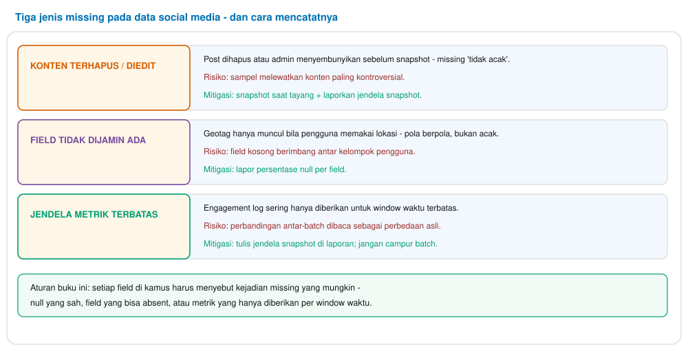

Buku Ajar Materi 3 — Jenis Data & Field Dictionary
Pertemuan 3 · 150 menit · CPMK-1

# Materi 3 — Jenis Data & Field Dictionary

Taksonomi unit data teks–media–interaksi–metadata–log, anatomi satu objek API, spektrum terstruktur hingga tak terstruktur, dan lima langkah merancang field dictionary.
**Tabel 0.1 — Identitas materi**

| Aspek | Isi |
| --- | --- |
| Mata kuliah | Social Media Analytics (3 SKS · semester 5) |
| Pertemuan | 3 dari 14 (jalur A — Fondasi; jembatan ke CPMK-2) |
| Beban | 150 menit: teori 60′ + implementasi 70′ + artefak 20′ |
| CPMK | CPMK-1 dan CPMK-2: mengklasifikasikan unit data beserta cara pengolahannya (C3); merancang field dictionary untuk API pilihan (C4); menjelaskan mengapa log engagement dan teks membutuhkan metode berbeda (C3) |
| Bukti penilaian | Kamus field satu platform (field, tipe, contoh, arti, missingness); kuis ringkas |
| Dasar penyusunan | Arsip riset `results/jenis-data.json`; objek API nyata (X v2, TikTok, Reddit, Bluesky); literatur data-management 2024–2026 |

> **Cara memakai buku ini**  
> Lapis Teori terdapat di Bagian 2, 4, 5, dan 7; Lapis Implementasi di Bagian 3, 6, dan 8; Lapis Artefak (yang dinilai) di Bagian 6 (kamus field) dan Bagian 9 (studi kasus spesifikasi dataset). Glosarium dan referensi di Bagian 12–13. Semua contoh endpoint/field per 2026; verifikasi ulang saat lab.
>

Daftar isi
1. Peta pembelajaran pertemuan 3
2. Taksonomi lima keluarga data
3. Anatomi satu objek API
4. Spektrum terstruktur hingga tak terstruktur
5. Multimodal sebagai satu unit
6. Field dictionary dan granularitas baris
7. Missingness, snapshot, dan jendela waktu
8. Implementasi: lab klasifikasi data
9. Studi kasus terpandu: dataset kampanye TikTok vs X
10. Sepuluh kesalahan umum mahasiswa
11. Etika: anonimisasi di tingkat field
12. Latihan mandiri dan ringkasan
13. Glosarium
14. Referensi pokok

## 1. Peta pembelajaran pertemuan 3

**Tabel 1.1 — Sub-CPMK, indikator, dan rute pembelajaran**

| Tahap | Sub-CPMK (indikator) | Aktivitas | Alokasi |
| --- | --- | --- | --- |
| T1 | Mengklasifikasikan lima keluarga unit data dan bagian-bagian unitnya | Gambar 1 + diskusi unit asli | 20′ |
| T2 | Membedah field sebuah objek API nyata | Lab bedah JSON (Bagian 3) | 25′ |
| T3 | Menempatkan data pada spektrum terstruktur / semi / tidak terstruktur | Gambar 3 + tabel implikasi metode | 15′ |
| T4 | Mengoperasi unit multimodal sebagai satu kumpulan data | Diskusi (Bagian 5) | 10′ |
| T5 | Merancang field dictionary 1 platform | Lab lima langkah (Bagian 6) | 60′ |
| T6 | Menyusun spesifikasi dataset kampanye TikTok vs X | Studi kasus (Bagian 9) | 20′ |

## 2. Taksonomi lima keluarga data

**Gambar 1.** Taksonomi unit data media sosial — lima keluarga yang hadir bersama-sama dalam satu objek post: teks, media, interaksi, metadata, dan log engagement. Pembahasan di kelas mengaitkan keluarga → metode (NLP, CV, timeseries, graf).

Unit data media sosial biasanya mendapat lima keluarga **data** yang hadir **bersama dalam post yang sama**. Pengelompokan bukan sekadar penamaan: tiap keluarga punya metode, sistem penyimpanan, dan risiko privasi yang berbeda. Tabel 2.1 mengaitkan keduanya:

**Tabel 2.1 — Keluarga unit data, metode peluang, dan risiko**

| Keluarga | Contoh isi | Metode khas | Risiko khusus |
| --- | --- | --- | --- |
| teks | caption, komentar, hashtag, mention, emoji | NLP (tokenisasi, klasifikasi), konten analitika | sarkasme & kode-campur; model bahasa berbeda |
| media | gambar, frame video, teks on-screen, audio | CV & OCR, transkripsi (ASR), multimodal fusion | beban penyimpanan & waktu cetak besar |
| interaksi | like, komentar, reply, share, save, follow | graph metrics, counter models | definisi per platform tidak sama (materi 2) |
| metadata | timestamp, bahasa, di mana, perangkat | jendela waktu, sampel design, geo clustering | bisa mengidentifikasi pengguna (geo + waktu) |
| log engagement | watch time, completion, scroll, click event | timeseries, timeseries & retensi kurva | sangat tergantung akses platform; harus dijelaskan di laporan |

> **Lapis teori**  
> Pengklasifikasian keluarga data sesuai standar deskripsi data dan data management plan: **struktur Peranan → penyimpanan → metode → etika**. Ini keterampilan yang juga dipakai di sains data umum — bukan hanya riset platform.
>

## 3. Anatomi satu objek API

**Gambar 2.** Anatomi satu objek API post: blok-blok field yang bersama-sama menandai satu unit data — identitas, kepengarangan, isi, metrik, dan media. Blok-blok ini menjadi kerangka field dictionary di Bagian 6.

Objek API adalah jendela memahami data platform: semua field yang ditawarkan dipasang dalam satu objek. Objeknya berkarakter **hidup**: field tidak selalu dijamin (bisa `null`), nilai bisa berubah, dan *timezone* sering berbeda. Aturan praktisnya: **identitas** per URL/pencarian, **kepengarangan** per akun riset, **isi** (teks/entities) untuk NLP, **metrik** per definisi engagement platform, dan **media** untuk model audio/visual.

Ketiga lapis implementasi di kelas biasa menggunakan objek X v2, TikTok, Reddit, atau Bluesky — yang sesuai platform. Tiga hal yang harus dicatat tiap objek:

1. Deterministik — JSON bisa dibaca ulang tanpa kehilangan makna; simpan raw seketika setelah koleksi.
2. Heterogen — tak ada platform yang menjamin semua field di setiap objek: `null` dan `absent` perlu dibedakan.
3. Berubah-ubah — field bisa ditambah/dihilangkan antar tahun; kamus field mencantumkan versi API dan tanggalnya.

> **Lapis implementasi**  
> Praktik yang ada di lab: ambil 500 post satu platform, jalankan `pandas.json_normalize` atau `json.dumps`, lalu daftar field yang muncul beserta tipe datanya. Tiap platform berbeda: objek post X v2 umumnya 25–45 field unik, TikTok 10–20, Reddit 15–30 per objek komentar. Setelah langkah itu, putuskan field mana yang benar-benar punya alasan ilmiah dipakai — bukan sekadar muncul di objek.
>

## 4. Spektrum terstruktur hingga tak terstruktur

**Gambar 3.** Spektrum struktur konten — terstruktur (SQL/pandas), semi-terstruktur (JSON/HTML/XML), dan tak terstruktur (teks, gambar, audio, video). Satu objek post sering mencakup ketiga band sekaligus.

**Tabel 4.1 — Band struktur, kata kunci metode, dan penyimpanan yang cocok**

| Band | Kata kunci | Penyimpanan | Catatan |
| --- | --- | --- | --- |
| Terstruktur | count, timestamp, dtypes (integer, float, boolean) | tabel/SQL; skema tetap | mudah bila simpan ditabulasi; perangkat tabel terbatas |
| Semi-terstruktur | JSON/XML/HTML; nested & entitas | JSON asli + dataframe ekstraks | duck-DB-like saat skala menengah |
| Tak terstruktur | alam bebas teks; media afidavit; audio transkrip | file utuh (JSON.gz/image/png/mp4) + kolom pointer | perlu audio-fith, OCR, ASR; ukuran data bila tak taut |

> **Lapis teori: keputusan penyimpanan**  
> **Raw first, tabel second** — simpan JSON mentah apa adanya sebelum tabulasi; tabulasi bisa diulang kapan pun, raw yang hilang tak bisa dibangun kembali. Entah itu timestamp: simpan timezone asli dan UTC berpasangan.
>

## 5. Multimodal sebagai satu unit

Sejak 2024–2026, video media sosial menuntut perlakuan unit dan multimodal: satu video memuat beberapa modalitas sekaligus:

- **Visual** — frame; binary CV (objek/gesture), CLIP embedding.
- Teks on-screen — hasil OCR dari frame; sering kritis karena di TikTok berisi kalimat penuh.
- Audio — hasil transkripsi (Whiser); penting untuk konten informal berbahasa Indonesia.
- Metadata — durasi, hashtag, kategori audio.

Metode multimodal mendalam ada di elective (Materi 15–16). Untuk pertemuan ini kuncinya: data multimodal disimpan sebagai satu unit yang bertaut ke post ID yang sama — bukan beberapa berkas mandiri tanpa tautan.

> **Lapis implementasi**  
> Contoh yang relevan: UMKM snack viral di TikTok — satu video memuat caption (teks), teks on-screen (OCR), audio yang ditranskripsi, plus metrik platform (watch time, save, share) — semuanya bertaut di satu unit post.
>

## 6. Field dictionary dan granularitas baris

**Gambar 4.** Lima langkah merancang field dictionary: ambil 500 objek, daftar field, tentukan tipe, tulis arti & missingness, dan pilih granularitas baris. Contoh potongan kamus untuk objek post Bluesky.

**Tabel 6.1 — Skema kamus field (format yang dipakai selama kuliah)**

| Field | Tipe | Contoh | Arti | Missingness |
| --- | --- | --- | --- | --- |
| `id` | string | `at://bsky.app/post/3l...` | id unik post | selalu ada |
| `created_at` | timestamp | `2026-10-25T02:14:05Z` | waktu tayang (UTC) | selalu ada |
| `text` | text | isi caption | bahan utama NLP | absen jika post hanya media |
| `reply_count` | int | 23 | jumlah balasan | bisa `null` di firehose |
| `quote_count` | int | 95 | jumlah kutipan | bisa `null` |
| `author.id` | string | `did:plc:...` | id pengguna (anonimisasi opsional) | selalu ada |
| `media[0].type` | enum | `video|image` | jenis media utama | absen jika no media |
| `geo` | float|null | — | lokasi (jarang di-share) | absen saat lokasi tak menyala |

Pertanyaan desain akhirnya: **granularitas baris**. Dua opsi yang dinyatakan di awal sebagai *entitas data:*

- Row per post — satu catatan per post (pilihan utama); mudah dipahami, tetapi data samping seperti log engagement dan thread balasan lebih aman di tabel terpisah yang bertaut ID.
- Row per event — satu catatan per event pengguna (klik, view, reply); cocok untuk data streaming, tetapi wajib bertaut ke post ID.

> **Lapis implementasi (alur kerja lab)**  
> 1. Simpan **JSON asli** ke `data/raw/{platform}/`, diberi checksum SHA-256.
> 2. Normalisasi JSON ke dataframe; kolom nested menjadi jalur penuh — `metrics.like` berubah menjadi `metrics_like`.
> 3. **Klasifikasi tipe** — timestamp, string, angka, enum, objek — ke kolom `dtype`.
> 4. Tulis arti dan kolom missingness — `null` yang sah, `absent`, atau jendela terbatas.
> 5. Cek konsistensi: casing nama field antar-platform, tanda list, dan timezone.
>

## 7. Missingness, snapshot, dan jendela waktu

**Gambar 5.** Tiga jenis kejadian missing di data social media — konten terhapus, field tidak dijamin ada, dan jendela metrik terbatas — beserta mitigasinya. Setiap kolom kamus harus menyatakan kejadian missingnya.

**Tabel 7.1 — Implementasi mitigasi untuk setiap tipe missing**

| Jenis | Contoh di lapangan | Catatan di kamus | Penanganan di kode |
| --- | --- | --- | --- |
| Konten terhapus | post yang dihapus admin/pengguna sebelum snapshot | `missing_reason = deleted` | wajib lapor jendela snapshot untuk mengurangi bias |
| Field menghilang | geotag & lang sesuai preferensi pengguna | `missing_reason = optout` | lapor persentase null per field |
| Jendela time-limit | engagement log sering diberikan dalam batch | `missing_reason = window` | jendela waktu dicantumkan di metadata batch |

## 8. Implementasi: lab klasifikasi data

> **Lapis implementasi (60 menit lab)**  
> 1. Ambil 500 objek platform yang sudah dipakai di pertemuan 2 (versi raw JSON, jangan diedit lebih dulu).
> 2. **Daftarkan** semua field yang muncul di `500 objek` — beri **tipe** data sesuai hasil inspeksi.
> 3. Klasifikasikan tiap field ke lima keluarga (teks / media / interaksi / metadata / log).
> 4. **Kamus field** — 12–15 baris field yang paling penting untuk riset group Anda (seperti Tabel 6.1).
> 5. Granularitas — pilih `row per post` atau `row per event`; sebabkan alasannya.
>

Deliverable yang dinilai: **kamus field** satu platform (12–15 baris, file Markdown/CSV) yang ≥3 baris menyentuh keluarga **log engagement** atau **media** — supaya penilaian tidak berfokus pada teks saja.

## 9. Studi kasus terpandu: dataset kampanye TikTok vs X

Pertanyaan kasus: **"Merancang dataset penilaian performa satu kampanye pemasaran di TikTok versus X — apa unit data, apa field, dan bagaimana keduanya dibandingkan?"** Diskusi bersama; dosen memandu:

**Tabel 9.1 — Rencana dataset kampanye dua platform**

| Perhatian | TikTok | X |
| --- | --- | --- |
| Keluarga data khas | media + log engagement (watch time, save, share) | teks + graf retweet/quote + interaksi |
| Unit dasar | satu video短 — caption/audio/on-screen log timestamps | satu post teks + reply chain |
| Sampling | hashtag + audio, feed deterministic rerank sampel POV | kata kunci/hashtag; feed kronologis per pengguna tak tersedia |
| Field mutlak | title, duration, view/watch metrics, hashtag list | id, text, entities, reply/quote/like counts |
| Perbandingan | normalisasi per 1.000 tontonan | normalisasi per 1.000 followers |
| Hukum & etika | akun riset TikTok Research API, UU PDP | API berbayar, API berbayar, ToS, UU PDP |

> **Lapis artefak (di kelas, bersama)**  
> Satu spesifikasi dataset gabungan, di kertas mahasiswa: kolom *unit data*, *field wajib*, *granularitas*, *metode pembersihan*, *risiko missing*, dan *preferensi etik*. Spesifikasi cukup 1 halaman; catat juga variabel yang berbeda antar dua platform.
>

## 10. Sepuluh kesalahan umum mahasiswa

**Tabel 10.1 — Kesalahan umum saat merancang dan mengumpulkan data**

| # | Kesalahan | Konsekuensi | Cara mencegah |
| --- | --- | --- | --- |
| 1 | Menyimpan hanya hasil tabulasi, bukan raw JSON | tabulasi bisa diulang, tetapi field yang tak tersimpan tak bisa dibangun kembali | simpan raw + checksum |
| 2 | `null` dan `absent` diperlakukan sama | metadata missing salah saat analisis | binarikan kolom presence (0/1) |
| 3 | Timestamp tak diberi timezone | waktu tayang vs UTC bergeser hingga 7–8 jam | standarkan ISO 8601 UTC-0 |
| 4 | Field nested tidak dipetakan ke kolom | tabel tidak rapi; risiko duplikasi | normalisasi path)-> kolom (>1 kelas) |
| 5 | Row per post dan row per event tercampur | penghitungan engagement ganda tanpa dasar yang jelas | pilih dan dokumentasikan granularitas |
| 6 | Media disimpan berseliweran di folder riset | penyimpanan terampung berat dan berulang | simpan media di folder media/, jangan di folder riset |
| 7 | Kamus field yang tidak bisa dipahami mahasiswa lain | kolaborasi gagal; kolom muncul tidak diketahui maknanya | tulis dalam istilah sederhana |
| 8 | Unit analisis tidak disebut di kamus | unit analisis kabur antar metode (post/user/event) | tulis unit analisis di awal kamus |
| 9 | Log engagement dibandingkan antar batch berkala | trend menyesatkan dari jendela yang tidak sama | dokumentasikan jendela di metadata dataset |
| 10 | Field pribadi disimpan tanpa anonimisasi | risiko PDP dan sensitivitas sepanjang riset | hash dulu field identitas |

## 11. Etika: anonimisasi di tingkat field

Materi ini pendokumen kesepata transparan riset **UU PDP** dan etik riset: anonimisasi di tingkat **kolom**, bukan hanya menyembunyikan nama di display. Praktik pertama yang kedengarannya hideiak zaman-jauz:

- Modifikasikan field yang berpotensi identifikasi: `author.id` di-hash, `geo` dihapus atau digenereralisasi ke wilayah luas, timezone disimpan UTC.
- Simpan mapping ID→hash hanya di penyimpanan terkunci yang tak ikut dipublikasikan.
- Berikan tinjauan etik sebelum data keluar dari lab; folder penyimpanan diberi label privasi.

> **Prinsip yang tidak bisa dilanggar**  
> Sebelum data dipublish/diupload ke tempat publik, **semua** field yang berpotensi identifikator pribadi (author ID, geo, timestamplist komponen yang dapat di- *de-anonymize*) harus dicoret atau disha-kin. Ini aturan yang dijalankan di Pertemuan 14 (capstone ethics note).
>

## 12. Latihan mandiri dan ringkasan

> **Latihan mandiri**  
> 1. Buat kamus field lengkap satu platform yang berbeda dengan pilihan lab (misal: lab Bluesky → latihan TikTok) 12 baris, tinjauan dosen.
> 2. Desain dataset row-per-event untuk beberapa metrik short-video berbasis perilaku; gambar struktur tabelnya.
> 3. Audit missingness: hitung persentase null tiap field di 500 objek dari Lab; tunjukkan field dengan lebih dari 20% null.
> 4. Standarkan satu tipe data yang salah (misal timestamp ISO vs epoch) pada data dari Pertemuan 2, dengan skrip validasi.
>

Ringkasan inti. **Lima keluarga data** (teks, media, interaksi, metadata, log) hadir bersamaan karena **post adalah objek kaya**, bukan teks saja. **Spektrum struktur** menentukan metode dan penyimpanan; tiap band punya tooling pilihan. **Field dictionary** adalah dokumen hidup yang mencakup **objek API, granularitas, jendela waktu, dan missingness**. Data **raw** selalu disimpan dulu — tabulasi bisa dibuat ulang, raw yang hilang tidak bisa dibangun kembali.

## 13. Glosarium

1. **Field dictionary** — dokumen kamus dataset: field, tipe, contoh, arti, missingness.
2. **Objek API** — satu paket field yang dikirim platform (post / user / media dll.).
3. **Nested field** — field bersarang; ditulis sebagai jalur penuh (`metrics.like`).
4. **Granularitas** — satuan satu baris: *row per post* atau *row per event*.
5. **Schema** — struktur resmi field yang disimpan platform — bisa berubah antar versi API.
6. **Unit multimodal** — satu konten yang pakai beberapa modalitas di post ID yang sama.
7. **On-screen text** — teks yang muncul di bingkai video atau sekitarnya.
8. **Watch time** — durasi tiap tontonan; kadang dijual sebagai detail ke-platform.
9. **Completion rate** — persentase video yg ditonton sampai akhir; produksi short-video.
10. **Retensi** — kurva jumlah penonton bertahan saat video berjalan.
11. **Jendela snapshot** — interval waktu kapan data benar-benar diberikan.
12. **Anonimisasi field** — menghapus/menghash field identitas pribadi sebelum dataset dipublikasikan.
13. **Checksum** — sidik digital file (SHA-256) yang membuktikan file tak rusak.
14. **ISO 8601** — format standard timestamp (YYYY-MM-DDTHH:MM:SSZ) dengan timezone.
15. **Normalization** — mengubah nilai ke satu skala agar revita bisa di pompale.
16. **Kolom identitas** — field yang bisa mengidentifikasi pengguna; wajib di-hash atau dihapus.

## 14. Referensi pokok

1. Zafarani, Abbasi, & Liu (2014). *Social Media Mining*, ch. 2 — unit data dan skema platform.
2. Russell (2019). *Mining the Social Web* (O’Reilly) — data-model dan penyimpanan.
3. Dokumen resmi dari objek API: **X API v2**, **TikTok Research API**, **Reddit API**, **Bluesky (AT Protocol)** — field konteks UI dan missingness.
4. Dokumentasi Meta Content Library (2024–2026) — field arsip skala besar.
5. MDPI (2026). *SMATM* — studi topic modeling multimodal untuk akun sosial.
6. Wickham, Çetinkaya-Rundel & Grolemund (2023). *R for Data Science*, ch. 12–13 — tidy data dan granularitas.
7. UU PDP No. 27 Tahun 2022 — fondasi etika dataset dengan field identitas.

> **Jembatan ke Materi 4**  
> Materi 4 memperluas akuisisi: bagaimana kelima-kelima field dictionary dari pertemuan ini dijejak sistem koleksi — **pagination, rate limit, quota, dan checksum** — plus praktik arsip yang reprodukibel.
>
