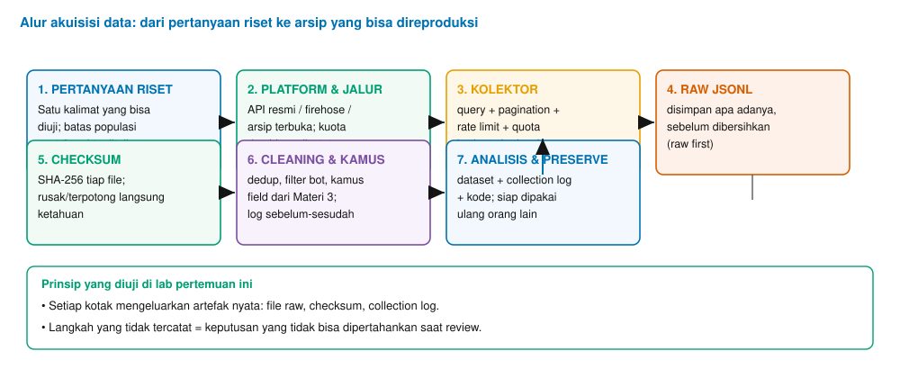
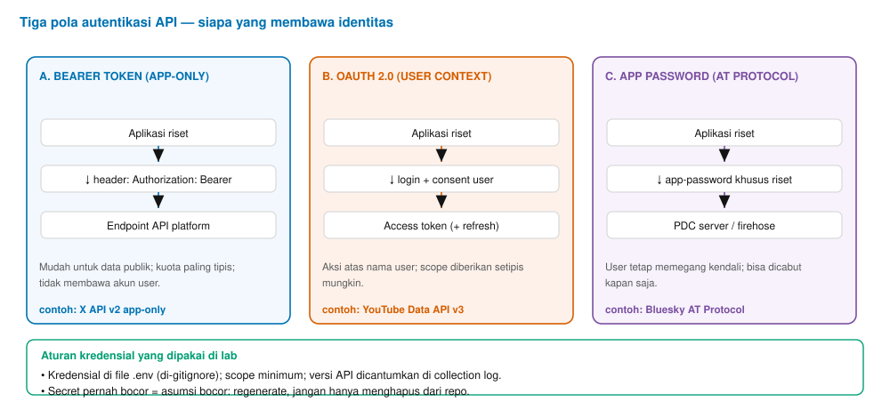
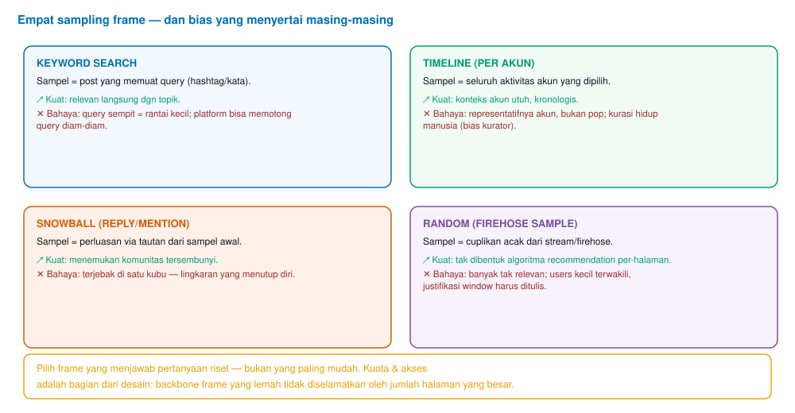
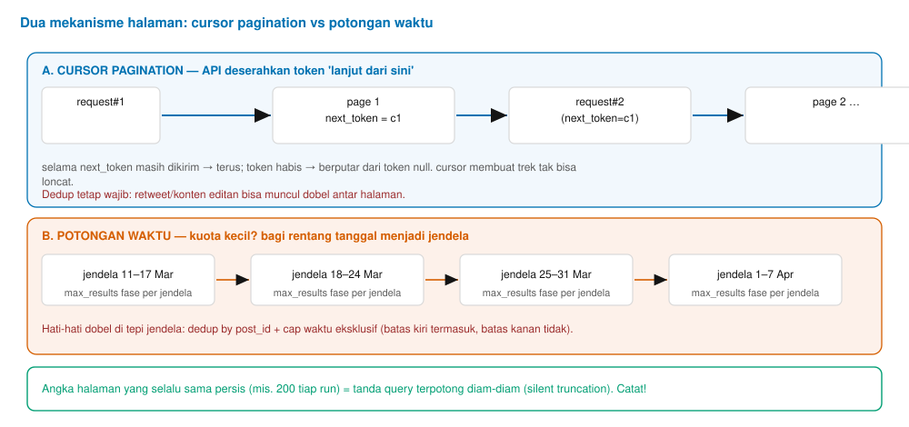
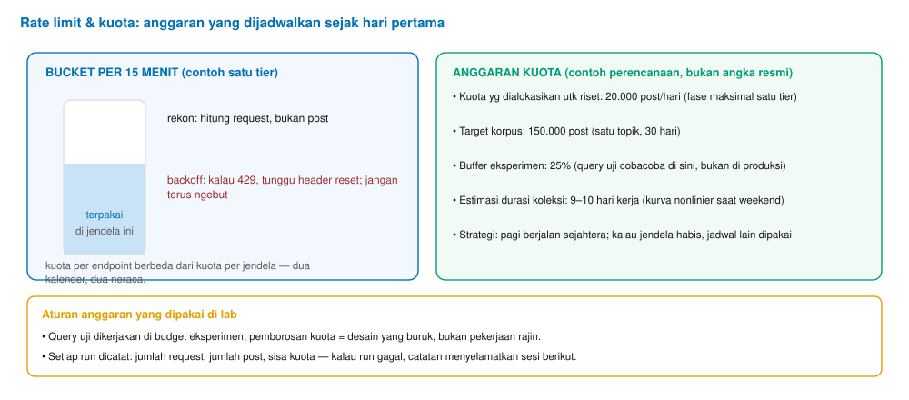
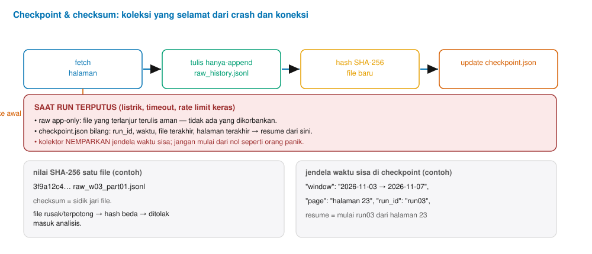
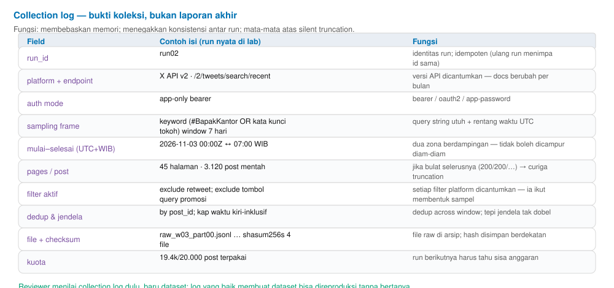

Buku Ajar Materi 4 — Akuisisi Data via API Resmi
Pertemuan 4 · 150 menit · CPMK-2

# Materi 4 — Akuisisi Data via API Resmi

Autentikasi, perancangan query, pagination, rate limit, checkpoint dan checksum, serta collection log — dari kredensial pertama hingga korpus yang dapat direproduksi.
**Tabel 0.1 — Identitas materi**

| Aspek | Isi |
| --- | --- |
| Mata kuliah | Social Media Analytics (3 SKS · semester 5) |
| Pertemuan | 4 dari 14 (jalur A — Fondasi; menutup CPMK-1, membuka jalur kerja CPMK-2) |
| Beban | 150 menit: teori 60′ + implementasi 70′ + artefak 20′ |
| CPMK | CPMK-2: mengumpulkan sampel terdokumentasi dari minimal tiga platform (C3); membenarkan sampling frame dan menaksir biasnya (C4); menilai kuota API terhadap anggaran riset (C5) |
| Bukti penilaian | Kolektor sederhana pada tiga platform, berkas raw (JSONL), CSV ringkasan, dan *collection log*; kuis ringkas konsep pagination–quota |
| Dasar penyusunan | Arsip riset `results/akuisisi-api.json`; dokumentasi resmi X API v2, YouTube Data API v3, AT Protocol, Reddit API; UU No. 27/2022 (PDP); literatur sampling (Lohr); kajian kebijakan akses 2024–2026 |

> **Cara memakai buku ini**  
> Lapis Teori berada di Bagian 2, 4, 5, dan 6; Lapis Implementasi di Bagian 3, 7, dan 9; Lapis Artefak (yang dinilai) di Bagian 8 (collection log) dan Bagian 10 (studi kasus). Glosarium dan referensi berada di Bagian 13–14. Semua contoh endpoint, kuota, dan harga ditulis per 2026 dan **harus diverifikasi ulang** saat jadwal lab, karena dokumen harga dan kuota platform berubah sepanjang semester.
>

Daftar isi
1. Peta pembelajaran pertemuan 4
2. Mengapa akuisisi adalah kompetensi tersendiri
3. Autentikasi: siapa yang membawa identitas kolektor
4. Query dan sampling frame: mesin penanya
5. Pagination: membaca halaman sampai token habis
6. Rate limit, kuota, dan backoff
7. Checkpoint dan checksum: koleksi yang selamat
8. Collection log: bukti, bukan pelengkap
9. Lab utama: kolektor mini tiga platform
10. Studi kasus: arsip isu tujuh hari dalam anggaran sempit
11. Sepuluh kesalahan umum dalam akuisisi API
12. Ringkasan modul
13. Glosarium
14. Referensi

## 1. Peta pembelajaran pertemuan 4

Pertemuan ini adalah pertemuan tangan: mayoritas waktu dihabiskan menulis kode kolektor, membaca jawaban API, dan mencatat keputusan selama proses berjalan. Meski demikian, lapisan teorinya tetap padat, karena kompetensi akuisisi tidak berhenti pada kemampuan memanggil API. Ujung dari kompetensi ini adalah kecakapan **merancang pengambilan sampel yang dapat dipertanggungjawabkan**: di tingkat sarjana, pertanggungjawabannya dibaca dosen penilai; di tingkat tesis, dibaca reviewer ilmiah; di tingkat industri, dibaca auditor data.

**Tabel 1.1 — Rute belajar delapan tahap pertemuan 4**

| Tahap | Aktivitas utama | Durasi |
| --- | --- | --- |
| 1. Pembuka artefak | Membaca dua collection log contoh: mana yang memungkinkan reproduksi, mengapa yang lain tidak | 15 mnt |
| 2. Teori: mengapa akuisisi adalah kompetensi tersendiri | Akses sebagai kendala utama 2024–2026; bias masuk lebih dahulu lewat koleksi | 15 mnt |
| 3. Lab kredensial | Inisialisasi proyek, berkas pengaturan (env), empat kredensial platform | 30′ |
| 4. Teori: sampling frame & operator query | Query sebagai mesin penanya; empat sampling frame (keyword, timeline, snowball, acak) | 20′ |
| 5. Teori: pagination, rate limit, dedup | Cursor vs potongan waktu; neraca kuota; backoff saat 429 | 25′ |
| 6. Lab inti | Membangun kolektor X + Bluesky untuk topik yang sama (tujuan 500 post per platform) | 70′ |
| 7. Perluasan endpoint | Menambahkan YouTube Data API v3 sebagai kanal ketiga; menaikkan rubrik | 45′ |
| 8. Tugas mingguan | Kolektor mini + collection log; kelompok 3–4 mahasiswa | 10′ |

> **Jembatan dari Modul 3**  
> Field dictionary yang dibangun pada Modul 3 kini berubah fungsi: ia menjadi **spesifikasi kolektor**. Env field yang tertulis di kamus tak lagi daftar abstrak seperti minggu lalu; minggu ini, setiap field harus diperoleh lewat query dan endpoint yang nyata. Mahasiswa yang melewati Modul 3 dengan kamus yang lengkap akan membangun kolektornya lebih cepat; yang hanya mengingat konsepnya akan menghabiskan awal sesi untuk menulis ulang kamusnya.
>

**Gambar 1.1.** Alur akuisisi data media sosial: setiap tahap mengeluarkan artefak yang bisa diaudit (file raw, checksum, collection log).

## 2. Mengapa akuisisi adalah kompetensi tersendiri

Tiga alasan menjadikan kepadatan modul ini patut mendapat perhatian. *Pertama*, akses data telah berubah menjadi kendala riset utama pada era 2024–2026. Beberapa platform menutup akses gratis bagi komunitas akademik atau memindahkannya ke lingkungan riset terdaftar (X sejak 2023; Meta Content Library yang hanya lewat approval lembaga); kajian yang menulis tentang kondisi ini memakai frasa *data access scarcity*. Konsekuensinya, mahasiswa yang menyusun rencana riset tanpa mempertimbangkan kuota membuang waktu pada desain yang sulit dilaksanakan.

*Kedua*, kesalahan pada tahap akuisisi menembus sampel dan tidak dapat dipulihkan pada tahap berikutnya. Analisis yang paling hati-hati tidak mengembalikan halaman yang hilang, tidak menyelamatkan jendela waktu yang salah, dan tidak memperbaiki query yang terpotong diam-diam. Dengan demikian, "pengumpulan yang buruk" menghasilkan riset yang buruk berapa pun baiknya model di bagian akhir.

*Ketiga*, bias memasuki proyek melalui pintu koleksi lebih dahulu. Logika feed platform (Modul 2) dan definisi field per platform (Modul 3) menentukan populasi yang tampil di sampel sebelum satu pun analitik berjalan. Karena itu, kolektor yang baik bukan sekadar kode yang berjalan; ia juga menuliskan keputusan eksplisit — frame apa yang diambil, mengapa secara teknik, dan sejauh mana frame itu membatasi apa yang bisa ditemukan di sampel.

> **Pernyataan patokan pertemuan 4**  
> "Korpus yang bagus itu mahal; yang murah hanyalah reproduksi dari *collection log* yang rapi." Setiap langkah di modul ini mengejar satu hal yang sama: memastikan setiap keputusan riset terdokumentasi dengan buktinya sendiri.
>

## 3. Autentikasi: siapa yang membawa identitas kolektor

Setiap request yang dikirim ke API melakukan dua hal sekaligus: meminta data dan memperlihatkan identitas. Ketiga pola identitas yang paling umum dapat dibaca pada Gambar 3.1 — bearer token berbasis aplikasi, OAuth 2.0 atas nama pengguna, dan *app password* pada protokol terbuka. Ketiganya berbeda pada kepemilikan kuota, cakupan akses (scope), dan risikonya.

**Gambar 3.1.** Tiga pola autentikasi dalam akuisisi riset: app-only (bearer), user context (OAuth 2.0), dan app password (AT Protocol).

**Tabel 3.1 — Perbandingan tiga pola autentikasi**

| Aspek | Bearer (app-only) | OAuth 2.0 (user) | App password |
| --- | --- | --- | --- |
| Pemegang kuota | Aplikasi | Pengguna akun riset | Akun pengguna AT Protocol |
| Batas data | Publik saja; kuota paling tipis | Sesuai scope yang disetujui | Akses penuh ke data milik akun tersebut |
| Risiko utama | Token bocor berarti akun riset bisa disusupi | Scope berlebih; refresh token harus disimpan aman | Dapat dicabut kapan saja oleh pemilik akun |
| Kegunaan riset | Pemetaan topik beragam, tanpa aksi akun | Aksi atas nama akun; feed personal | Riset pada protokol terbuka |

### 3.1 Aturan kredensial yang diuji di lab

- Kredensial — baik bearer token, kunci aplikasi, maupun app password — tidak pernah dituliskan dalam kode. Ia disimpan di berkas `.env`, dan berkas itu didaftar pada `.gitignore`.
- Scope OAuth dilancarkan menjadi paling sempit yang diperlukan tugas. Lebih baik meminta ulang hak akses ketimbang membawa hak yang tak terpakai.
- Sekali kredensial bocor — satu kali, hingga lokal — ia dianggap terkompromi: token harus di-regenerate, bukan cukup dihapus dari riwayat repo.
- Setiap run mencantumkan mode kredensial di collection log. Ini membantu taksir kuota run berikutnya tanpa membuka dashboard API.

> **Peringatan sekitar secret**  
> Kesalahan yang paling sering terjadi di lab: menyalin token langsung ke dalam kode agar cepat berjalan. Kebiasaan kecil ini memperlihatkan kredensial di layar banyak orang — dan sekali kode terbagi, kredensial ikut terbagi. Kebiasaan yang dibangun di sini akan menolong mahasiswa ketika proyeknya besar.
>

## 4. Query dan sampling frame: mesin penanya

Query adalah mesin penanya kolektor. Ia menentukan objek apa yang berhak masuk sampel dan objek apa yang tersaring. Ada dua versi query yang perlu dibedakan sejak awal: query harapan (yang ditulis peneliti) dan query kenyataan (yang berjalan di API bersama operator tambahan serta batas platform). Operator umum yang dipakai di lab dirangkum pada tabel berikut.

**Tabel 4.1 — Operator query umum dan makna akuisisinya (sisipan sintak tercatat per 2026)**

| Operator | Makna | Pengaruhnya pada sampel |
| --- | --- | --- |
| `#hashtag` atau kata | Post memuat istilah itu | Relevan langsung terhadap tema; sempit bila istilahnya jarang |
| `OR` dan tanda kurung | Alternatif istilah selang sehingga tak kehilangan kata | Memperluas query tanpa menguras kuota |
| `"frasa tepat"` | Istilah berurutan | Sampel mengecil, presisi meningkat |
| `-is:retweet` (X) | Retweet dihapus | Mengurangi duplikasi; post kutipan (quote) tetap terhitung tersendiri |
| `lang:id` | Terkait bahasa Indonesia | Label bahasa dari platform tidak selalu akurat; perlu diperiksa dengan language-ID sendiri |
| `from:akun` | Post akun tertentu | Cepat, tetapi cenderung bias: profilnya dipilih peneliti |

Empat pattern pengambilan sampel (sampling frame) pada Gambar 4.1 dibedakan, dan masing-masing membawa bias yang menyertai: **keyword search** mengambil post yang memuat masukan query — relevan langsung dengan topik, namun bila query terlalu sempit, sampel makin kecil daripada gambaran populasi; **timeline** mengambil seluruh aktivitas akun yang dipilih — konteks akun utuh namun representatifnya akun, bukan populasi; **snowball** mengembangkan sampel melalui reply dan mention — menemukan komunitas tersembunyi namun kadang terjebak pada satu kubu; **random sample dari firehose** mengambil cuplikan acak dari stream yang terbuka — bebas dari keterikatan algoritma yang menyeleksi halaman demi halaman, namun membawa banyak post yang tidak relevan.

**Gambar 4.1.** Empat sampling frame dan bias yang menyertai masing-masing.

> **Prinsip penting**  
> Setiap operator query yang **tidak** dicantumkan di collection log adalah filter yang tak terbaca. Pengulas riset akan menganggap sampel yang diambil berbeda dari yang dijanjikan — dan ia benar: memang query yang berjalan berbeda dari yang ditulis.
>

## 5. Pagination: membaca halaman sampai token habis

API jarang mengembalikan seluruh jawaban sekaligus. Data datang per halaman, dan proses meminta halaman berikutnya berulang-ulang inilah *pagination*. Gambar 5.1 memperkenalkan dua pola yang diujikan di lab: **cursor pagination** (API memberi tanda "lanjut dari sini" berupa *next_token*) dan **potongan waktu** (rentang tanggal dipecah menjadi jendela yang lebih kecil).

**Gambar 5.1.** Dua mekanisme pagination: cursor pagination (A) dan pembagian rentang waktu menjadi jendela (B).

Pada cursor pagination, loop berawal dari request tanpa token; jawaban memuat batch data dan *next_token*; run berikutnya dikirim bersama token itu, dan seterusnya sampai token berikutnya bernilai kosong (null). Satu bahaya yang wajib dikenali: **silent truncation** — platform memotong hasil pada batas halamannya sendiri tanpa memberi peringatan. Sinyal yang paling mudah ditangkap di lab: ukuran halaman yang persis sama pada semua run. Angka 45-45-45 harus mengundang kecurigaan; 45-45-0 yang disebabkan token habis baru dianggap wajar.

Pada potongan waktu, rentang koleksi dipecah menjadi jendela (mis. 12 jam), tiap jendela menghasilkan pengambilan yang terbatas kuotanya. Pola yang paling sering ditemui: **duplikasi di tepi jendela**. Bila aturan batas waktu (kiri-inklusif, kanan-eksklusif) tidak ditetapkan, satu post bisa tampil di dua jendela sekaligus, dan analisis selanjutnya menganggapnya dua kejadian berbeda. Dua langkah menyelesaikannya: menetapkan aturan batas (inklusif vs eksklusif), lalu menjalankan dedup pada post_id setelah semua jendela ditutup.

> **Bahaya zona waktu**  
> Platform mengembalikan waktu dalam UTC; mahasiswa Indonesia memikir waktu WIB (UTC+7). Kesalahan klasiknya: potongan jendela "00:00–12:00" dihitung dengan membaca UTC, sementara kolektor menulis timestamp WIB. Sampel bisa kehilangan post puncak ketika garis waktu lintas zona waktu. Aturan: simpan waktu dalam UTC, dan *tulis keduanya* (UTC + WIB) di collection log.
>

## 6. Rate limit, kuota, dan backoff

Istilah *rate limit* dan kuota sering dicampur, padahal berbeda bentuk: rate limit memasok permintaan dalam satu jendela waktu (banyak API memakai 15 menit), sedangkan kuota menghitung total penggunaan dalam kalender panjang (per hari, per bulan). Keduanya bekerja seperti dua kalender yang berbeda — dan menuntut dua neraca yang diisi bersamaan.

**Gambar 6.1.** Rate limit per jendela (kiri) dan rencana anggaran kuota (kanan) yang ditulis sejak hari pertama.

Saat rate limit tercapai, API merespons HTTP 429 dengan header yang menyebut waktu reset. Pada lab, aturannya satu: **jangan terus menembak ulang**. Baca header reset, menunggu (*backoff*), lalu mencoba lagi setelah jendela sisa terbuka. Run tidak dipersulit dan kuota tidak terbakar oleh request yang tidak terjawab.

**Tabel 6.1 — Neraca anggaran kuota (contoh perencanaan lab — bukan angka resmi; verifikasi di halaman API)**

| Baris neraca | Contoh isi | Pelajaran |
| --- | --- | --- |
| Kuota harian yang disetujui | 20.000 post per hari (tier contoh) | Baca halaman tier sebelum menulis kode |
| Target korpus | 150.000 post · satu topik · 30 hari | Perkiraan: 8 hari kerja bila panen stabil |
| Buffer eksperimen | 25% kuota (≈5.000 post/hari) | Query uji dijalankan di buffer, bukan di produksi |
| Estimasi durasi | 9–10 hari kerja | Waktu koleksi adalah waktu kalender, bukan waktu prosesor |
| Sisa kuota yang dicatat | 19.4k/20.000 (tertulis di run terakhir) | Run berikutnya tahu anggaran sisa tanpa estimasi |

> **Mengapa kuota jadi bagian desain**  
> Sejak 2023, sejumlah platform memindahkan akses akademik ke tier berbayar (X) atau lingkungan riset terpisah dengan biaya kelembagaan (yang dilaporkan publik per 2026 menyebut kisaran USD 371 per tim per bulan — **verifikasi ulang** sebelum kutip di manuskrip). Konsekuensinya, jumlah halaman yang bisa dikoleksi bukan keputusan teknis semata; ia adalah keputusan anggaran yang menuntut pertanyaan "berapa data yang akan diperoleh dan berapa biayanya" bisa dijawab di hadapan komite riset.
>

## 7. Checkpoint dan checksum: koleksi yang selamat

Koleksi besar jarang sukses pada percobaan pertama. Listrik mati, koneksi terputus, rate limit keras — run yang jalan lama hampir selalu kena satu di antaranya. Tanpa mekanisme *checkpoint*, kegagalan satu jam bisa memaksa koleksi diulang dari nol. Dengan checkpoint yang baik, run yang terputus dapat dilanjutkan, bukan diulang.

**Gambar 7.1.** Loop checkpoint: fetch halaman → tulis append-only → hash → update checkpoint; run yang terputus disambung dari titik terakhir.

Aturan write yang diikuti lab disebut **append-only**: tiap halaman data langsung ditulis sebagai baris baru di berkas JSONL tanpa pernah menimpa isi lama. Dengan pola ini, kata “hilang” berhenti muncul dalam percakapan data — kejadian apa pun yang terlanjur terulis sudah aman.

**Tabel 7.1 — Isi minimal berkas `checkpoint.json`**

| Field | Contoh | Guna |
| --- | --- | --- |
| `run_id` | `run03` | Idempoten: run yang sama menimpa checkpoint yang sama |
| `window` | 2026-11-03 → 2026-11-07 (UTC) | Jendela koleksi yang perlu dilanjutkan |
| `page` | halaman 23 · next_token tersimpan | Resume: mulai dari sini, bukan dari halaman satu |
| `files` | raw_w03_part01.jsonl… | Daftar berkas yang sudah terlanjur terulis |
| `updated_at` | 2026-11-07T04:12Z | Neraca waktu run terakhir |

Berkas yang terkumpul kemudian mengalami **checksum**: untuk setiap berkas dihitung sidik jari SHA-256, dan sidik jari itu dikunci di manifest. Pada sesi berikutnya, hash dihitung ulang; berkas yang hashnya berbeda ditolak masuk analisis sampai penyebabnya diketahui dahulu (umumnya transfer atau salinan yang terputus). Checksum membuat klaim “berkas tidak rusak” menjadi pernyataan terverifikasi, bukan pernyataan harapan.

> **Yang tidak terselamatkan checkpoint**  
> Koleksi jenis ini menangkap satu kejadian yang tidak bisa diselamatkan oleh sembarangan checkpoint: **post yang dihapus penulisnya**. Post yang tersedia saat run pagi bisa hilang pada run sore. Karena itu: raw disimpan *apa adanya* per run, dan tiap run mencatat waktu penarikan — dengan demikian perbandingan antar run dapat membedakan "hilang karena dihapus" dari "hilang karena tidak sempat dikoleksi".
>

## 8. Collection log: bukti, bukan pelengkap

Collection log adalah dokumen yang mengikat semua elemen modul ini. Tiga fungsinya sekaligus: sebagai **memori**, ia membebaskan peneliti dari kewajiban mengingat parameter tiap run; sebagai **alat konsistensi**, ia memaksa run ke-dua dan ke-tiga memakai frame yang sama; dan sebagai **alarm**, ia memunculkan silent truncation yang terjadi diam-diam — bila jumlah halaman berulang persis, log segera memperlihatkan pola itu. Gambar 8.1 dan Tabel 8.1 merangkum bentuk log yang dipakai di lab.

**Gambar 8.1.** Wujud collection log: daftar field dengan contoh isi run nyata dan maknanya.

**Tabel 8.1 — Field minimal collection log (contoh run lab)**

| Field | Contoh isi | Fungsi |
| --- | --- | --- |
| run_id | run02 | Idempoten; run ulang menimpa id yang sama |
| platform + endpoint | X API v2 · `/2/tweets/search/recent` | Versi API dicantumkan — dokumen berubah sepanjang waktu |
| auth mode | app-only bearer | Basis estimasi kuota run berikutnya |
| sampling frame | keyword (OR dua istilah) · window 7 hari | Frame lengkap: query eksak + rentang UTC |
| mulai–selesai | 03 Nov 00:00Z ↔ 07 Nov 07:00 WIB | Dua zona ditulis berdampingan |
| pages / post | 45 halaman · 3.120 post mentah | Halaman bulat berulang = curiga truncation |
| filter aktif | exclude retweet; lang:id | Semua operator platform ditulis |
| dedup | by post_id · batas kiri-inklusif | Tepi jendela tak dobel |
| file + checksum | raw_w03_part01.jsonl · SHA-256 tersimpan | Bukti arsip utuh |
| kuota | 19.4k/20.000 post | Run berikutnya tahu sisa anggaran |

> **Perspektif reviewer**  
> Penguji membaca collection log **sebelum** membaca dataset. Log yang baik memungkinkan seluruh proses direproduksi tanpa bertanya; log yang buruk memicu pertanyaan "kapan koleksi dijalankan, query apa yang dipakai, dan mengapa data tidak muncul lagi saat diulang" — pertanyaan yang seharusnya sudah terjawab oleh dokumen itu sendiri.
>

## 9. Lab utama: kolektor mini tiga platform

Lab inti pertemuan 4 merangkai seluruh konsep modul ini menjadi kerja nyata yang dinilai: mahasiswa — berpasangan — membangun kolektor sederhana pada **tiga platform** untuk satu topik yang sama. Rekomendasi platform: *X API v2* (keyword recent search), *Bluesky via AT Protocol* (firehose filter yang gratis), dan *YouTube Data API v3* (daftar komentar dari beberapa video bertopik). Tujuan target: 500 post per platform — cukup besar untuk membedakan struktur data antar platform, cukup kecil untuk menghemat kuota.

### 9.1 Sepuluh langkah lab

1. **Kelompok & topik.** Pilih topik yang bisa diuji pada ketiga platform sekaligus (hindari topik yang hanya hidup di satu platform).
2. **Kredensial di .env.** Empat berkas kredensial disiapkan; `.gitignore` diuji dengan memeriksa isinya.
3. **Kamus sampling frame.** Tulis query per platform sebelum menulis kode; operator diperiksa pada dokumentasi per 2026.
4. **Nama run.** Format `run01_singkat`: nama run dari awal mencegah berkas tertukar antar run dan antar kelompok.
5. **Kolektor X.** Tulis fungsi `fetch_page(token)` dan loop cursor; berhenti saat next_token null atau kuota tercapai.
6. **Kolektor Bluesky.** Subscribe firehose/filter selama 3 menit, tulis chunk per sesi; satu berkas JSONL per chunk.
7. **Kolektor YouTube.** Ambil daftar video topik → commentsThreads; pagination baca sampai nextPageToken habis.
8. **Setiap run: checkpoint + SHA-256.** Hash disimpan di manifest; run tidak pernah menimpa hasil run lain.
9. **Tulis collection_log.md saat run berlangsung** — *bukan* setelah selesai. Tangan yang menulis setelah jalan akan lupa parameter yang aktif saat itu.
10. **Debrief ringkas.** Bandingkan field dari ketiga platform; mana yang hilang di mana; beri nilai missingness.

**Tabel 9.1 — Rubrik penilaian lab dan tugas mingguan (total 100)**

| Kriteria | Porsi | Indikator penuh poin |
| --- | --- | --- |
| Kelaikan sampling frame | 25 | Frame lengkap dengan operator, jendela, dan alasannya — tiga platform konsisten |
| Dedup & batas jendela | 15 | Dedup by post_id; batas kiri-inklusif dinyatakan; uji duplikat tepi |
| Checksum & reproducibility | 20 | Checkpoint resume terbukti; verifikasi SHA-256 diulang pada sesi lain |
| Collection log lengkap | 30 | Seluruh isian Tabel 8.1 ada; log ditulis saat run, bukan setelahnya |
| Refleksi bias | 10 | Satu paragraf: frame mana yang mendorong hasil dan cara menaksir arahnya |

> **Rencana cadangan lab**  
> Akses API bisa gagal di tengah sesi (situs terputus, kuota habis, kredensial hangus). Karena itu dosen menyimpan arsip mini lokal: kelompok yang tidak mendapat akses tetap melanjutkan langkah 4–10 memakai dataset cadangan, dan kegagalan akses justru menjadi bahan refleksi di rubrik kriteria kelima.
>

## 10. Studi kasus: arsip isu tujuh hari dalam anggaran sempit

Sering kali, mahasiswa diminta mengumpulkan percakapan sebuah isu selama satu minggu. Pertanyaan praktisnya: bagaimana menyusun keputusan-keputusan akuisisi ketika kuota menyempitkan pilihan yang tersedia? Contoh kasus yang dipakai di kelas: mendokumentasikan percakapan publik tentang **penanganan banjir Jakarta** selama tujuh hari dengan kuota yang sempit (tier terendah).

**Tabel 10.1 — Keputusan akuisisi kasus banjir Jakarta (7 hari) dan alasannya**

| Keputusan | Pilihan | Alasan |
| --- | --- | --- |
| Platform utama | X recent search (tier rendah) | Keyword search lebih tepat untuk isu generik daripada feed |
| Platform gratis | Bluesky firehose (3 sesi singkat) | Biaya nol; sampling acak gratis yang melengkapi X |
| Platform tambahan | YouTube komentar (5 video bertopik) | Membawa sampel komentar tanpa menguras kuota unit |
| Jendela waktu | 7 × 12 jam (kiri-inklusif) | Ruang percakapan tetap muat kuota per jendela |
| Target per jendela | 2.000 post | ≈ 14.000 post mentah; perkiraan muat pada tier terendah |
| Dedup tepi jendela | by post_id + batas kiri-inklusif | Tepi jendela tak dobel |
| Kuota buffer | 25% (untuk uji query) | Query alternatif diuji di buffer sebelum produksi |
| Instrument | collection_log.md + checkpoint saat jalan | Bukti keputusan tersimpan sejak hari pertama |

> **Pembacaan atas keputusan studi kasus**  
> Perhatikan bahwa langkah-langkah keputusan di atas tidak hanya tentang "platform mana yang paling nyaman": bila kuota dan akses masuk anggaran, pilihan menjadi keputusan desain riset yang dapat dibela di hadapan komite apa pun. Kolektor yang dibangun dengan cara yang sama akan melayani studi yang lebih besar pada tahun berikutnya.
>

## 11. Sepuluh kesalahan umum dalam akuisisi API

**Tabel 11.1 — Sepuluh kesalahan yang paling sering terjadi pada siapa pun yang melakukannya pertama kali**

| # | Kesalahan | Tangkalnya |
| --- | --- | --- |
| 1 | Mencampur waktu UTC dan WIB tanpa catatan | Simpan UTC; tulis kedua zona di log |
| 2 | Tidak menjalankan dedup by post_id antar jendela | Dedup setelah semua jendela ditutup |
| 3 | Mengabaikan silent truncation | Bandingkan jumlah halaman antar run |
| 4 | Operator query tidak dituliskan di log | Semua operator dicantumkan |
| 5 | Menghabiskan kuota untuk query eksperimen | Buffer 25% ditulis paling depan |
| 6 | Tidak memakai checkpoint sehingga run gagal harus diulang dari nol | checkpoint.json + berkas append-only |
| 7 | Kredensial tercommit ke repo | .env + .gitignore + regenerasi setelah bocor |
| 8 | Membandingkan jumlah post lintas platform tanpa normalisasi | Perbandingan memakai angka ternormalisasi (Modul 2) |
| 9 | Mengabaikan fakta post dapat dihapus penulisnya | Simpan raw per run + catat waktu penarikan |
| 10 | Log ditulis setelah run selesai menghilangkan jejak | Log diisi bersamaan dengan berjalan-nya run |

## 12. Ringkasan modul

Akuisisi adalah tahap pertama di mana bias, kuota, dan konsep sampling frame bekerja bersama — dan tahap yang paling mudah luput perhatian. Mahasiswa membawa pulang empat kebiasaan yang kini menjadi standar: (1) kredensial di .env dan scope yang dipilih minim; (2) sampling frame yang lengkap — query, jendela, operator, dan alasannya; (3) koleksi yang selamat — checkpoint dan penulisan append-only, checksum untuk sidik jari, dan dedup by post_id; serta (4) collection log yang ditulis *selama* run jalan, bukan sesudahnya.

Tidak ada akronim yang perlu dihafal dari modul ini; yang perlu dikuasai adalah satu kalimat sederhana: **"Korpus yang tidak bisa direproduksi adalah korpus yang belum selesai."** Pada pertemuan berikutnya (Modul 5), seluruh kerangka teknik ini dipindahkan ke ranah kebijakan: apa yang terjadi bila jalur resmi terlalu mahal, dan apa yang masih sah dilakukan bila akses hanya tersedia lewat platform bergating atau lingkungan enclave.

## 13. Glosarium

**Tabel 13.1 — Istilah inti pertemuan 4**

| Istilah | Makna dalam konteks modul ini |
| --- | --- |
| **endpoint** | Alamat API tempat request dikirim; satu platform umumnya punya banyak endpoint dengan kuota yang berbeda-beda |
| **sampling frame** | Definisi eksplisit populasi yang akan diambil: query (keyword/timeline/snowball/acak) plus jendela waktu |
| **query** | Ekspresi pencarian yang menentukan isi sampel; operator query adalah rangkaian filter yang harus dicantumkan |
| **pagination** | Mekanisme membaca data halaman demi halaman; diuji dalam bentuk cursor (next_token) dan potongan waktu |
| **silent truncation** | Pemotongan hasil oleh platform tanpa pemberitahuan; ditangkap dari pola jumlah halaman yang berulang persis |
| **rate limit** | Batas jumlah request pada jendela pendek (umumnya 15 menit); biasa menyertakan header reset |
| **kuota (quota)** | Jumlah penggunaan maksimum pada kalender panjang; menuntut perencanaan anggaran sejak desain |
| **backoff** | Praktik menunggu setelah menerima respons 429; mencegah kuota terbakar oleh request yang tidak terjawab |
| **checkpoint** | Catatan keadaan (state) run yang disimpan selama koleksi berlangsung; memungkinkan run terputus dilanjutkan |
| **checksum** | Sidik jari SHA-256 untuk berkas; pemeriksaan integritas berkas yang bisa diverifikasi |
| **append-only** | Pola tulis yang menambah baris baru tanpa pernah menimpa isi lama; membuat "hilang" tidak mungkin |
| **dedup** | Penghapusan duplikasi berdasarkan kunci (post_id), terutama di tepi antar jendela |
| **collection log** | Bukti tertulis parameter tiap run: query, jendela, filter, halaman, kuota, file, checksum |
| **app password** | Kredensial khusus pada protokol terbuka (mis. AT Protocol) yang bisa dicabut kapan saja oleh pemilik akun |
| **idempotent** | Aturan: run yang sama memakai run_id yang sama; run ulang menimpa artefak yang sama |
| **JSONL** | Format berkas baris-per-objek ringan, pilihan wajar untuk berkas append-only |

## 14. Referensi

1. Russell, M. *Mining the Social Web* (ed. 3). Bab pengumpulan data via API.
2. Dokumentasi X API v2 — tier, kuota, harga (diakses 2026; **angka diverifikasi ulang** saat lab).
3. Dokumentasi Meta Content Library — proses akses terpasang 2024–2026.
4. Lohr, S. L. *Sampling: Design and Analysis* (ed. 3). Bingkai sampling yang berlaku lintas platform.
5. Dokumentasi AT Protocol / Bluesky — app password dan firehose.
6. Dokumentasi YouTube Data API v3 — kuota, komentar, pagination (Google Developers).
7. Kajian "data access scarcity" pada riset platform (mis. preprint data 2505.09877, 2025).
8. Undang-Undang No. 27 Tahun 2022 tentang Pelindungan Data Pribadi (UU PDP).
9. Laporan publik kelembagaan lingkungan enclave riset data 2026 (dikutip bersifat indikatif).

Dokumen disusun dari arsip riset Modul 4 (`results/akuisisi-api.json`) dan penelusuran kebijakan akses 2024–2026. Panduan angka kuota dan harga bersifat contoh pedagogis; **verifikasi ulang** pada halaman resmi platform sebelum dipakai dalam laporan ilmiah.
