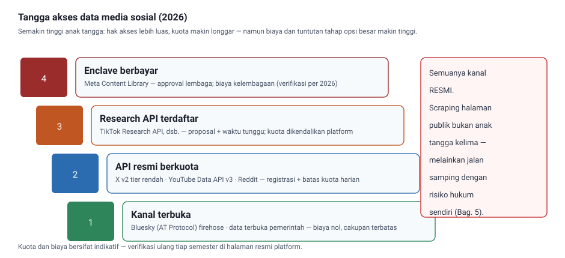
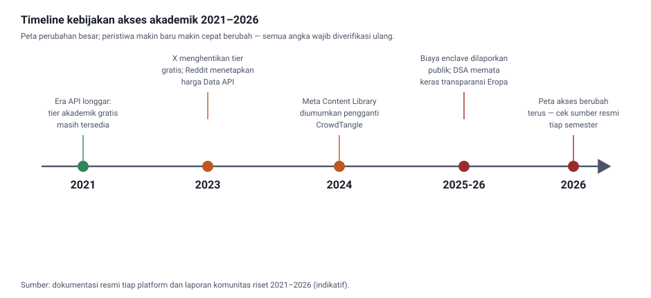
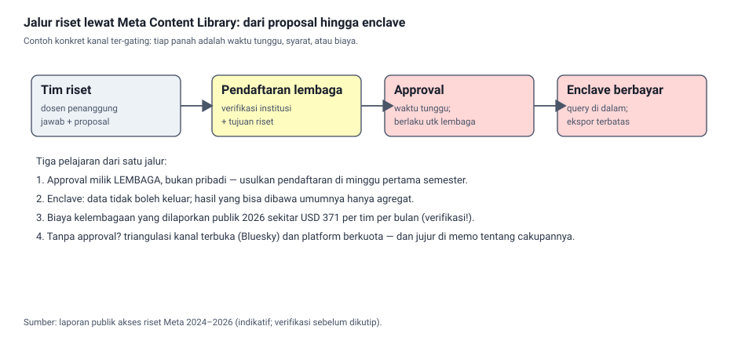
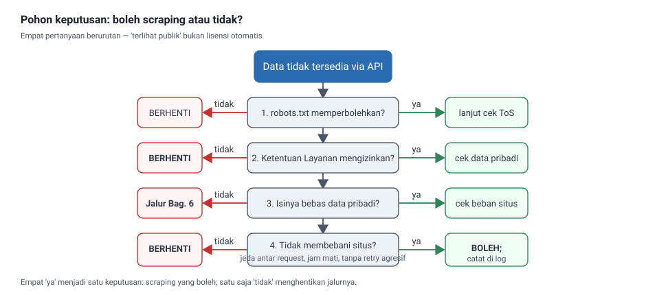
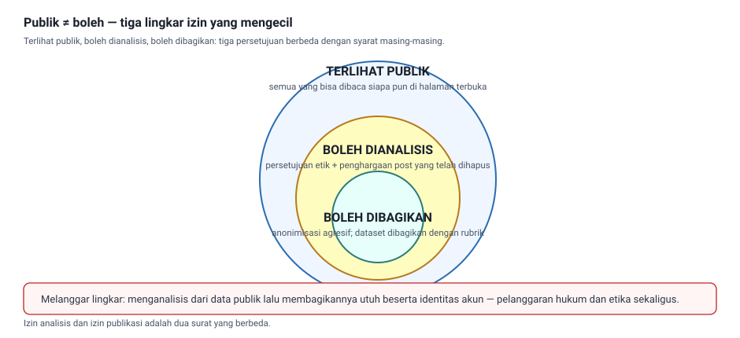

Buku Ajar Materi 5 — Akses Gated, Biaya, Scraping & Legalitas

# Buku Ajar Mata Kuliah Social Media Analytics

**Materi 5 — Akses Gated, Biaya, Scraping & Legalitas** (Pertemuan 5 · 150 menit · 3 SKS · CPMK-1)

Penutup jalur fondasi: setelah mahasiswa tahu *apa* datanya (Materi 3) dan *bagaimana cara teknis* mengambilnya (Materi 4), pertemuan ini menjawab pertanyaan yang lebih ditentukan: **apakah data itu legal dan etik untuk diambil, berapa biayanya, dan apa jalur terbaik dengan anggaran yang tersedia.**

**Tabel 0.1 — Identitas modul**

**Daftar isi:** 1 Peta pembelajaran · 2 Mengapa akses adalah urusan hukum · 3 Peta akses data 2026 · 4 Platform demi platform · 5 Scraping · 6 Aturan hukum & etika · 7 Feasibility memo · 8 Lab utama · 9 Studi kasus banjir Jakarta · 10 Sepuluh kesalahan umum · 11 Sepuluh pertanyaan pengaman · 12 Ringkasan · 13 Glosarium · 14 Referensi

## 1. Peta pembelajaran pertemuan 5

Materi 4 berakhir dengan berita yang sebenarnya sudah terasa di udara: **kolektor yang bagus tidak berarti apa-apa kalau datanya tidak boleh diambil.** Pertemuan ini menutup pertanyaan fondasi itu. Pertanyaan riset yang paling menarik pun harus ditunda — atau dialihkan ke platform lain — kalau jalur datanya tidak ada, terlalu mahal, atau bermasalah secara hukum. Keputusan semacam ini bukan urusan pengacara semata; ia adalah keputusan metodologis, dan peneliti data sosial yang baik melakukannya sejak awal, bukan setelah data setengah terkumpul.

Pertanyaan pemandu pertemuan ini sengaja dibuat konkret dan terukur:

«Saya ingin menganalisis reaksi publik atas kebijakan baru penggabungan desa. Data di mana, dari siapa, dengan alat apa, melanggar aturan siapa, dan berapa biayanya — dan jawaban yang mana yang masih masuk akal untuk anggaran nol kelompok mahasiswa?»

**Tabel 1.1 — Rute pembelajaran 8 tahap**

**Jembatan dari Materi 4:** collection log yang kini mampu mendokumentasi proses akuisisi berguna berlipat di pertemuan ini — dokumen yang sama menjadi bukti tanggung gugat bahwa pengambilan data dilakukan tertata, dalam kuota, dan dengan jalan sah.

## 2. Mengapa akses adalah urusan hukum, bukan urusan kelaziman teknis

Bayangkan tiga mahasiswa dengan pertanyaan riset yang sama-sama baik. Yang pertama ingin mengukur sentimen publik terhadap kenaikan tarif commuter di X. Yang kedua ingin melacak narasi hoaks kesehatan di grup Facebook ibu-ibu. Yang ketiga ingin memetakan jaringan dukungan kandidat di TikTok. Ketiganya obsesif soal metode analisis, tapi masing-masing menghadapi tembok yang berbeda — dan tidak ada satu pun tembok itu yang bisa diakali dengan kode yang lebih rapi.

Mahasiswa pertama akan menemukan bahwa API X yang tadinya murah untuk riset akademik kini dikenakan biaya berat; tier riset gratis yang dulu lazim telah dirampingkan sejak 2023. Mahasiswa kedua menemukan bahwa grup Meta hanya bisa ditelusuri lewat Meta Content Library, yang memerlukan persetujuan lembaga, proses seleksi, dan akses lewat *secure enclave* berbayar. Mahasiswa ketiga menemukan TikTok Research API terbuka bagi peneliti — tapi harus mengajukan proposal, menunggu seleksi, dan menerima kuota yang ketat.

Perbedaan nasib ketiganya bukan kebetulan teknis. Ini adalah perubahan zaman: data media sosial telah menjadi komoditas. Platform memahami bahwa arsip komentar penggunanya punya nilai ilmiah, komersial, dan politik — dan karena itulah aksesnya diatur, dikawal, dan dijual. Kondisi ini tidak bisa dihindari; yang bisa kita kendalikan adalah bagaimana meresponsnya secara ilmiah. Itulah fungsi feasibility memo yang akan kita rangkai di bagian 7.

> **Konsep kunci — gated access**  
> Sebuah jalur akses disebut **gated** bila buka-tutup pintunya ditentukan platform saja: siapa yang boleh lewat (akun riset atau umum), seberapa banyak boleh lewat per hari (kuota), apa yang boleh dibawa keluar (tanpa PII, agregat saja), dan berapa harga pasnya (gratis, tier, atau bayar per tim).
>

Jembatan ke bagian 3: sebelum membahas platform satu per satu, kita perlu satu gambar besar yang mengurutkan semua jalur — dari yang paling terbuka hingga yang paling terkunci.

## 3. Peta akses data 2026: tangga kebijakan dan timeline

Cara paling ringkas untuk membaca lanskap akses adalah sebuah tangga. Di anak tangga teratas, data mengalir hampir bebas dan legal. Semakin turun, syarat mulai bertambah: pendaftaran, persetujuan lembaga, kuota, bayar, hingga enclave yang antaranya menuntut tim dan dana. Mahasiswa yang tahu tangga ini tidak akan kehabisan ide ketika satu jalur tertutup — ia langsung turun satu anak tangga lalu mengecek ulang: *jalur berikutnya masih menjawab pertanyaan saya tidak*?

**Tabel 3.1 — Anak tangga akses 2026 (karakteristik & risiko)**

Tangga ini bukan foto yang diam. Perubahan kebijakan berlangsung nyaris tiap tahun, dan mahasiswa perlu membiasakan diri membaca timeline — bukan untuk hafal, tetapi untuk menemukan **polanya**: arah geraknya selalu ke arah akses yang lebih diatur dan lebih mahal.

> **Aturan praktis membaca timeline**  
> Angka harga dan syarat di bab ini adalah **kondisi per 2026** — berlaku sebagai urutan besaran, bukan angka pasti. Bagian terpenting bukan hafal angka harga enclave; melainkan kebiasaan memeriksa halaman kebijakan resmi platform *sebelum setiap penelitian dimulai*. Kebijakan akses adalah dokumen yang berubah, dan feasibility memo tanpa tanggal pengecekan adalah dokumen yang cacat.
>

Jembatan ke bagian 4: dengan kerangka tangga di kepala, kita kini menjelajah platform utama satu demi satu dan menempatkan masing-masing di anak tangga yang tepat.

## 4. Platform demi platform: jalur, kuota, biaya, batas

Tabel berikut adalah peta jalur untuk tujuh platform yang paling sering muncul dalam riset bahasa Indonesia. Yang perlu dibaca dari tabel ini bukan angka detailnya, tapi polanya: beberapa platform terbuka luas, sebagian menaruh dirinya di anak tangga ketiga, dan satu kawasan besar berdiri di belakang enclave.

**Tabel 4.1 — Jalur akses dan biaya per platform (kondisi per 2026, verifikasi ulang tiap semester)**

Dua pola yang perlu diberi perhatian khusus:

**Pertama, Meta adalah kawasan enclave.** Kalangan ibu-ibu di grup Facebook, komentar Instagram, dan thread Threads semuanya berada di belakang pintu Meta Content Library. Untuk riset yang butuh bahan dari grup tertutup — misalnya pelacakan hoaks kesehatan — jalur ini sering kali tidak bisa dihindari. Gambar berikut menunjukkan alur aksennya, termasuk proses seleksi dan penahapan yang perlu dianggarkan.

> **Contoh keputusan — kesehatan: hoaks obat herbal**  
> Penelitian narasi "obat herbal menyembuhkan diabetes" di grup Facebook ibu-ibu: tanpa MCL, tidak ada jalur sah. Dua pilihan realistis: (a) ajukan MCL dengan sponsor lembaga, siap dana enclave dan waktu menunggu; (b) turun anak tangga — pakai forum kesehatan publik (Reddit r/…, forum kesehatan berita) sebagai korpus pembanding, walau berarti mengubah pertanyaan dari "grup tertutup" ke "ruang publik". Kedua jalur sah; yang salah adalah diam-diam memakai akun pribadi untuk koleksi grup.
>

**Kedua, Bluesky adalah pengaman jalur.** Ketika semua jalur lain mempersulit, Bluesky (dan kawasan federasi terbuka secara umum) memberi kelegaan berupa firehose yang sah dan gratis. Namun komunitas berbahasa Indonesia di sana jauh lebih kecil, dan profil penggunanya tergolong lapisan pengguna yang lebih terdidik — jadi data Bluesky yang baik untuk uji konsep dan metode, belum tentu mewakili gelombang opini publik Indonesia.

Jembatan ke bagian 5: tangga kita punya anak tangga terbawah yang paling menarik sekaligus paling berisiko — memungut data dari halaman yang terbuka, tanpa sepengetahuan platform. Di sinilah banyak peneliti awal kelelahan; kita akan melintasi zona ini dengan aman.

## 5. Scraping: memungut data dari halaman publik

Scraping sering jadi pilihan pertama mahasiswa: tidak perlu approval, tidak perlu kuota, langsung (bisa dibilang) "ambil semuanya". Namun satu kalimat itu menyembunyikan emas dan perangkap dalam jumlah yang sama. Sisi emasnya: banyak data Indonesia yang hanya ada di halaman web biasa — komentar portal berita, forum obrolan kesehatan publik, arsip tanya-jawab layanan publik — dan semuanya jauh lebih terbuka daripada platform komersial. Sisi perangkapnya: banyak platform keras melarang scraping dalam Terms of Service, dan membongkar proteksinya berpotensi menyeret peneliti ke jalur yang tidak sehat.

Kaidah dasarnya dapat dipegang dengan satu gambar — pohon keputusan enam pertanyaan. Setiap cabang harus kembali jawabannya ya; satu saja jawaban tidak berarti scraping harus dihentikan atau dialihkan.

**Tabel 5.1 — Enam pemeriksaan sebelum scraping**

> **Yurisdiksi itu bukan semu — Indonesia dan dunia**  
> Legalitas scraping berbeda antar negara. Pengadilan di AS (kasus hiQ v. LinkedIn) sempat berkata data publik tidak bisa dikunci dengan kontrak; lalu keputusan itu berubah bentuk dalam peretasan hukum berikutnya. UE membatasi penghisapan lewat GDPR & hukum kontrak. Di Indonesia, dua landasan yang relevan: UU ITE dan UU PDP. Karena itu aturan aman satu-satunya: **pretapi diri dengan pertimbangan paling ketat di antara semua yurisdiksi yang relevan** — jangan cari negara mana yang paling longgar.
>

Contoh nyata yang bisa langsung dipahami: mengumpulkan komentar portal berita nasional tentang kasus korupsi 2024. Halaman terbuka, robots.txt tidak melarang, beban rendah — jalur aman sejauh anonimisasi nama dan tanpa menyimpan email pengomentar. Bandingkan dengan niat singkat "ambil profil semua follower akun politik X dengan masuk menggunakan akun pribadi" — jalur ini menabrak pertanyaan 1, 2, 3, dan 5 sekaligus, dan meski secara teknis bisa jadi berhasil, ia berada tepat di zona yang seharusnya dihindari peneliti.

Jembatan ke bagian 6: enam pertanyaan tadi duduk di atas kerangka hukum. Kini kita buka kerangkanya — dari UU PDP hingga kontrak ToS — dan melihat ancaman mana yang benar-benar terjadi.

## 6. Aturan hukum dan etika: apa yang mengikat

Banyak mahasiswa mengelompokkan semua ancaman hukum jadi satu kotak hitam yang menakutkan. Lebih berguna menyusunnya sebagai tiga lapis yang masing-masing punya pasokan kepastian yang berbeda:

**Tabel 6.1 — Tiga lapis regulasi yang mengikat peneliti SMA**

Lapis pertama sering disalahkaperti. Banyak mahasiswa beranggapan "key post langsung publik, bukan data pribadi". Pendapat ini semu: status *publik di halaman* tidak otomatis berarti *bebas dikoleksi*. UU PDP dan GDPR memakai kriteria identifikasi: bila seseorang bisa diidentifikasi — dari nama akun, foto wajah, gabungan sinyal (waktu post + gaya bahasa + lokasi halaman) — maka itu data pribadi. Gambar berikut menunjukkan satu post yang dipecah jadi dua kolom.

Lapis kedua dan ketiga sering dianggap sama "pedoman kantoran". Padahal keduanya mengikat berbeda: ToS berpelaku perjanjian antara platform dan pengguna — melanggarnya bisa berakibat batal akun riset (dan reputasi lembaga); zona abu-abu menyelipkan ancaman pidana di sebagian yurisdiksi. Untuk kelopak tercepat: bila satu pertanyaan pun ada yang memaksa *menyamar* atau *menipu platform*, tetapkan: jalur itu bukan riset; cari jalur lain.

> **Etika lapis keempat — yang tidak tertulis di kertas**  
> Regulasi menentukan *batas minimum*. Etika bertanya lebih jauh: apakah warga yang post terasa seperti disurvei tanpa perlindungan? Riset SMA yang baik: (a) memangan akun dengan nama grup di footnote lembaga, bukan menutupi identitas; (b) tidak mengundang partisipasi tersembunyi; (c) menutup PII sebelum dataset dibagikan — dari siapa pun, termasuk rekan lab.
>

Jembatan ke bagian 7: semua elemen — tangga jalur, platform, scraping, regulasi, etika — kini siap dirangkai menjadi satu dokumen keputusan: feasibility memo.

## 7. Feasibility memo: struktur dan contoh lengkap

Buku ajar ini tidak meminta mahasiswa jadi ahli hukum. Fungsinya: **menulis satu halaman yang membuat dosen (atau atasan siapa pun) bisa memahami jalur mana yang dipilih dan mengapa jalur lain ditolak.** Dokumen inilah yang di dunia kerja disebut feasibility memo, dan keterampilannya terpakai jauh melebihi kelas SMA.

**Tabel 7.1 — Struktur feasibility memo (enam blok)**

Contoh memo berikut sudah diringkas. Buat mahasiswa menilai: blok mana yang bagus, blok mana yang harus ditambah. (Memo v1 yang sebenarnya akan ditulis di lab bagian 8 dan dinilai dengan rubrik Tabel 8.1.)

> **Contoh Feasibility Memo — v1**  
> Memo: pelacakan sentimen banjir (lanjutan riset Materi 4) — 2026-01-xx
>
> 1. Pertanyaan: bagaimana sentimen publik atas banjir Jakarta 3 hari sejak awal; unit = post X/Bluesky yang sebut `#banjirjakarta` / kata "banjir".
>
> 2. Kandidat: (a) X API tier akademik; (b) Bluesky firehose; (c) jalur scraping portal berita.
>
> 3. Keputusan: X ditunda bila tier saat ini tidak terjangkau tim (lihat 4). Bluesky dipilih sebagai jalur utama uji coba; portal berita jadi korpus pembanding, anonimisasi nama akun komentator.
>
> 4. Biaya & risiko: X menuntut tier berbayar (cek halaman resmi hari memo); Bluesky kurang mewakili audiens umum; portal berita berisiko struktur HTML berubah.
>
> 5. Mitigasi & jadwal: buffer persetujuan 25%; jadwal approval bila jalur X diteruskan; fallback dataset arsip public.
>
> 6. Hukum & etik: anonym field user sebelum analisis; nama akun bilang tidak disimpen; ToS portal dibaca (bagian crawler).
>

Jembatan ke bagian 8: lab kali ini justru menguji memo, bukan kode — karena di pertemuan inilah kemampuan mengambil keputusan yang diuji.

## 8. Lab utama: menyusun feasibility memo tiga platform

**Format:** 90 menit kerja kelompok, satu topik bagi seluruh kelas (karena membandingkan memo antar kelompok jadi pelajaran yang paling membekas). Pertanyaan topik: **bagaimana narasi publik tentang penggabungan desa di Sumatera Utara** (topik kebijakan lokal; risikonya rendah; muncul di semua platform).

**Tabel 8.1 — Rubrik feasibility memo (skor 100)**

> **Panduan dosen — lakukan 2 kebiasaan**  
> (1) Cek draf memo berkala selama lab, bukan setelah nilai masuk — feedback diterima sebelum memo final, bukan setelah nilai. (2) Bawa semua keputusan rak tidak masuk akal: "ambil via akun pribadi" dihitung gagal bukan karena mahal, tapi karena melanggar ToS — di kelas ini hukum yang tidak dinegosiasikan.
>

Jembatan ke bagian 9: memo yang habis dibuat perlu diuji dengan luka uji: sebuah kasus yang lebih menahankan — banjir Jakarta yang sudah kita kolektor di Materi 4.

## 9. Studi kasus: banjir Jakarta — kelanjutan dari Materi 4

Di pertemuan 4, kolektor X, Bluesky, dan YouTube sudah hidup dan menulis collection log. Pertemuan ini menguji keputusannya di zona yang paling kritikal: pertanyaan riset bisa adil tapi jalur datanya bisa sempit, mahal, atau dilarang. Tabel berikut memperluas memo contoh di bagian 7 ke level struktural — bagian mana yang dulu cukup, bagian mana yang kini harus ditambah.

**Tabel 9.1 — Bagan studi kasus: masalah baru dan tindak balasnya**

Hasil belajar pentingnya: di kasus banjir, **anggaran nol tetap cukup** — tetapi hanya karena jalur Bluesky dan portal berita diakui sebagai pengganti yang sah untuk X; dan karena kita mengakui bahwa grup Meta mungkin tempat narasi paling kaya, namun tidak diandalkan tanpa persetujuan. Ini akhir fase fondasi: dari sini, setiap pertemuan makan data yang sudah diberi izin sah.

Jembatan ke bagian 10: studi kasus ini memuncak dua kesalahan terbaik — mari kita rangkum jadi suatu daftar yang bisa dari satu tugas.

## 10. Sepuluh kesalahan umum pertemuan 5

**Tabel 10.1 — Kesalahan umum dan mitigasinya**

Jembatan ke bagian 11: sebelum tutup, periksa pemahamanmu lewat sepuluh pertanyaan pengaman.

## 11. Sepuluh pertanyaan pengaman

**Tabel 11.1 — Self-check pertemuan 5**

Jembakan ke bagian 12: kita rangkum seluruh argumen dalam dua halaman terakhir.

## 12. Ringkasan modul

Pertemuan ini menutup fondasi. Empat temuan yang menjadi jangkar:

**Pertama**, keputusan data dimulai dari pertanyaan riset, bukan dari platform favorit. Tangga akses (bagian 3) memberi lima anak tangga; platform yang satu bisa dibandungkan dengan yang lain tapi tidak bisa didandani.

**Kedua**, scraping berada di zona abu-abu yang sah bila rugi enam pemeriksaan terjawab: halaman publik, robots.txt baik, ToS tidak melarang, beban kecil, data pribadi terkontrol, reproduksi terchartul.

**Ketiga**, identifikasi data pribadi tidak melihat apakah post terbuka atau bukan — yang jadi tolok ukur adalah kemungkinan seseorang diidentifikasi. UU PDP dan GDPR memeluk kriteria yang sama.

**Keempat**, feasibility memo adalah alat keputusan yang bisa perlu jauh melampaui kelas. Enam blok: pertanyaan, kandidat jalur (≥ 3), keputusan & alasan, biaya & risiko, mitigasi & jadwal, rujukan hukum-etik.

Selain hukum dan etika, satu kebiasaan kecil yang akan mengikuti mahasiswa jauh melebihi mata kuliah ini: **tulis tanggal pengecekan, dan jangan percaya harga dari halaman blog siapa pun** — karena kebijakan akses media sosial baik berubah tiap semester.

## 13. Glosarium

**Tabel 13.1 — Glosarium materi 5**

## 14. Referensi

1. Undang-Undang RI No. 27 Tahun 2022 tentang Perlindungan Data Pribadi (UU PDP).
2. Regulation (EU) 2016/679 — GDPR; situs resmi European Commission untuk panduan riset akademik.
3. Dokumen resmi Terms of Service & robots.txt untuk platform yang dipelajari: X, Meta Content Library, TikTok Research API, Reddit, YouTube, Bluesky/AT Protocol (masing-masing dicek tanggal pengusahaan memo).
4. Hasil riset modul kelas 2024–2026: `results/scraping-legalitas.json`, `results/etika-legal.json`, `results/data-access-governance.json` (arsip kurikulum Social Media Analytics).
5. Bruns, A. (2019). *Are Filter Bubbles Real?* Wiley (mengingatkan bahwa jalur & feed membentuk sampling frame, bukan populasi).
6. Pedoman penelitian akademik IRB singkat: kewajiban minimalisasi data & persetujuan lembaga bagi riset mahasiswa yang menyentuh data pribadi.
