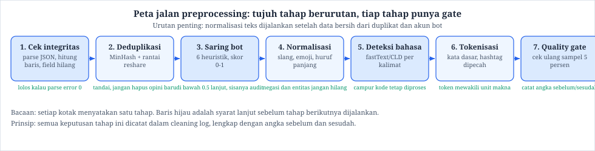
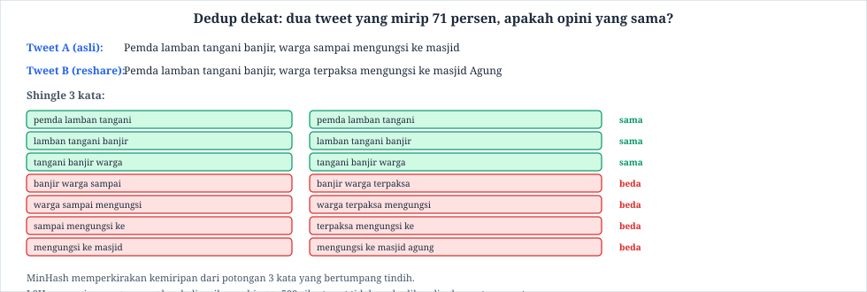
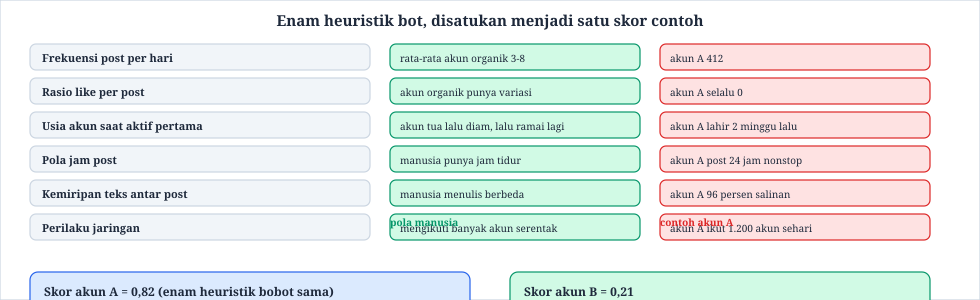
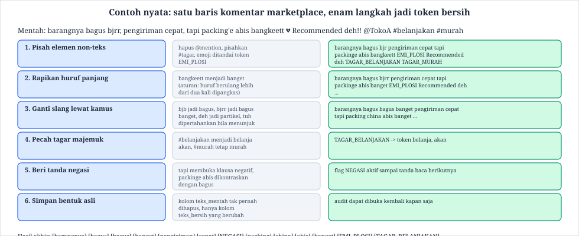
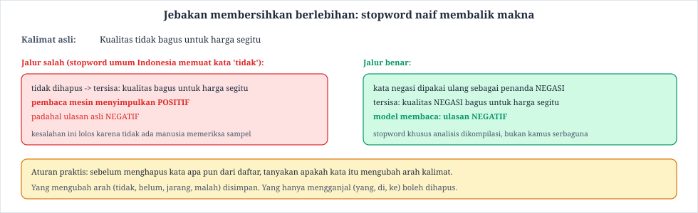
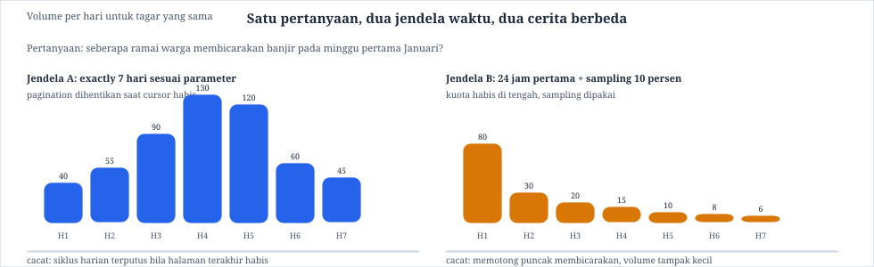
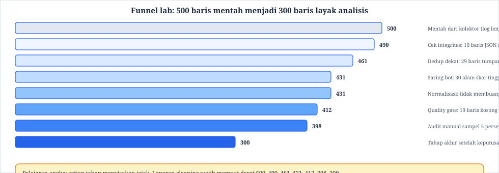

Buku Ajar Materi 6: Preprocessing dan Kualitas Data

# Buku Ajar Mata Kuliah Social Media Analytics

**Materi 6: Preprocessing dan Kualitas Data** (Pertemuan 6 · 150 menit · 3 SKS · CPMK-2)

Materi 4 dan 5 menjawab soal akses: apa yang boleh diambil dan dengan jalur apa. Pertemuan ini berganti pertanyaan. Setelah data ada di laptop, tugas mahasiswa adalah mengubah tumpukan mentah menjadi kumpulan baris yang layak dihitung. Kegiatan itu disebut preprocessing. Hasilnya menentukan kebenaran analisis pertemuan 8 sampai 11, sebab model terbaik pun akan tergagal kalau makan data yang masih penuh kembar, bot, dan slang yang tak tertangani.

**Tabel 0.1: Identitas modul**

**Daftar isi:** 1 Peta pembelajaran · 2 Tiga kisah nyata kenapa data mentah menipu · 3 Peta jalan preprocessing · 4 Deduplikasi dan rantai reshare · 5 Bot dan akun bermutu rendah · 6 Normalisasi teks campur kode · 7 Bahasa dan campuran kode · 8 Jebakan membersihkan berlebihan · 9 Bias sampling dari parameter API · 10 Lab membersihkan 500 baris · 11 Studi kasus banjir Jakarta · 12 Sepuluh kesalahan umum · 13 Sepuluh pertanyaan pengaman · 14 Ringkasan, glosarium, referensi

## 1. Peta pembelajaran pertemuan 6

Mahasiswa yang selesai pertemuan ini tidak lagi melihat cleaning sebagai tugas mengganjal yang harus diburu cepat. Ia melihatnya sebagai tahap ilmiah dengan keputusan yang bisa dipertanggungjawabkan. Seluruh langkah pada pertemuan ini mengikuti satu prinsip: tiap keputusan pembersihan dicatat beserta alasannya, sehingga orang lain bisa mengulang pekerjaan yang sama.

Pertanyaan pemandu pertemuan ini:

«Saya punya 500 baris data mentah. Bagaimana saya mengubahnya menjadi 300 baris yang bisa dihitung, tanpa diam-diam membuang pendapat orang yang tidak sependapat dengan asumsi saya?»

**Tabel 1.1: Rute pembelajaran 8 tahap**

**Jembatan dari Materi 5:** feasibility memo yang menyebut satu jalur data dan anggaran riset kini dipakai kembali sebagai lampiran collection log. Laporan cleaning yang ditulis dengan prinsip yang sama menjadi dokumen kedua yang wajib menyertai setiap dataset di mata kuliah ini.

## 2. Tiga kisah nyata kenapa data mentah menipu

Kisah pertama berasal dari riset analisis sentimen pemilu. Seorang analis mengumpulkan tweet bertagar suatu isu politik dan melaporkan bahwa opini publik sangat negatif. Setelah diperiksa, separuh tweet berasal dari rantai retweet berantai: satu akun asal, lalu ribuan akun menyalin kalimat yang sama persis. Hitungan sentimen tetap berjalan, tetapi yang dihitung bukan ribuan opini. Yang dihitung adalah satu opini yang disalin. Kasus ini adalah pelajaran bahwa volume bukan bukti keanekaragaman.

Kisah kedua terjadi pada studi kampanye media sosial 2019. Peneliti menemukan lonjakan jumlah post sekitar jam tertentu pada hari-hari tertentu, dengan pola yang sangat rapi: usia akun pendek, rasio like nol, teks nyaris identik. Lonjakan itu sebagian besar berasal dari akun terkoordinasi. Bila angka mentah dipakai sebagai ukuran dukungan publik, kesimpulannya akan keliru. Heuristik bot pada bagian 5 muncul sebagai respons terhadap kasus semacam ini.

Kisah ketiga tidak melibatkan hoaks atau politik sama sekali. Seorang mahasiswa menganalisis ulasan produk di marketplace. Ia memakai kamus sentimen bahasa Indonesia baku. Hasil evaluasinya buruk, dan penyebabnya terbaca saat sampel dibaca manusia: ulasan asli berisi kata bjb (bagus), bangetttt, gws (gak gw cars?), dan nada ironi seperti mantep banget nih lagian. Kamus baku tidak mengenali bentuk-bentuk itu, sehingga ulasan positif terbaca netral. Normalisasi pada bagian 6 menangani masalah ini.

> **Catatan**  
> Etos pekerjaan
>
> Membersihkan data bertujuan menjadikan pengukuran lebih jujur, bukan menjadikan hasil sesuai harapan. Setiap keputusan menghapus atau mengubah baris wajib punya alasan yang ditulis, bukan alasan yang terasa benar.
>

## 3. Peta jalan preprocessing

Pipeline pada Gambar 3.1 menyusun tujuh tahap dalam urutan yang disarankan. Urutan itu penting. Membersihkan bentuk teks sebelum duplikat dan bot tersaring akan menyulitkan perhitungan kemiripan, sebab variasi ejaan justru menyamarkan salinan. Sebaliknya, memfilter bot setelah normalisasi masih mungkin, namun kerja komputasi jadi lebih besar.

Di bawah tiap kotak pada Gambar 3.1 terdapat syarat kelanjutan. Syarat itu disebut gate. Gate berfungsi seperti pos pemeriksaan: bila angka pada tahap tersebut melampaui batas yang ditentukan, proses berhenti sampai penyebabnya dilaporkan. Contohnya, bila parse error muncul pada lebih dari 1 persen baris, tahap 1 harus dilaporkan ke collection log sebelum apa pun dihapus.

**Tabel 3.1: Urutan tahap dan alasan urutannya**

Setiap tahap menghasilkan dua berkas: dataset baru dan catatan tahap. Catatan tahap memuat jumlah baris masuk, jumlah baris keluar, selisih, dan alasan selisih. Berkas itulah yang disebut cleaning log, dan ia menjadi lampiran wajib tugas akhir.

## 4. Deduplikasi dan rantai reshare

Duplikat dalam data media sosial jarang berupa salinan persis. Yang sering muncul adalah duplikat dekat: teks sama, beda beberapa kata, atau beda satu tanda baca. Cara tradisional membandingkan seluruh pasangan baris tidak layak untuk dataset berskala besar, sebab 500 ribu baris berarti sekitar 125 miliar pasangan. MinHash menyelesaikan masalah ini dengan memperkirakan kemiripan dari potongan kecil teks yang disebut shingle.

Cara kerjanya bisa dijelaskan dalam tiga langkah. Langkah pertama, teks dipotong menjadi kumpulan shingle tiga kata yang bertumpang tindih. Langkah kedua, tiap shingle diubah menjadi sidik jari angka (hash). Langkah ketiga, kemiripan diperkirakan dari proporsi sidik jari yang sama antara dua teks, bukan dari seluruh hurufnya. LSH mempercepat pencarian dengan hanya memeriksa pasangan yang punya sidik jari yang sama di satu atau lebih ember.

Gambar 4.1 menunjukkan contoh dua tweet tentang banjir. Tweet asli berbunyi: «Pemda lamban tangani banjir, warga sampai mengungsi ke masjid». Tweet kedua berbunyi: «Pemda lamban tangani banjir, warga terpaksa mengungsi ke masjid Agung». Dari tujuh potongan tiga kata, lima potongan sama dan dua beda, sehingga skornya 5 dibagi 7, yaitu sekitar 0,71. Bila ambang kelas ditetapkan 0,60, kedua tweet ditandai sebagai duplikat dekat.

Yang perlu hati-hati adalah reshare yang membawa opini baru. Bila tweet kedua menambahkan klaim yang tidak ada di tweet asli, misalnya nama masjid, video, atau angka korban, ia bukan sekadar salinan. Penanganan yang benar adalah menandai pasangan itu sebagai berkaitan, bukan membuang salah satunya. Tabel 4.1 meringkas tiga situasi yang sering ditemui.

**Tabel 4.1: Tiga jenis kembar dan penanganannya**

> **Catatan**  
> Cacat yang sering terjadi
>
> Metode menghapus seluruh baris dengan skor di atas ambang, tanpa membaca apa pun, sering membuang pendapat yang justru berbeda. Skor kemiripan adalah alat bantu keputusan, bukan keputusan itu sendiri.
>

## 5. Bot dan akun bermutu rendah

Bot tidak selalu jahat. Sebagian menyebarkan informasi cuaca dan lalu lintas yang berguna. Dalam analisis opini publik, keberadaannya mengganggu karena mendistorsi hitungan. Karena itu pembuatan saringan bot pada mata kuliah ini menggunakan enam heuristik yang mudah diperiksa, bukan model rahasia.

Keenam heuristik pada Gambar 5.1 diberi bobot sama pada contoh kelas. Skor tiap heuristik berbentuk angka 0 sampai 1, lalu dirata-ratakan. Akun A pada contoh itu mendapat skor 0,82 dan disaring dari analisis sentimen. Akun B mendapat 0,21 dan tetap dipakai. Ambang 0,50 ditetapkan sebagai contoh supaya mudah diingat, bukan karena angka itu baku industri.

**Tabel 5.1: Arti ambang dan akibat kerjanya**

Batas kejujuran metode ini perlu dinyatakan terbuka: heuristik salah positif. Akun pialang berita, akun komunitas, dan akun penggemar yang memposting sangat rajin bisa salah ditandai sebagai bot. Karena itu aturan kelas ini mewajibkan audit manual terhadap 5 persen sampel yang disaring. Hasil audit ditulis dalam laporan, termasuk contoh yang ternyata manusia. Kalibrasi ulang dilakukan tiap semester, sebab perilaku bot ikut berubah.

## 6. Normalisasi teks campur kode

Bagian ini menggunakan satu contoh nyata secara menyeluruh. Baris mentah yang dipakai adalah ulasan marketplace berikut:

barangnya bagus bjrr, pengiriman cepat, tapi packing'e abis bangkeett 💔 Recommended deh!! @TokoA #belanjakan #murah

Gambar 6.1 menampilkan enam langkah pengolahannya, lengkap dengan bentuk antara yang bisa diperiksa mahasiswa. Setiap langkah berikutnya berbasis hasil langkah sebelumnya, sehingga bila ada yang keliru, sumbernya bisa ditemukan.

Langkah 1 memisahkan elemen di luar kata. Mention `@TokoA` dipisah ke kolom metadata, tagar `#belanjakan` dan `#murah` disimpan terpisah sebagai fitur topik, dan emoji diubah menjadi token `EMI_PLOSI` atau `EMI_SENANG`. Emoji tidak dibuang, karena dalam ulasan Indonesia emoji sering menjadi penanda nada. Hati yang pecah pada contoh di atas menandakan kekecewaan meski sebagian kata terlihat positif.

Langkah 2 menangani huruf panjang. Aturan kelas ini sederhana: huruf berulang lebih dari dua kali dipangkas, jadi bangkeett menjadi banget. Aturan serupa dipakai untuk kata seperti baguusss dan mantappp. Aturan ini disimpan dalam kamus perbaikan, bukan hardcode, supaya bisa diperiksa.

Langkah 3 mengganti slang dengan kamus. Kata bjrr diganti menjadi bagus banget, bjb menjadi bagus, dan gws dipertahankan seperti pada pemakaiannya pada bagian permintaan maaf. Kamus slang disusun mahasiswa sendiri, dimulai dari 60 entri yang paling sering muncul di data mereka sendiri. Kamus publik dipakai sebagai pelengkap, bukan sebagai pengganti.

Langkah 4 memecah tagar majemuk. `#belanjakan` menjadi dua token, yaitu belanja dan akan. Pemecahan dipakai karena analisis topik pertemuan 11 memperlakukan tagar sebagai satu istilah akan kehilangan muatan tema. Tabel 6.1 memuat aturan setiap langkah dalam bentuk ringkas.

**Tabel 6.1: Aturan tiap langkah normalisasi dan alasan keilmuannya**

Langkah 5 memberi tanda negasi. Kata pembalik arak seperti tidak, belum, malah, dan keterangan kontras seperti tapi dan namun membuka wilayah negasi sampai tanda baca berikutnya. Pada contoh ulasan tadi, frasa packing'e abis berada dalam wilayah negasi karena mendahului penutup, dan penanda ini akan dipakai model pada pertemuan 9.

Langkah 6 adalah aturan yang paling sering dilanggar mahasiswa. Kolom teks mentah tidak boleh dihapus. Semua perubahan ditulis ke kolom baru. Dengan aturan ini, setiap kesalahan kamus masih bisa ditelusuri dan dibetulkan tanpa mengunduh ulang data.

> **Catatan**  
> Praktik baik
>
> Satu berkas kode normalisasi dipakai untuk seluruh tahap analisis. Mengubah kamus di tengah jalan berarti tabel di pertemuan 8 sampai 11 tidak lagi setara, dan itu harus dihindari.
>

## 7. Bahasa dan campuran kode

Ulasan dan komentar Indonesia hampir selalu bercampur. Baris pertama berbahasa Jawa, baris kedua bahasa Indonesia, satu kata bahasa Inggris menyelip di antaranya. Cara penanganan yang disarankan di kelas ini: deteksi bahasa per kalimat, bukan per dokumen, dan campuran kode diperlakukan sebagai fenomena yang diproses, bukan sebagai kesalahan yang dibuang.

Deteksi awal memakai fastText language identification atau compact language detector. Keduanya bekerja dengan cepat untuk teks pendek. Bila baris bertanda tiga bahasa atau lebih, baris itu diberi label campur dan tetap diproses. Tabel 7.1 memuat tiga jalan keluaran.

**Tabel 7.1: Tiga jalan penanganan berdasarkan hasil deteksi**

Satu peringatan penting. Deteksi bahasa pada teks sangat pendek sering keliru, misalnya kata ok dinetralkan menjadi bahasa Inggris. Karena itu baris yang terdiri dari satu atau dua kata tidak dipaksa diberi label. Baris semacam itu cukup diberi penanda tak-pasti dan diperlakukan sebagai data valid sepanjang isinya bukan sampah.

## 8. Jebakan membersihkan berlebihan

Membersihkan berlebihan terjadi ketika alat pembersih menghapus bagian yang sebenarnya membawa makna. Kasus paling umum adalah stopword yang memuat kata negasi. Kalimat «Kualitas tidak bagus untuk harga segitu» menjadi «kualitas bagus untuk harga segitu» setelah kata tidak dibuang. Baca mesin menyimpulkan ulasan positif, padahal aslinya negatif. Gambar 8.1 memperlihatkan dua jalan: jalur salah dan jalur benar.

Aturan praktis yang mudah diingat: sebelum menghapus sebuah kata, tanyakan apakah kata itu mengubah arah kalimat. Yang mengubah arah disimpan dan ditandai. Yang hanya mengganjal boleh dihapus. Kata yang mengubah arak mencakup tidak, belum, jarang, malah, bukan, dan tanpa. Daftar itu harus dicek setiap kali kamus stopword diperbarui.

Contoh kedua dari kelas ini adalah stemming berlebihan pada entitas nama. Kata Jakarta dijadikan jakarta meski yang dimaksud kota, bukan kata dasar lain. Pada analisis yang menagih lokasi, aturan kelas ini meminta entitas nama dilindungi dengan kamus tersendiri sebelum stemming dijalankan.

## 9. Bias sampling dari parameter API

Parameter kolektor yang tampak netral sebenarnya menyaring populasi. Pemilihan jendela waktu, batas halaman, dan operator tanggal menentukan bagian mana yang terlihat. Gambar 9.1 membandingkan dua jendela waktu untuk pertanyaan yang sama tentang tagar banjir pada minggu pertama Januari.

Jendela A mengambil tepat tujuh hari sesuai parameter, sedangkan pagination berhenti ketika cursor habis. Jendela B hanya mengambil 24 jam pertama lalu memakai sampling 10 persen karena kuota menipis. Hasilnya berbeda. Jendela B memotong puncak pembicaraan sehingga volume per hari tampak kecil. Tidak ada yang salah dari angka keduanya, yang salah adalah menyajikan angka B sebagai gambaran tujuh hari penuh.

**Tabel 9.1: Parameter kolektor dan bias yang ditimbulkan**

Cara menutup bias ini bukan mengumpulkan semuanya, sebab itu mustahil. Cara yang jujur adalah menyebut batas pada laporan. Kalimat seperti «hasil berlaku untuk tujuh hari pertama Januari, dengan bahasa Indonesia dominan, dan tidak mewakili periode berikutnya» sudah cukup untuk menjaga klaim tetap dalam bukti.

## 10. Lab: membersihkan 500 baris

Lab pertemuan ini memakai data hasil kolektor pertemuan 4: 500 baris komentar dan post bertagat banjir, lengkap dengan collection log. Tujuannya bukan mencapai jumlah tertentu, melainkan menghasilkan deret angka yang bisa dijelaskan.

Langkah kerja disusun sebagai berikut.

**Langkah 1. Cek integritas.** Muat berkas, hitung baris rusak. Pada dataset kelas ini, 10 baris JSON rusak dibuang dan alasannya ditulis.

**Langkah 2. Dedup dekat.** Hitung MinHash dengan ambang 0,60. Sebanyak 29 baris bertanda duplikat. Setengahnya diperiksa cepat: 18 memang salinan, 11 membawa klaim baru sehingga disimpan dengan penanda berkaitan.

**Langkah 3. Saring bot.** Hitung skor enam heuristik. Tiga puluh akun berada di atas 0,50, lalu 5 persen sampel disaring diaudit. Dua dari lima ternyata manusia aktif, sehingga skornanya diturunkan manual dengan alasan tertulis.

**Langkah 4. Normalisasi.** Jalankan satu berkas kode normalisasi. Tahap ini tidak membuang baris. Ia hanya menambahkan kolom teks bersih dan penanda negasi.

**Langkah 5. Quality gate.** Baris kosong atau berisi kurang dari tiga token disingkirkan. Sasaran minimum 300 baris di luar audit.

**Langkah 6. Audit dan keputusan akhir.** Sampel acak 5 persen dibaca manusia. Empat belas baris ditandai ragu, lalu diputuskan satu per satu. Hasil akhir 300 baris layak analisis.

**Tabel 10.1: Rubrik laporan cleaning (skor 100)**

> **Catatan**  
> Catatan penilaian
>
> Kelompok yang funnel angkanya berbeda dari contoh tidak otomatis salah. Yang dinilai adalah kesesuaian angka dengan alasan. Bukti duplikat harus tampil, bukan diklaim.
>

## 11. Studi kasus banjir Jakarta, dilanjutkan

Studi kasus modul ini melanjutkan arsip banjir yang dikumpulkan pada Materi 4 dan diuji aksesnya pada Materi 5. Langkah penerapannya mengikuti pipeline Gambar 3.1 dengan tambahan yang khusus untuk data Twitter seperti rantai retweet dan tanda verifikasi akun.

**Langkah 1. Muat dan cek.** Berkas JSON dari kolektor X dan Bluesky dijumlah. Kontrol checksum memastikan berkas sama dengan yang dicatat di collection log. Kesalahan parse 0,4 persen, di bawah batas 1 persen.

**Langkah 2. Dedup dengan rantai.** Retweet polos dihitung sekali, tetapi jejak jumlah reshare disimpan di kolom tersendiri. Dedup dekat memakai ambang 0,60. Hasil: 431 post asli dan 26 rantai.

**Langkah 3. Bot.** Enam heuristik dihitung. Akun dengan skor di atas 0,50 disaring, lalu diaudit. Satu akun layanan publik yang sangat rapi ternyata manusia, dan disimpan kembali.

**Langkah 4. Normalisasi.** Komentar diproses dengan kamus slang yang berisi bjr, gws, bgt, dan variasi huruf panjang. Tagar banjirjakarta dipecah menjadi banjir dan jakarta untuk analisis topik, tetapi kolom aslinya dipertahankan.

**Langkah 5. Bahasa.** Sebanyak 9 persen baris terdeteksi campur kode Jawa-Indonesia. Semuanya diproses per kalimat, tidak dibuang.

**Langkah 6. Quality gate.** Baris kosong dan baris di bawah tiga token disingkirkan. Sisa 412 baris.

**Langkah 7. Audit.** Sampel 5 persen dibaca. Empat belas baris ditandai ragu, dibahas berkelompok, lalu diputuskan.

**Langkah 8. Laporan.** Laporan cleaning ditulis memuat funnel, kamus, hasil audit, dan batasan cakupan. Laporan ini menjadi lampiran wajib capstone.

**Tabel 11.1: Deret angka studi kasus beserta catatannya**

## 12. Sepuluh kesalahan umum

**Tabel 12.1: Kesalahan umum dan mitigasinya**

## 13. Sepuluh pertanyaan pengaman

**Tabel 13.1: Self-check**

## 14. Ringkasan, glosarium, dan referensi

Ringkasnya, pertemuan ini mengajarkan satu kebiasaan: mengubah data mentah menjadi baris layak hitung sambil terus mencatat alasan. Tujuh tahap pipeline memberi urutan yang mencegah pekerjaan sia-sia. Dedup dekat memisahkan salinan dari pendapat baru. Saringan bot mengangkat sampel dari bunyi paling keras, dengan pengakuan jujur bahwa heuristik bisa salah. Normalisasi menyeragamkan bentuk tanpa menghapus emoji, tagar, dan negasi. Quality gate dan audit manual menjaga keputusan akhir tidak bergantung pada asumsi diam-diam.

**Tabel 14.1: Glosarium materi 6**

### Referensi

1. Broder, A. Z. (1997). On the resemblance and containment of documents. *Proceedings of the Compression and Complexity of Sequences*, 21-29. Dasar teori MinHash.
2. Leskovec, J., Rajaraman, A., dan Ullman, J. D. (2020). *Mining of Massive Data Sets*, edisi ketiga, Cambridge University Press. Bab locality-sensitive hashing dan near-duplicate detection.
3. Joulin, A. dkk. (2016). Bag of tricks for efficient text classification. *arXiv:1607.01759*. Dipakai sebagai rujukan identifikasi bahasa cepat.
4. Davis, C. A. dkk. (2016). BotOrnot, sistem penilaian probabilitas akun bot di Twitter. *First Monday*, 21(7).
5. Su, M. dkk. (2019/2020). Studi perilaku kubu bot pada tagar politik Indonesia, tersedia pada literatur computational social science kawasan ini. Dipakai sebagai latar kisah bagian 2.
6. Kementerian Komunikasi dan Informatika RI, pedoman literasi digital dan penanganan informasi bohong. Dipakai sebagai konteks etis bagian 2.
7. Hasil riset kurikulum materi 6: `results/preprocessing.json` (arsip modul Social Media Analytics 2024-2026).
