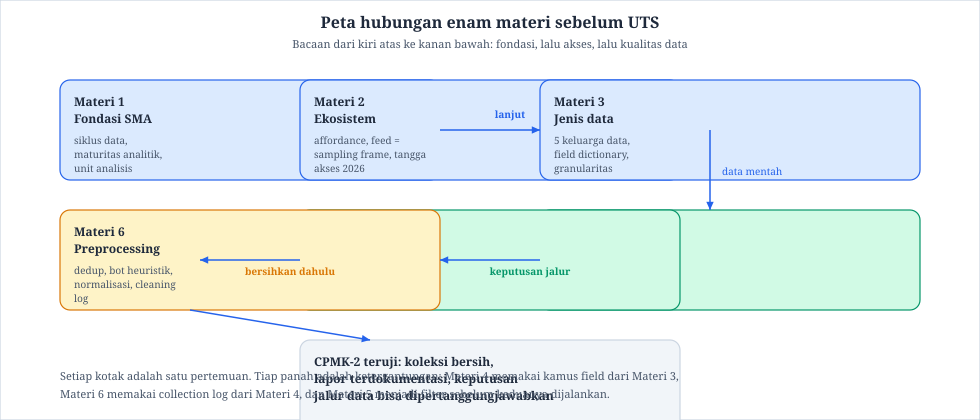
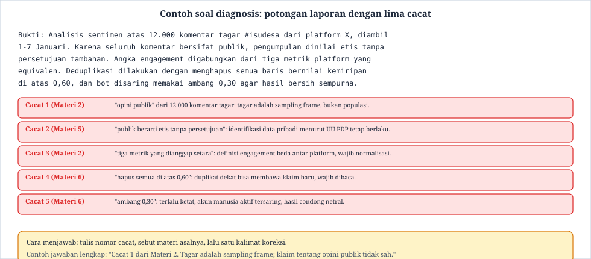

Buku Ajar Materi 7: Rangkuman Materi 1-6 dan Kisi-Kisi UTS

# Buku Ajar Mata Kuliah Social Media Analytics

**Materi 7: Rangkuman Materi 1-6 dan Kisi-Kisi UTS** (Pertemuan 7 · 150 menit · 3 SKS · persiapan UTS)

Pertemuan ini tidak memuat materi baru. Fungsinya satu: mengubah enam pertemuan pertama menjadi rangkuman yang bisa dipelajari, lengkap dengan kisi-kisi ujian tengah semester. Mahasiswa yang membaca modul ini sampai selesai, lalu mengerjakan bagian latihan pada tiap bagian, seharusnya memasuki UTS tanpa harus membaca ulang seluruh modul dari halaman pertama.

**Tabel 0.1: Identitas modul**

**Daftar isi:** 1 Peta pembelajaran · 2 Peta hubungan enam materi · 3 Rangkuman Materi 1 · 4 Rangkuman Materi 2 · 5 Rangkuman Materi 3 · 6 Rangkuman Materi 4 · 7 Rangkuman Materi 5 · 8 Rangkuman Materi 6 · 9 Konsep lintas materi yang wajib dikuasai · 10 Kisi-kisi UTS · 11 Contoh soal terpandu · 12 Rencana belajar 7 hari · 13 Kesalahan saat mempersiapkan UTS · 14 Ringkasan dan glosarium cepat

## 1. Peta pembelajaran pertemuan 7

Pertemuan ini dibagi menjadi tiga kegiatan. Bagian awal diisi kuliah ringkas 30 menit yang menjelaskan cara membaca kisi-kisi. Bagian tengah berupa latihan mandiri 70 menit, di mana mahasiswa mengerjakan contoh soal pada bagian 11 dan memeriksa jawabannya. Bagian akhir 50 menit untuk tanya jawab dan penyusunan rencana belajar pribadi.

Tujuan yang harus tercapai pada pertemuan ini: mahasiswa mampu menyebutkan tanpa melihat catatan, enam ide pokok, lima istilah teknis, dan tiga prosedur dari Materi 1 sampai 6. Kemampuan itu diukur lewat latihan pada bagian 11, bukan dengan diakui sendiri.

**Tabel 1.1: Rute kegiatan pertemuan 7**

**Jembatan dari Materi 6:** cleaning log yang Anda susun kemarin adalah contoh nyata apa yang dimaksud dengan dokumentasi keputusan. Kisi-kisi UTS banyak mengukur hal yang sama, hanya pada konteks yang lebih pendek.

## 2. Peta hubungan enam materi

Sebelum masuk ke rangkuman per materi, perhatikan satu gambar besar. Ujian tengah semester di mata kuliah ini bukan menguji enam bagian yang terpisah. Ia menguji sebuah rangkaian: fondasi menentukan cara pandang, akses menentukan bahan, dan pembersihan menentukan kualitas. Gambar 2.1 menampilkan hubungan itu.

Gambar 2.1 dibaca dari kiri atas. Materi 1 memberi definisi siklus data dan unit analisis. Materi 2 menempatkan platform pada tangga akses dan mengingatkan bahwa feed adalah sampling frame. Materi 3 memberi kamus field yang dipakai Materi 4 untuk merancang kolektor. Materi 5 menjadi penyaring etis dan biaya sebelum Materi 4 dijalankan pada data nyata. Materi 6 menerima keluaran Materi 4 dan menjadikannya baris layak hitung. Panah pada gambar adalah ketergantungan; bila satu panah putus, rangkaiannya gagal.

> **Catatan**  
> Cara memakai peta ini
>
> Saat menjawab soal diagnosis, tanyakan dulu cacat itu tergantung pada panah mana. Cacat definisi metrik bergantung pada Materi 2 dan 3. Cacat log rusak bergantung pada Materi 4. Cacat pembalikan makna bergantung pada Materi 6. Menyebut materi asal sudah memberi separuh kredit jawaban.
>

## 3. Rangkuman Materi 1: Fondasi dan ruang lingkup

Materi 1 menetapkan bahasa yang dipakai sampai akhir kuliah. Social media analytics adalah proses mengubah aktivitas di platform menjadi himpunan data, lalu menjadi keputusan yang bisa dipertanggungjawabkan. Siklusnya empat langkah: pertanyaan riset, akuisisi, analisis, dan interpretasi.

Tiga ide yang paling sering keliru di sini. Pertama, metrik platform adalah kuantitas, bukan kesimpulan. Angka 3 juta view bisa berarti kualitas konten bagus, bisa juga hasil pembelian iklan. Kedua, maturitas analitik punya empat tingkat: deskriptif, diagnostik, prediktif, dan preskriptif. Banyak tugas akhir berhenti di tingkat deskriptis padahal diminta prediktif. Ketiga, unit analisis harus dipilih sebelum data dikumpulkan. Unit post berbeda dengan unit akun, dan keduanya tidak bisa dipertukarkan di tengah analisis.

**Tabel 3.1: Konsep Materi 1 untuk UTS**

Latihan cepat: tuliskan satu kalimat yang membedakan "3 juta tayangan pada tagar X selama 7 hari" dari "isu X disukai publik". Kalau kalimat Anda menyebut batas waktu dan tagar sebagai ruang lingkup, Anda sudah siap untuk soal bentuk ini.

## 4. Rangkuman Materi 2: Ekosistem dan affordance

Materi 2 menjadikan platform sebagai objek studi, bukan latar. Affordance berarti aksesibilitas yang disediakan platform: field apa yang tersedia, seberapa jauh jejah wahana ke belakang, dan siapa yang dipaksa melihat apa.

Dua gagasan wajib. Gagasan pertama: feed rekomendasi bukan populasi. Post yang Anda kumpulkan lewat tagar atau feed adalah sampel dari mekanisme distribusi, sehingga klaim tentang "seluruh publik" tidak sah. Gagasan kedua: engagement punya definisi berbeda di tiap platform. Satu like di TikTok tidak sama dengan satu like pada X, dan tontonan yang dihitung otomatis berbeda dari tontonan yang dipilih penonton. Tabel tangga akses lima anak tangga, dari firehose terbuka sampai enclave berbayar, sering keluar sebagai soal pencocokan.

**Tabel 4.1: Tujuh platform dan jalur risetnya**

Contoh soal yang mungkin muncul: mahasiswa diberi kalimat "opini publik sangat negatif, dari 12.000 komentar bertagar isu X". Koreksi yang diharapkan: tagar adalah sampling frame, 12.000 komentar tidak mewakili publik, dan periodenya disebut.

## 5. Rangkuman Materi 3: Jenis data dan kamus field

Materi 3 membagi data media sosial menjadi lima keluarga: teks, media, interaksi, metadata, dan log. Tiap keluarga punya metode utama. Teks dinilai dengan NLP, media dengan penglihatan komputer atau transkripsi audio, interaksi dengan analisis jaringan, metadata dan log dengan analisis deret waktu.

Gagasan penting kedua adalah struktur data. Platform mengirim JSON dengan field bertingkat. Sebuah post bukan baris datar: ia memuat teks, metrik, media, dan penunjuk balasan. Field dictionary adalah dokumen yang menamai tiap field, memberi tipe, arti, dan granularitas. Granularitas menentukan satu baris mewakili apa: satu post, satu balasan, atau satu kejadian.

Missingness pada data media sosial punya tiga wajah. Penghapusan oleh pengguna membuat teks hilang, penutupan privasi membuat field kosong, dan batas jendela waktu membuat bagian periode tidak pernah terambil. Ujian menguji apakah Anda bisa membedakan ketiganya, karena mitigasinya berbeda.

**Tabel 5.1: Konsep Materi 3 untuk UTS**

## 6. Rangkuman Materi 4: Akuisisi lewat API resmi

Materi 4 adalah materi paling teknis sebelum UTS. Ringkasan yang perlu dikuasai ada empat. Pertama, autentikasi punya tiga pola umum: API key, OAuth, dan kredensial aplikasi. Kedua, pagination dikerjakan dua cara, yaitu cursor untuk melanjutkan dari token terakhir, dan potongan waktu untuk menelusuri periode. Ketiga, rate limit dihormati dengan backoff, yaitu menunggu lebih lama setiap kali permintaan ditolak, bukan mengulang lebih cepat.

Keempat, dan paling sering keluar di ujian: silent truncation. Pagination bisa berhenti lebih awal tanpa peringatan, misalnya saat kuota habis atau filter tidak cocok. Kolektor yang tangguh menghitung berapa baris per halaman, membandingkannya dengan ekspektasi, dan menulis selisih itu ke collection log. Checksum berbentuk hash, SHA-256 dipakai di kelas ini, dipakai untuk memastikan berkas yang dipakai analisis identik dengan berkas yang dikumpulkan.

**Tabel 6.1: Istilah Materi 4 untuk UTS**

Contoh soal perhitungan: sebuah kolektor mengharapkan 10 halaman berisi 100 baris, yaitu total 1.000 baris. Hasil sebenarnya 9 halaman penuh plus 1 halaman berisi 40 baris. Jawaban yang benar bukan "940 baris, sesuai API". Jawaban yang benar adalah: halaman terakhir hanya 40 baris, jauh di bawah 100, sehingga pagination kemungkinan terpotong dan hal itu wajib ditulis di log.

## 7. Rangkuman Materi 5: Akses, biaya, scraping, legalitas

Materi 5 menguji kemampuan mengambil keputusan, bukan hafalan harga. Tangga akses lima anak tangga, mulai firehose terbuka sampai enclave berbayar, menjadi alat sehari-hari untuk menempatkan platform. Pada tingkat kedua, API berkuota gratis seperti YouTube membatasi unit harian. Pada tingkat ketiga, Research API seperti TikTok memerlukan seleksi proposal. Pada tingkat keempat, Content Library menaruh data di enclave dengan biaya per tim. Pada tingkat kelima, scraping berada di zona abu-abu yang sah hanya bila enam pemeriksaan lolos: halaman publik, robots.txt tidak melarang, ToS tidak melarang, beban kecil, data pribadi terkendali, dan proses tercatat untuk reproduksi.

Dua aturan hukum yang wajib dikuasai. Pertama, status publik di halaman bukan berarti bebas dikoleksi: UU PDP dan GDPR memakai kriteria identifikasi, jadi siapa pun yang bisa dikenali dari nama akun, foto, atau gabungan sinyal tetap data pribadi. Kedua, Terms of Service adalah kontrak. Melanggarnya bisa membekukan jalur riset dan reputasi lembaga, bukan sekadar masalah teknis.

Feasibility memo enam blok adalah struktur keputusan yang keluar di ujian dalam bentuk soal esai pendek: pertanyaan riset dan unit analisis, kandidat jalur minimal tiga, keputusan dan alasan, biaya dan risiko, mitigasi dan jadwal, serta rujukan hukum dan etika. Soal biasanya memberi satu pertanyaan riset dan sebuah kendala, lalu meminta Anda memilih jalur dan menolak dua lainnya dengan alasan tertulis.

> **Catatan**  
> Kalimat yang aman di jawaban ujian
>
> "Angka kuota dan harga yang saya tulis menurut halaman resmi platform pada tanggal ... karena kebijakan berubah setiap semester." Kalimat seperti ini menunjukkan kebiasaan ilmiah, bukan kekurangan hafalan.
>

## 8. Rangkuman Materi 6: Preprocessing dan kualitas data

Materi 6 memberi urutan tujuh tahap: cek integritas, deduplikasi, saring bot, normalisasi, deteksi bahasa, tokenisasi, quality gate. Urutan itu bagian dari jawaban ujian. Membersihkan bentuk teks sebelum duplikat dan bot tersaring akan menyamarkan salinan karena variasi ejaan.

Dedup dekat memakai MinHash dan LSH. Shingle tiga kata dibandingkan, dan skor 5 dari 7 potongan sama berarti 0,71. Dengan ambang 0,60, pasangan itu ditandai duplikat. Pengecualian penting: bila teks kedua membawa klaim baru, ia bukan duplikat.

Saringan bot memakai enam heuristik: frekuensi post, rasio like, usia akun, pola jam, kemiripan teks, dan perilaku jaringan. Ambang 0,50 adalah contoh kelas. Heuristik salah positif, sehingga audit manual 5 persen wajib. Normalisasi melakukan enam langkah pada contoh komentar marketplace, dan aturan terpenting bahwa kolom teks mentah tidak pernah dihapus.

Over-cleaning adalah jebakan yang hampir pasti keluar. Kalimat "kualitas tidak bagus" menjadi "kualitas bagus" setelah stopword menghapus kata tidak. Kata yang mengubah arah kalimat harus disimpan dan ditandai, bukan dibuang.

**Tabel 8.1: Deret angka funnel lab yang perlu diingat**

## 9. Konsep lintas materi yang wajib dikuasai

Beberapa ide hanya muncul kalau materi dibaca sebagai satu rangkaian. Ujian sering mengujinya dalam bentuk soal diagnosis.

**Tabel 9.1: Konsep lintas materi dan sumbernya**

## 10. Kisi-kisi UTS

Kisi-kisi berikut disusun per CPMK, materi, dan bentuk soal. Bobot disesuaikan dengan beban masing-masing aspek dalam praktik analisis data sosial.

**Tabel 10.1: Kisi-kisi ujian tengah semester**

Total 100 poin. Ambang kelulusan 65 sesuai ketetapan program studi. Remediation bagi yang di bawah ambang berupa tugas perbaikan laporan diagnosis dengan kunjukan konsultasi wajib.

## 11. Contoh soal terpandu

Bagian ini memuat satu contoh untuk tiap bentuk soal. Kerjakan dulu tanpa melihat jawaban, karena nilai latihan justru terletak pada perbedaan jawaban Anda dengan kunci.

### Contoh 1: pilihan ganda konsep

Soal: mana pernyataan berikut yang benar tentang feed rekomendasi? (a) Feed rekomendasi merepresentasikan opini seluruh pengguna platform. (b) Feed rekomendasi adalah sampling frame yang arahannya ditentukan platform. (c) Feed rekomendasi hanya memuat konten dari akun yang diikuti. (d) Feed rekomendasi tidak bisa dijadikan data.

Jawaban: (b). Pembahasan singkat: jawaban (a) keliru karena menganggap sampel mewakili populasi, (c) salah untuk feed For You, dan (d) terlalu keras karena feed tetap bisa dijadikan data bila batasnya dinyatakan.

### Contoh 2: perhitungan MinHash

Soal: dari 7 potongan tiga kata, 5 potongan identik antara teks A dan teks B. Berapa skornya dan apakah pasangan ini ditandai duplikat bila ambang 0,60?

Jawaban langkah demi langkah: (1) hitung 5 bagi 7 sama dengan sekitar 0,71; (2) bandingkan dengan ambang 0,60; (3) 0,71 lebih besar dari 0,60, jadi keduanya ditandai duplikat dekat; (4) tambahkan catatan: sebelum membuang, periksa apakah teks B membawa klaim baru.

### Contoh 3: diagnosis laporan

Soal: potongan laporan berikut memuat lima cacat. Tandai nomor cacat, sebut materi asalnya, dan tulis satu kalimat koreksi.

Jawaban: lima cacat sesuai gambar, yaitu tagar sebagai populasi, publik berarti etis, metrik setara, hapus semua duplikat, dan ambang bot terlalu ketat. Tiap jawaban lengkap memuat nomor, materi, dan koreksi satu kalimat. Jawaban yang hanya menyebut nomor tanpa koreksi mendapat separuh kredit.

### Contoh 4: feasibility memo mini

Soal: Anda ingin menelusuri narasi kenaikan harga pupuk di grup Facebook petani. Anggota tim seluruhnya mahasiswa, tanpa sponsor lembaga, dan data dibutuhkan dalam dua minggu. Susunlah memo mini enam blok dan pilih satu jalur.

Jawaban: (1) Pertanyaan: bagaimana narasi kenaikan harga pupuk; unit: post di grup komunitas. (2) Kandidat: Content Library butuh seleksi lembaga dan waktu; Research API Meta belum membuka grup tertutup; scraping grup tertutup melanggar ToS dan UU PDP karena butuh login. (3) Keputusan: Content Library ditinjau ulang pada semester berikutnya bila ada sponsor; untuk penelitian ini jalur dialihkan ke forum komunitas publik dan grup terbuka sejenis yang datanya memang publik, dengan pertanyaan riset disesuaikan. (4) Biaya dan risiko: waktu seleksi tidak masuk dua minggu. (5) Mitigasi: jalur cadangan berupa analisis arsip portal berita tani nasional. (6) Hukum dan etik: kelompok tertutup tidak disentuh, dan batasan cakupan tertulis di laporan.

## 12. Rencana belajar 7 hari

Rencana berikut mengasumsikan dua jam per hari. Sesuaikan dengan beban mata kuliah lain, tetapi jangan turun di bawah satu jam untuk materi yang Anda nilai masih lemah.

**Tabel 12.1: Rencana 7 hari menuju UTS**

## 13. Kesalahan saat mempersiapkan UTS

**Tabel 13.1: Kesalahan persiapan dan perbaikannya**

## 14. Ringkasan dan glosarium cepat

Ringkasnya, UTS menguji rangkaian, bukan hafalan. Fondasi memberi bahasa. Ekosistem memberi batas klaim. Jenis data memberi kamus. Akuisisi memberi log. Akses memberi izin. Preprocessing memberi kebersihan. Soal diagnosis mengukur apakah Anda bisa memakai keenamnya sekaligus pada satu laporan.

Cara terbaik memakai modul ini: baca rangkuman tiap materi, tutup bukunya, tulis tiga ide pokoknya, baru bandingkan. Lalu kerjakan latihan di bagian 11 tanpa melihat kunci.

**Tabel 14.1: Dua puluh istilah cepat**

### Referensi

1. Buku ajar Materi 1 sampai 6, mata kuliah Social Media Analytics, arsip kurikulum 2026 sebagai sumber utama seluruh rangkuman pada modul ini.
2. Broder (1997) untuk dasar MinHash; Leskovec, Rajaraman, dan Ullman (2020) untuk LSH dan near-duplicate detection.
3. Undang-Undang Nomor 27 Tahun 2022 tentang Perlindungan Data Pribadi, untuk klaim mengenai identifikasi data pribadi.
4. Dokumen Terms of Service dan halaman kebijakan resmi X, Meta Content Library, TikTok Research API, Reddit, YouTube, dan Bluesky, yang menjadi rujukan angka kuota dan biaya.
